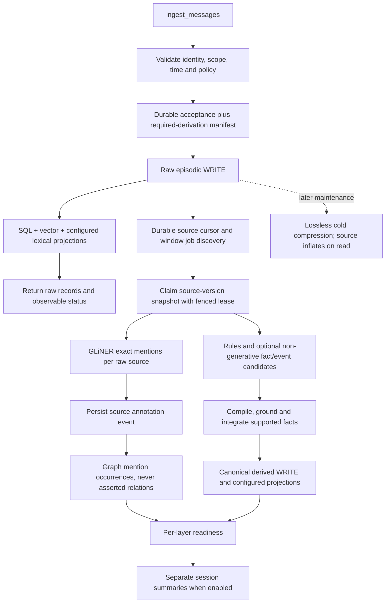

# Raw ingestion plus durable background grounding — implementation plan

Design baseline: 2026-10-18. Reconciled for handoff: 2026-10-20. Status: design for review; BI implementation not started.
Authority: owner accepted all three policies. [Current trace](INGESTION_STORAGE_TRACE.md),
[ADR-077](adr/ADR-077-background-grounded-ingestion.md), D-99.

## Accepted policy

1. Retain recoverable raw messages and derive grounded facts plus annotations in the background.
2. Project source-bound graph mentions. Mention presence never asserts a relationship or increases trust.
3. Use lossless compression for retained raw data. Summaries are separate, lossy derivatives, never raw replacements.

Contextual linking follows [ADR-078](adr/ADR-078-engineering-first-context-enrichment.md)
and the [accepted enrichment decisions](INGESTION_CONTEXT_ENRICHMENT.md).
The selected ingestion direction is non-generative: engineering rules, scoped
retrieval and optional configured encoder/extractor/reranker models. Unsupported
results remain unresolved; no generative call or hidden fallback is permitted in
this target ingestion profile. Future generative enhancement needs a separate
explicit selection; existing optional engine capabilities are not removed by this
documentation change. Before BI-01/04/06/07 implementation, review the
[52 generic gap requirements](NON_LLM_GAP_REGISTER.md) and
[lexical backend assessment](LEXICAL_BACKEND_OPTIONS.md). These are proposals,
not enabled defaults or a second ingestion path. Existing temporal, neighbour
reranking and whole-unit packing capabilities must be reused and verified.

One canonical gateway remains. No intake_v2 path, compatibility registry, alternate
writer, DB copying, historical re-embedding or implicit historical backfill. This
plan does not activate a provider, download a model or change a runtime default.
The selected application profile becomes the target default after its gates pass;
core mechanics tests can continue selecting an explicitly raw-only policy.

## Target flow



Raw write/indexing may still require embedding inference. Only derivation moves
to the background; this is not a zero-model-cost ingestion claim. There is no
single distributed transaction across SQL and external indexes.

## Existing building blocks and gaps

| Existing implementation | Reuse | Work still needed |
|---|---|---|
| ingest/message_ingestion.py, gateway.py, intake_store.py | Validation, accepted intent, identities, retry and application recovery | Pin required derivation policy to acceptance and expose status |
| runtime/outbox.py, runtime/jobs.py | SQL work rows, leases, epochs, progress and immutable jobs | Close raw-to-job discovery gaps, persist open-window membership, prove source-aware fenced commits |
| ingest/windows.py, workers/windows.py | Segmentation, extraction, repair, compiler and integration hooks | Mandatory durability in selected profile, strict conversation boundaries and bounded scheduling |
| derive/gliner_mentions.py, schemas/durable/entity_mentions.py | Exact spans and source-bound unasserted annotations | Persist annotations independently of whether a fact candidate is produced or accepted |
| memories/associative/projector.py, entities.py | Portable graph projection, namespace checks, entity policy | Consume annotation events and preserve individual mention occurrences |
| compose/compression.py, maintenance stage | Lossless raw encoding/inflation; optional context fitting | Verify all relevant representations, pending jobs and erasure behavior |
| schemas/public/receipt.py | Internal receipt/readiness foundation | Caller-visible per-layer status without changing success into a misleading all-layers-ready claim |

Existing window queues alone do not prove the selected guarantee. Current
workers.outbox is optional; raw observation can fail after the raw write. Reuse
its storage rather than building a second queue, and prove the missing boundaries.
Temporal integration of ingestion transport remains separate ACD-04/07 work:
first prove the durable job handler with local dispatch, then let Temporal
Activities invoke that same handler with the existing embedded Resonate/journal
where selected. Do not introduce two competing schedulers or recovery authorities.
The SQL outbox owns required work; runners transport/execute it. If the selected
application uses Temporal, activation requires the ingestion adapter/Activity
registration and retry tests too; maintenance-runner evidence alone is insufficient.
Do not treat Resonate process memory as a durable SQLite checkpoint store.

## Contracts to finalize in phase 1

| Contract | Required fields / rule |
|---|---|
| RequiredDerivation | Ingestion/operation identity, namespace, policy revision, required layers, activation/source range, source record IDs and versions; persisted with acceptance metadata |
| SourceSnapshot | Namespace, record/message IDs, record version, actual source-text hash, sender/role, source time and erasure generation; raw text loaded and inflated from retained source |
| DerivationJob | Stable key from scope + ordered source snapshots + task + producer/model/rule/schema/policy identities; state, lease owner/epoch, attempts, not-before and deadline |
| AnnotationBatch | SourceSnapshot plus tuple of existing EntityMention values; validated empty tuple is an explicit successful zero-result, not a missing job |
| FactCandidate | Atomic content, cited source IDs/versions/spans, subject/predicate/object as applicable, time precision, polarity/modality and assertion owner; model cannot author trust/scope/system IDs |
| EffectIdentity | Stable per-job output identity, source bindings and producer revision; duplicate commits reuse the existing effect instead of inserting another fact/edge |
| Readiness | Independent raw_store, vector, lexical, annotations, facts, graph_mentions and summaries states; disabled layer = not_requested, validated zero output = complete with count 0 |
| Failure | Stage, bounded error class, attempt count, retry eligibility and affected scope/source IDs; no raw content or credentials in logs |

Names above are proposed logical contracts, not classes/APIs already implemented.
Reuse existing durable types and blobs where their semantics match. Introduce
only missing fields/events, with strict schemas and migrations. No alias layer.
Separate source-content version from annotation-generation/projection revision:
annotating an unchanged source must not invalidate its own cited source version.
For source annotation updates, recommend a dedicated system-owned annotation
event: patch annotation state without rewriting content, changing source time,
re-embedding text or pretending an annotation is an asserted semantic fact.
Choose the exact event vocabulary during phase 1; do not overload decay or an
audit-only marker to mutate materialized state.

## Ordered implementation and acceptance

| Step | Owner role | Implementation | Focused completion gate |
|---|---|---|---|
| BI-01 Contracts and configuration | Architecture / ingestion maintainer | Freeze contracts above; validate policy, model bindings, graph capability and retention compatibility; define policy revision and activation boundary | Strict schema/default tests; disabled/missing model combinations fail clearly; one authoritative setting per behavior |
| BI-02 Preserve raw acceptance | Ingestion / storage maintainer | Reuse ingest_messages; persist required-derivation manifest with accepted intent; preserve message/sender/session/conversation/source clocks, retry and redaction semantics | Identical retry, conflicting ID, historical time, parent mismatch, policy exclusion and interrupted application cases |
| BI-03 Durable discovery and queue | Runtime / storage maintainer | Reconcile committed raw events into existing durable outbox; persist open-window membership; make job insertion and cursor advance one SQL transaction | Kill/reopen between raw append, job discovery, cursor commit and acknowledgement; no missing or duplicate work |
| BI-04 Isolated window formation | Ingestion maintainer | Partition by namespace/session/conversation and policy boundary; source-version snapshots; size/time/session-close triggers, deterministic late-arrival policy | Interleaved users/conversations, roots/replies, late history, idle close, partial windows after restart |
| BI-05 Grounded mention stage | Model / grounding maintainer | Shared GLiNER pool and named profile; exact Unicode offsets; bind every valid source's annotations, even when facts are empty or rejected | Repeated/Unicode spans, unknown confidence, malformed SDK data, source mutation, forged sender and empty-result clearing |
| BI-06 Grounded fact stage | Semantic / grounding maintainer | Tested rules plus optional named non-generative extraction models; cited same-scope prefill; typed schema/role validation, exact source grounding, time/polarity/owner checks; unresolved outcomes rather than generation | Unsupported quote/relation rejected; assistant proposal not promoted to user fact; exact raw offsets; temporal precision, corrections, negation and zero-generative-call cases |
| BI-07 Fenced effect commit | Runtime / semantic maintainer | Persist annotation/fact effects through event door; durable effect identities; verify lease epoch, source versions and erasure generation at commit | Two workers, expired lease, crash after some effects, replay and forget-during-inference; stale worker cannot commit |
| BI-08 Mention graph projection | Graph maintainer | Project source/version/span-bound occurrences and unasserted links; keep asserted relations separate | Repeated occurrences survive; namespace isolation, replay equality, source erasure and no false asserted paths on SQLite graph plus provider contract fixtures |
| BI-09 Readiness and controls | API / observability maintainer | Expose per-layer status, counts, failures and bounded wait/flush controls; source-only reads remain possible while derivation is pending | Raw success with derived pending/failed, disabled layers, zero-result completion, timeout and retry status |
| BI-10 Recoverable compression | Storage / retention maintainer | Retain full event replay in target profile; optional lossless payload and cold-text compression; inflate before grounding; erasure/legal hold overrides preserved | Exact UTF-8 round-trip/fingerprint, cold-source extraction, corruption loud failure, legal hold, restart and no forgotten-source resurrection |
| BI-11 Separate summaries | Offline / memory maintainer | Separately selected extractive summary/episode jobs cite raw parents and policy/producer identity; no summary replacement of raw text; generative summarisation is outside the selected ingestion profile and requires a later explicit policy | Summary absence/failure does not invalidate grounded facts; raw support still accessible; scope/trust, zero-generative-call profile and token limits tested |
| BI-12 Integration and promotion | Verification / engineering lead | Small one-namespace smoke then namespace/restart/fault cases; update configuration docs/tracker and select application profile | Focused suites and bounded cached-model correctness gate pass; no full benchmark or broad quality claim |

BI-01 is the first buildable package. BI-02/03 must precede default background
activation. BI-05/06 can be developed in parallel after contracts; BI-08 depends
on persisted annotations and commit safety, not on generating asserted graph
relations. BI-11 follows the fact/annotation path rather than expanding its first
release. These are implementation dependencies, not invented delivery dates.

### Raw-to-job recovery requirement

Do not claim that the current raw append and queue observation are atomic. The
acceptance manifest pins required work before raw application. A durable scanner
finds committed raw records for those manifests, including a write whose observer
failed. It inserts work and advances its source cursor atomically. Resume existing
accepted intents first; then reconcile missing work. Dedup constraints make
repeated discovery harmless. Persist an incomplete window's membership too;
recovery cannot depend on reaching the size/idle trigger before a crash.

Only manifests activated for this policy are in scope. No implicit processing of
all old conversations. Historical sources require an explicitly selected range.
In-memory storage may remain a deterministic test mode but is not crash-durable.
Fail incompatible selected durability modes clearly rather than silently
claiming persistence with ephemeral logs or volatile queues.

### Fencing and side effects

Run model calls outside namespace locks. At commit, validate the fence and source
erasure/version state within the same SQL transaction that records the durable
effect identity/event; a prior nontransactional check is insufficient. External
indexes consume events idempotently and maintain independent readiness. A
partial multi-effect commit resumes missing outputs; success is not acknowledged
until required effects are accounted for. Do not promise exactly-once arbitrary
network side effects or exact recovery inside an unfinished inference call.

### Graph representation

Recommended portable shape:

```
Raw source(version) --has_mention--> MentionOccurrence --refers_to--> ScopedEntitySurface
Derived fact       --supported_by--> Raw source(version)
Asserted relation  --supported_by--> Validated claim evidence
```

Occurrence key includes scope, source/version/hash, label and offsets. Entity
surface identity includes scope and type plus normalized spelling; a matching
name is not proof two real people are identical. No automatic cross-namespace
entity merge. Preserve quote/offset/SDK confidence/source owner on the occurrence;
confidence is not relationship truth or inherited trust. Fact-envelope annotations
reuse the raw-source occurrence; never rebind offsets to paraphrased fact text.

Use occurrence nodes because a single (record,entity,mentions) edge can collapse
repeated spans in portable graph stores. If a backend lacks required typed
properties, fail the selected capability or use the canonical occurrence record;
do not drop provenance silently. Existing rule mentions and new GLiNER mentions
must converge on one projection contract, not duplicate incompatible graph paths.
Readers must distinguish these traversal edges from asserted factual relations.

### Proposed operating limits for review

Reuse existing window knobs: six turns, 1,500 estimated tokens, 120-second idle
cut, explicit close/flush. Treat conversation boundaries as hard; multiple roots
without an explicit conversation ID remain distinct under accepted identity rules.
For a continuing conversation, the caller must provide its conversation ID.

Start with one extraction worker, at most one in-flight inference per shared
GLiNER settings key, bounded pending windows (proposal: 256 per namespace, 1,024
per Engine), and fair namespace scheduling. These are conservative design
starting points, not measured SLOs. Saturation must either reject before acceptance
with a retryable result or retain durable accepted work with explicit pending
status; never accept and silently drop derivation. SQL disk-quota exhaustion is
an admission failure, not an unbounded-memory fallback.

Recovery and per-stage inference budgets must be durable and configurable;
attempts cannot reset an operation's total work budget. Use accepted operating
limits from ENRICHMENT_OPERATING_POLICY.md; additional numeric retry defaults
need selection in BI-01. Generative calls are zero in this ingestion profile.
Model-stage deadlines are required provider-native settings; recovery reuses
persisted successful outputs. Track non-generative calls by task/profile.
Budgets/limits are configurable and validated; do not hard-code magic values.
Budget exhaustion dead-letters required work visibly while raw data remains
recoverable. Later stages need separately declared budgets.

### API/readiness recommendation

Finalise one ingest_messages receipt plus a read-only status query and bounded
wait for requested layers in BI-01. Replace affected shapes directly where
required by Q-S1-B; no compatibility aliases or second ingestion path. Proposed method names:
`ingestion_status(message_ids, namespace=...)` and
`wait_for_derivation(message_ids, namespace=..., timeout_s=...)`.
These are design names, not callable current APIs. A status method is not a second
write path. Avoid inferring completion from a shared mutable last_receipt.

Layer states: pending, running, complete, failed, cancelled or not_requested.
Projection failure is not extraction failure; zero valid facts is a completed
assessment, provided rejection/abstention counts are visible. Erased sources
cancel work and revoke graph/derived visibility; reading stale status cannot
re-authorize them. Summaries are optional readiness unless explicitly required.

## Configuration and rollout rules

Use current configurable providers and named task/model profiles. Select GLiNER
with entities capability when that stage is enabled; embedding/reranking profiles
remain optional and role-specific. The target non-generative profile must not
require a window_extract LLM binding. Final names/settings are BI-01 contract work,
not new callable configuration keys introduced by this document. Reuse
workers.outbox/window segmentation/envelope/grounding/integration flags until
configuration normalization replaces a field directly; no second switch may
contradict the authoritative policy. Selecting the target profile requires the
bindings; never silently fall back to ungrounded extraction or a remote service.

Graph backend remains replaceable (SQLite adjacency/Ladybug/Neo4j); lexical and
vector providers remain independent. Graph mentions require associative support
and validated projection capability. Native backend hybrid is not introduced.
Mention annotations persist even if graph projection is not requested.

Require recoverability of retained policy-approved source, not indefinite
retention of prohibited secrets. Firewall redaction/quarantine, authorized erasure
and legal-hold policy still apply. Compression is not encryption. Keep summaries
separate from raw source and distinguish lossless disk savings from lossy token
savings. No automatic lossy deletion, provider copying or re-embedding.

## Focused verification checklist

- [ ] Policy/schema/default validation, missing-model and incompatible durability cases.
- [ ] IDs, session/conversation/replies, historical times and idempotent retries.
- [ ] Crash before/after acceptance/raw append/discovery/cursor commit/effect append/ack.
- [ ] Persisted partial windows, expired leases, concurrent workers and cancellation.
- [ ] Annotation completion when extraction returns zero facts or rejects all candidates.
- [ ] Exact raw Unicode/repeated spans, polarity/time precision and spoof rejection.
- [ ] Canonical fact events, partial-result replay and no duplicate facts/mentions.
- [ ] Graph typed occurrence/namespace/rebuild/delete contracts; no asserted traversal from mentions.
- [ ] Per-layer readiness, overload, bounded wait, failure and dead-letter visibility.
- [ ] Lossless raw encoding, cold-source derivation, legal hold and forget races.
- [ ] Summary lineage, separate failure/readiness and raw recoverability.
- [ ] Small offline cached-model ingestion smoke; assert zero generative calls,
      no hidden remote fallback, and explicit unresolved/deferred outcomes.
- [ ] Diverse invented fixtures across users, roles, time precision, negation and multi-fact inputs; no benchmark gold text or dataset-specific extraction rules.
- [ ] Kernel-only performance probes if selected; no full-suite/performance/paid evaluation implied.

## Status and next action

All BI-01..BI-12 are **PLANNED**. The three policy decisions are accepted;
implementation, configuration schemas and operating limits remain reviewable.
Next: implement BI-01, then BI-02/03, before changing the application's default.
Provider tracker totals are unchanged; this is a separate ingestion workstream,
not completion of deployment acceptance or PA-107 evaluation migration.

## Exact target contract review — 2026-10-18

See [ENRICHMENT_SCHEMA_CONTRACTS.md](ENRICHMENT_SCHEMA_CONTRACTS.md), including executable review-only JSON Schema and all 52 requirement mappings. This refines BI-01 contracts, BI-04 snapshots, BI-05 mentions, BI-06 facts, BI-07 effects, BI-08 graph projection and BI-09 coverage/readiness. All BI implementation steps remain PLANNED; technical choices Q-S1..5 are selected as B/B/A/A/B. Existing canonical durable/read types must evolve directly, without a second intake/fact path.

## Accepted rewrite constraints — 2026-10-18

Replace affected assertion/evidence/time/bundle shapes together; coordinate producers, compiler, gateway, storage, projectors, graph, readers and focused fixtures without legacy aliases or dual-writing. Resolved times remain aware datetimes; unknown-timezone dates remain text. Typed values and explicit domain events are accepted. Bundles persist full selected excerpt copies; source references, reverse copy indexing, permission checks and cascade erasure are mandatory. Source deletion must include derivative/log/cache/index copies under engine control; external backup/export limitations must remain visible. This updates BI contract planning only; no reset, database migration/copy or re-embedding is implicitly authorised.

## Operating limits refinement — 2026-10-18

Owner selected a 4,096-token target evidence budget (not the unchanged current runtime constant). See ENRICHMENT_OPERATING_POLICY.md for the proposed balanced candidate/worker/ranking limits, 43-predicate initial registry and 20 copied-data erasure checks. Only the 4K token budget is selected at this stage; remaining numeric limits and backup receipt policies require review. Existing BI steps remain PLANNED.

## Operating selections accepted — 2026-10-18

O1..O4 accepted A/A/A/A. Use the balanced numeric limits and 4K assembly target, full gated vocabulary, immediate read denial plus tracked asynchronous copied-data cleanup, development backups off and production content retention at most seven days with restore gate. These constrain BI-01/04/06/07/09 and erasure tests. All BI runtime steps remain PLANNED; limits are not measured SLOs.

## Semantic structure and usage guide — 2026-10-18

[SEMANTIC_REGISTRY_STRUCTURE_AND_USAGE.md](SEMANTIC_REGISTRY_STRUCTURE_AND_USAGE.md) describes the proposed pure semantic registry, one-pack ownership of all 43 starter predicates, property categories, role handling, ingestion/read flow and memory-layer mapping. Existing accepted policies remain unchanged. Proposed key-category/role/type refinements and extra 10/35 vocabulary items are not activated; target schema changes await review.

## CPU model evidence added - 2026-10-18

[Kernel results](CPU_NON_LLM_BENCHMARK_RESULTS.md) now support a proposed non-generative role split: cheap Model2Vec8M label/context candidates, optional GLiNER2.5 Small entity candidates, and TinyBERT/MiniLM passage reranking where needed. These are alternatives/task bindings, not a mandatory serial pipeline. On the tiny passage fixture, Model2Vec8M gets 4/8 while TinyBERT gets 7/8 and MiniLM gets 8/8; a good routing score does not justify truth decisions or evidence trimming.

Keep source-span, role, modality, time, identity and authority checks after model candidates. No generative calls or hidden escalation. Current inference results do not test relation extraction, 4K dependency bundles or the configured 48-candidate pool. Those focused promotion gates remain open; all BI implementation steps remain PLANNED and no default model is changed.

## Measured 48-candidate / 2K-3K comparison - 2026-10-18

[Kernel report](CPU_EVIDENCE_BUDGET_BENCHMARK.md) compares six methods at 64/128/256 message tokens, fixed 48-candidate pools, neural batches of 16, and 2,048/3,072 evidence-only token caps. All required sources are supplied in the pool; links/spans are fixture annotations. This is not engine or LoCoMo validation.

Recommended comparison profiles, not activated defaults:

| Area | Recommendation | Measured reason / remaining gate |
|---|---|---|
| Full-message evidence | Prefer 3K over 2K for this profile | TinyBERT linked completeness 16/16 at 3K versus 15/16 at 2K, longest messages; independently authored cases still needed |
| 2K profile | Explicit incomplete status, or a separately validated compact selector | Annotated-span upper bound fits 16/16; no automatic trimming precision established |
| Reranking | Keep optional; TinyBERT is the lower-cost measured cross-encoder | Longest rank48 median 67ms versus MiniLM 1,150ms; both 16/16 linked completeness at 3K |
| Candidate ranking | Preserve BM25 plus optional static profiles | Supplied-pool BM25 and static methods also reach 16/16 at 3K here; no mandate for neural inference |
| Bundle assembly | Preserve source dependency closure and account for copied support | Flat TinyBERT packing 11/16 at 2K, linked/full 15/16; no partial linked bundles accepted |
| Next engineering experiments | Obligation-aware selection, immutable token-cost cache, read-time source-span dedup | Proposed only; do not change durable copied-excerpt/erasure contracts |

The previously accepted 4K target is not replaced by this benchmark request. Bind actual deployment budgets to the reader tokenizer and prompt reserve; benchmark BERT-token counts are not universal. BI implementation remains PLANNED and no model/provider/config defaults changed.
