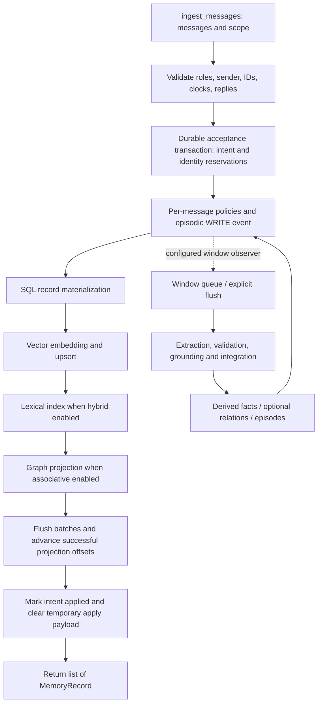

# Ingestion, storage, projections and compression — current code trace

Reviewed 2026-10-18 in `memspine-restructure`. Three agents traced current code;
root checked the default templates, projector registration, schemas and compression
implementation. This is source analysis, not a fresh execution/benchmark of all
provider combinations. The recent PA-121 gate proves one configured local
message/window case, with real GLiNER and a deterministic generative fixture.

## Target decision and current behavior

The owner selected **raw messages plus background grounded facts and mention
annotations** for the next ingestion design. This is a target decision: this
review does not enable extraction or alter Engine configuration. The owner also accepted source-bound graph mention edges and recoverable raw
data with lossless compression and separate summaries. The accepted target is
planned in [BACKGROUND_INGESTION_PLAN.md](BACKGROUND_INGESTION_PLAN.md); it is
not current default-on runtime behavior.

Current default `Engine()` selects `assistant`, which extends `base`.
`base` names the `simple` profile; there is no separate `simple.yaml` template.
The bare `core` template differs in read policy. Both enable working, episodic
and semantic memory; enabling a logical layer does not mean every message is
written to that layer. Associative graph memory is not enabled by these templates.
Environment/application/runtime overrides can change every effective selection;
this review has not inspected a running application's resolved configuration.

| Current default | Actual behavior | Source |
|---|---|---|
| Authoritative persistent event history | `event_log.mode=full`; payload compression off | [base](../src/memspine/config/templates/base.yaml#L11), [schema](../src/memspine/config/schema/storage.py#L15) |
| Structured record materialization | SQLite; PostgreSQL selectable through storage provider | [storage configuration](../src/memspine/config/schema/storage.py#L49) |
| Vector projection | LanceDB, configured embedding service; default provider FastEmbed | [vector configuration](../src/memspine/config/schema/storage.py#L80), [embedding](../src/memspine/config/schema/llm.py#L19) |
| Lexical projection | `read.hybrid=true`, Tantivy | [read defaults](../src/memspine/config/schema/read.py#L72) |
| Graph projection | Absent unless associative memory is enabled; selecting a graph provider alone is insufficient | [registration](../src/memspine/api/engine.py#L776) |
| Window semantic extraction | Off by default | [write defaults](../src/memspine/config/schema/write.py#L44) |
| Semantic entity extractor | Off unless the semantic policy selects LLM or GLiNER and required bindings exist | [extractor builder](../src/memspine/runtime/container.py#L1277) |
| Enhanced automatic sleep/derivation scheduler | Opt-in; manual/other configured worker paths are distinct | [offline configuration](../src/memspine/config/schema/offline.py#L89) |
| Lossy context compression | Off by default | [compression policy](../src/memspine/compose/compression.py#L111) |

**Default ingestion already performs embedding-model inference.** No generative
LLM extraction is implied by that. Lexical indexing and ordinary graph projection
are rule/index operations; configured extraction, classification, entity
embeddings or compression may add model calls.

## One canonical message path

The diagram shows normal ordering, not one distributed transaction. Event append,
SQL materialization and external projections commit at different boundaries.
Accepted-but-unapplied intents and projector offsets support recovery; earlier
successful projections can exist when a later one fails. Window processing can
continue beyond raw ingestion completion. No exactly-once guarantee is implied
for arbitrary external side effects.

| Step | Processing | What persists / observable boundary | Code |
|---|---|---|---|
| 1. Public input | Namespace plus batch, session/conversation options, role, sender and historical time | Public return is `list[MemoryRecord]`, not a receipt | [Engine API](../src/memspine/api/engine.py#L1948) |
| 2. Normalize identities | Preserve supplied `message_id`; generate missing IDs; one missing session per call; each independent root gets a conversation, replies inherit it | Message/conversation identity reservations; conversations belong to sessions | [normalizer](../src/memspine/ingest/message_identity.py#L102) |
| 3. Validate relationships | Parents must be stored or earlier in batch; reject unresolved/forward/self links and conflicting scope | Namespace-scoped message IDs and conversation/session ownership | [reply validation](../src/memspine/ingest/message_identity.py#L135) |
| 4. Preserve attribution/time | Role and sender are independent; nested sender ID/kind/name retained; historical creation time distinguished from engine ingestion time | `source.message`, tags, axes and source clocks | [sender/time](../src/memspine/ingest/message_identity.py#L194), [application](../src/memspine/ingest/message_apply.py#L215) |
| 5. Durable acceptance | Validate source/policy/quota and reserve identities before applying raw records | Accepted intent, readiness/receipt, source state, restart apply payload in SQL | [gateway](../src/memspine/ingest/gateway.py#L303), [transaction](../src/memspine/ingest/intake_store.py#L263) |
| 6. Batch preparation | Prewarm embeddings and optional alternate index text; still apply records individually | Cache may avoid repeated inference; not a second write path or universal bulk upsert | [batch preparation](../src/memspine/ingest/write.py#L442) |
| 7. Write policies | Governance, parent trust caps, firewall, optional redaction/quarantine, role/exclusion policy and annotations | Accepted input can be excluded or screened before a raw record lands | [policies](../src/memspine/ingest/write.py#L371), [role processing](../src/memspine/ingest/message_apply.py#L124) |
| 8. Raw message write | Every accepted applicable message becomes an episodic record with original source content subject to policy | WRITE event plus structured record fields; not automatically a semantic fact | [raw application](../src/memspine/ingest/message_apply.py#L229) |
| 9. Project | SQL record, vector, optional lexical and optional graph projectors apply in order | Index entries point to record identity; successful flush advances offsets | [registration](../src/memspine/api/engine.py#L766), [append/project](../src/memspine/api/engine.py#L5400) |
| 10. Observe window | Successfully added episodic records can enter configured extraction windows | Queue/job state is separate from raw write; observer failure does not undo raw storage | [observer](../src/memspine/ingest/write.py#L397) |
| 11. Finish acceptance | Map real record IDs; mark intent applied/readiness; clear temporary source-text apply payload | Public caller receives resolved records; internal receipt tracks readiness | [gateway completion](../src/memspine/ingest/gateway.py#L421), [intake store](../src/memspine/ingest/intake_store.py#L420) |

Identical supplied-ID retries reuse accepted identity; changed data is rejected.
Missing IDs on a repeated call create new identities, so callers must reuse the
resolved ID for idempotency. `updated_at` does not authorize an overwrite/revision.
See [retry policy](../src/memspine/ingest/message_retry.py#L33).

## What each store/index contains

These are cooperating components, not mutually exclusive ingestion modes.

| Component | Stored representation | Processing | Model use / constraints |
|---|---|---|---|
| SQL event log | Event identity/kind/scope/time/actor/schema, payload and fingerprint | Append and optional lossless payload encoding | No generative call. Full is default; rolling changes retention; ephemeral does not retain a readable replay log |
| SQL records | Text, record ID/namespace/type, status/validity/history, source JSON, trust/quarantine, scores/tags/axes, fingerprint/lineage, source precision and compressed-content field | Materialize record state from events | The structured current view, not an independent authority competing with the event log |
| LanceDB vector projection | `record_id`, `namespace`, vector; table identity depends on embedding space | Embed original content, or configured `index_text`; upsert and namespace-prefilter | Default float32 vector schema. Embeddings do not preserve recoverable source text or prove facts |
| Tantivy lexical projection | Stored raw record ID and namespace plus indexed, non-stored content field | Tokenization/analyzer; strips projection control characters, optional date augmentation; commit can batch | No LLM. Original text comes from SQL, not by recovering it from tokens |
| Hybrid retrieval | No separate canonical content store | Query vector and lexical lanes, fuse rankings in Engine | A read strategy, not a third write representation or extraction model |
| Graph projection | Memory nodes; configured entity nodes/mention edges; LINK relationship edges; selected derived-from links | Namespace-aware upserts using event data and optional entity policy | Graph projector does not itself infer truth; optional entity embeddings add inference |
| Derived records | Facts, episodes, summaries/profile/reflections when their paths are enabled | Separate records/objects with source parents, support evidence, trust limits and producer provenance | These can omit information and must not silently replace raw source |

Sources: [SQL record columns](../src/memspine/services/storage/sql_base.py#L264),
[LanceDB schema](../src/memspine/services/vector/lancedb_store.py#L128),
[vector projector](../src/memspine/services/vector/projector.py#L25),
[Tantivy schema](../src/memspine/services/lexical/tantivy.py#L176),
[lexical projector](../src/memspine/services/lexical/projector.py#L30),
[graph projector](../src/memspine/memories/associative/projector.py#L70),
[hybrid fusion](../src/memspine/read/pipeline/router.py#L661).

Current adapters include SQLite/PostgreSQL record storage; LanceDB/pgvector/
Weaviate vectors; Tantivy/OpenSearch/Weaviate lexical; Ladybug/SQLite adjacency/
Neo4j graph. FTS5 was removed from the current lexical provider set:
[SQL schema note](../src/memspine/services/storage/sqlite/schema.py#L36).
Weaviate currently uses separate vector and lexical adapters/collections,
self-provided embeddings, `near_vector` and BM25. Selecting Weaviate does not
activate a backend-native `hybrid()` query. Direct Neo4j graph and an optional
Neo4j outbox mirror are different configurations.

The current Engine registers a vector projector unconditionally. Turning
`read.hybrid` off removes lexical construction; it does not establish a SQL-only
write mode. A genuine no-embedding SQL-only configuration needs an explicit
capability/design review rather than bypassing the canonical write path.

## Logical memory types are a separate axis

| Memory type | Relationship to message ingestion |
|---|---|
| Episodic | Default raw-message target |
| Semantic | Separately written assertions/facts; optional window mining derives these from raw messages |
| Working | Enabled in assistant/core, but not an automatic second copy of every `ingest_messages` turn |
| Resource | `ingest_data` extracts/chunks documents into resource records through the canonical gateway |
| Associative | Enables graph-backed associations/projection, separately from SQL/vector/lexical storage |
| Reflective | Configured reflection derives higher-level records with parents/trust limits |
| Procedural | Explicit/configured procedural knowledge/prompt/skill flows; not inferred from every message by default |
| Prospective | Explicit watches and worker protocols; accepting a raw message does not establish future exactly-once action execution |
| Shared | Explicit shared records/grants and scope policies; not automatic sharing of raw messages |

Physical provider choice does not substitute for memory type. A semantic fact
can be in SQL and indexed lexically/vectorially while also participating in graph
projection. Resource chunks likewise use SQL/index projectors; their content
segmentation differs from conversational reply-tree grouping.

## Extraction and graph processing

| Configured path | Processing and output | Boundary |
|---|---|---|
| Raw episodic ingestion | Store messages and search projections | No automatic semantic GLiNER/window LLM just because semantic memory is enabled |
| Window `facts` | Segment, extract many candidate facts, validate/repair, compile, configured stages, deposit semantic children | Requires enabled window path, usable role binding and episodic/semantic layers |
| Window `facts_graph` | Facts plus separately validated edge section | Co-occurrence is not sufficient evidence for an asserted edge |
| Window `all` | Facts, edges and an episode section | Episode narrative is distinct from raw text and facts |
| `prompt` | Selected sections in one structured response | Repair/split/coverage/check stages can add calls; do not promise exactly one maximum call |
| GLiNER prepass | Exact per-source spans, confidence and unasserted annotations on cited envelope sources | No trust boost; no replacement of claim support evidence |
| Direct semantic GLiNER | Annotations in `RecordFingerprint.entity_mentions` before dedup | Does not create entity/attribute fact keys; dropped source spans remain in MERGE audit snapshots |
| Direct semantic LLM | Current adapter uses first extracted fact's entity/attribute to key the input record | Not a many-independent-fact splitter for a long direct semantic input |
| Graph memory node | WRITE projects a node when associative graph is enabled | Node presence does not mean the text was converted to relations |
| Graph entities/mentions | Current entity policy consumes `record.entity`, `dst:` tags and optional rule-based turn mentions | **It does not consume the new GLiNER fingerprint annotations yet** |
| Asserted graph relations | LINK / compiled relation path | Must preserve support, provenance, namespace and invalidation semantics |

Relevant code: [window builder](../src/memspine/ingest/windows.py#L116),
[stage ordering](../src/memspine/ingest/windows.py#L312),
[window compiler](../src/memspine/workers/windows.py#L2025),
[semantic annotation binding](../src/memspine/memories/semantic/store.py#L259),
[graph entity selection](../src/memspine/memories/associative/entities.py#L137).
The stage order is temporal 100, grounding 200, coverage 250, resolver 300,
integration 400, prepass 500; each is separately configured. Rich grounding and
integration defaults are not assumed on. Raw source coordinates are used for
persisted support spans, not generated prompt prefixes.

## Compression: different mechanisms

| Mechanism | When / default | What changes | Meaning preserved? |
|---|---|---|---|
| Event payload zstd | At append when `event_log.compress=true`; default false | Canonical JSON payload bytes, with compressed flag; decompressed when read | Lossless; no LLM and no reader-token saving by itself |
| Cold-record zstd | Maintenance on eligible tiers, default target `dormant`; requires that maintenance path to run | Moves content into `content_zstd`, clears plain materialized content; read paths inflate it | Lossless; original content fingerprint preserved |
| Summaries / episodes / profile | Enabled session/offline derivation paths | Additional compact derived records with lineage | Lossy semantic abstraction; not byte compression of raw source |
| Multi-resolution decay | Opt-in; job cap defaults zero | Compact derived views/lower resolution planning | Can be lossy; cap zero reports/plans without generating jobs |
| Assembly fitting | Opt-in `assembly=false` default | Context copies: drop low-score records, optional LLMLingua, provider-compaction seam | Lossy reader context; does not rewrite stored raw records |
| Vector quantization / reduced dimensions | Provider/embedding policy dependent | Numerical search representation | Approximate retrieval trade-off, not a source-text summary or recoverable raw store |

Cold compression skips deleted/quarantined/legal-hold records. Protecting context
blocks can leave a result over budget; unavailable optional LLMLingua skips that
stage with a warning; provider compaction is currently a no-op. A compressed
materialized record does not imply its historical WRITE payload or lexical
projection was erased/re-encoded. Separate retention/deletion policies govern
those copies; disk or token reduction is not universal across all stores.

Sources: [payload encoding](../src/memspine/services/storage/sql_base.py#L139),
[cold compression/inflation](../src/memspine/compose/compression.py#L168),
[maintenance event](../src/memspine/derive/pipeline/stages/maintenance.py#L134),
[assembly options](../src/memspine/compose/compression.py#L111),
[session consolidation](../src/memspine/derive/pipeline/stages/consolidate.py#L192),
[offline flags](../src/memspine/config/schema/offline.py#L29).

## Example: one message

Input: a user with sender ID `user-123` says `I moved from Porto to Lisbon last
month.`, with a supplied historical `created_at` and `message_id`.

1. Validate/resolve the IDs, session, conversation, reply and sender. Preserve
   the source time separately from engine ingestion time.
2. Persist acceptance and an episodic source record/event. The record retains
   the source sentence subject to configured redaction/firewall policy.
3. Embed its content (or configured index view) and store a vector keyed to its
   record. Lexically index searchable tokens and namespace/record references.
4. With graph enabled, a memory node can be projected. Neither `Porto`/`Lisbon`
   being mentioned nor a generated graph node independently asserts a move.
5. With grounded window extraction configured, derive supported move facts and
   optional relations/date interpretation with raw parents and cited evidence.
   This is the selected target, not current default-on behavior.
6. Later compression may losslessly encode the cold text or create a separate
   summary; read-context compression can shorten only the selected prompt view.

## Findings and recommended design work

| Priority | Finding | Recommended direction |
|---|---|---|
| P1 | Target background fact/annotation ingestion is not current default | Introduce an explicit ingestion policy selecting derived layers, required named models, readiness and bounded queue behavior; keep one canonical gateway |
| P1 | GLiNER annotation-to-graph mapping is missing | If selected, project source/version-bound mention edges with `asserted=False`; assert relationships only through grounded relation integration |
| P1 | Raw acceptance/search readiness differs from derivation readiness | Expose clear caller-visible states and failures; public ingest currently returns records rather than the internal receipt |
| P1 | No single transaction covers SQL and external indexes | Preserve replay/idempotency; test failure between each projection and flush, with observable per-projection readiness |
| P2 | Supplied reply to a stored parent requires explicit session | Decide whether to inherit the stored parent's session when omitted; do not silently change current validation |
| P2 | Direct semantic extractor keys only the first returned fact | Prefer supported many-item window route or explicitly design a many-item semantic API; preserve parent spans |
| P2 | Batch embedding prewarm does not mean bulk backend upsert | Measure kernels first; then consider capability-based bulk projection with flush/watermark correctness |
| P2 | SQL-only mode is not established by toggling hybrid | Decide whether no-embedding ingestion is a supported capability; never create a bypassing write path |
| P2 | Sender metadata retention is not proof of an efficient sender index | Trace sender filters/query plans before promising per-sender search performance |
| P2 | Compression occurs at several independent representations | Record policy per representation and retention, protect raw source recoverability, measure storage and token effects separately |
| P2 | Scope/alias/sleep limitations remain configuration-dependent | Do not claim complete namespace isolation from mention-cache fixes; learned pre-pass aliases are namespace-scoped since RM-18 (no source manifest yet, DS-11), enhanced sleep scoping is opt-in |
| Documentation | Older prose suggests FTS5/current window summary or simple-no-lexical behavior | Follow current provider registration and flags: FTS5 removed; no persisted per-window summary found; `read.hybrid` controls lexical projection |

A configured current Engine instance's effective configuration is still needed
to replace these default/optional descriptions with an exact deployment trace.
No provider, graph or compression behavior was modified by this analysis.
