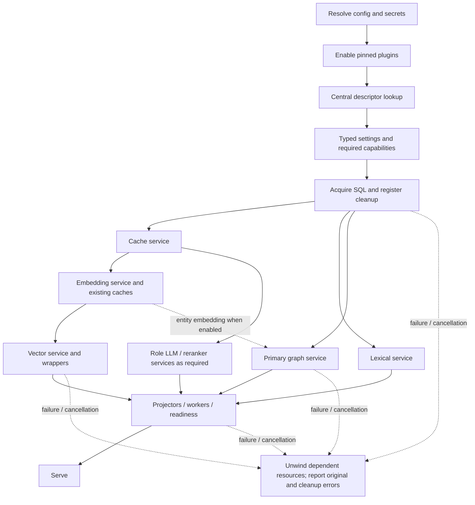
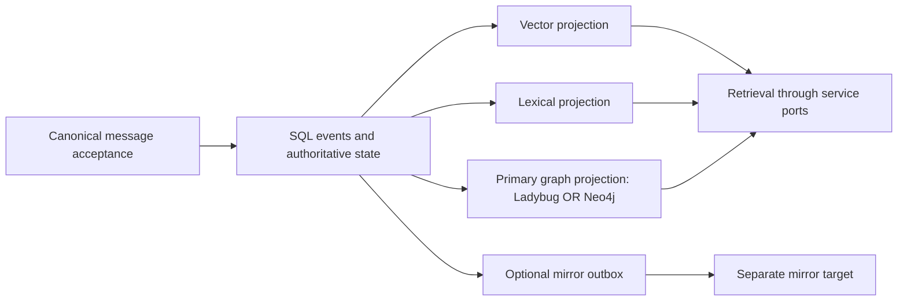

# Provider architecture: consolidated review specification

> Model-slot update (ADR-082, supersedes the ADR-075 profiles/bindings): every model
> is selected in one `model` block, one inline slot per category:
> `model.embedding`, `model.llm.<role>` (typed `timeout_s`, `structured`, `thinking`,
> `escalation` with inline targets), `model.rerank` (`chain` plus behaviour keys),
> `model.extraction.<consumer>`, `model.decider.{route,read}`, `model.vision` and
> `model.placement`. Each slot is `{provider, <typed common keys>, settings}`. There
> are no named profiles and no aliases; identical effective settings still share
> weights (ADR-079). See [ADR-082](adr/ADR-082-model-slots.md) and the
> [migration plan](MODEL_SLOTS_MIGRATION_PLAN.md). Older key names below are the
> historical review record.

> Durable orchestration update (ADR-071): the active DBOS runner, dependency,
> selector and old system-database field are removed. Use `workers.runner: temporal`
> with typed `workers.temporal` and `workers.resonate` settings. The maintenance
> runner combines external Temporal with embedded Resonate and an application-owned
> SQLite step journal. [Operations](TEMPORAL_RESONATE_OPERATIONS.md) and
> [verified scope](provider_verification/temporal-runtime-final-state.json).


Track implementation evidence and next work packages in the
[125-item status tracker](PROVIDER_TODO.md). Proposed follow-ups are distinct
from confirmed defects and deployment prerequisites.

**Date:** 2026-10-17. **Status:** agreed provider implementation and follow-up code are recorded locally. Q1–Q35 and subsequent scope decisions are reflected in code and documentation. See [final verification](provider_verification/README.md), including the investigated startup regressions and actual deployment prerequisites. No push or production migration has been performed. This specification replaces the accumulated draft/question transcript.

**Scope:** centralized registry and catalog; provider construction/lifecycle for SQL, vector, graph, lexical, cache, LLM, embedding and reranking; breaking config migration; direct Neo4j primary graph support; service-wide controlled changes with category-specific strategies. OpenSearch lexical, Weaviate lexical/vector and pgvector vector were added by the follow-up authorization in ADR-069. Guard-backed cleanup recovery and the typed HTTP service-change execution adapter are implemented; actual production controller/access integration remains deployment-specific.

**Current implementation reference:** [provider operations](PROVIDER_OPERATIONS.md)
and typed source contracts take precedence over the illustrative proposal
fragments retained below. Section 8 records implementation evidence and remaining
gates; section 14.4 records the final schema choices. Historical alternatives are
not additional supported configuration formats.

**Latest owner scope clarification (2026-10-17):** database copying and re-embedding
are excluded from this implementation. References below describe future extension
contracts, not pending delivery items. This does not authorize automatic data
movement when a provider or model setting changes.

**Approval boundary:** Q1-Q35 architecture choices are recorded below; Q2 is the requested B+C hybrid. Concrete field names and contracts below are the engineering mapping of those accepted decisions; implemented behaviour is checked against code and phase tests. Additional adapters and future capabilities remain explicitly labelled as proposals. No old-config or old-factory compatibility aliases. Removed provider keys are rejected by strict schema validation; no provider RETIRED map, translation, compatibility aliases or replacement-hint layer is retained.

## 1. Accepted decisions

| Q | Accepted direction | Consequence |
|---|---|---|
| 1 | Primary graph separate from mirror | `graph.provider` and nested `graph.mirror` have independent roles |
| 2 | Central registries plus catalog | One authoritative registry per kind; catalog generated from descriptors |
| 3 | Controlled switching | Config/restart/rebuild/readiness; no live hot-switch |
| 4 | Typed results and central lifecycle | Register owned cleanup immediately; explicit borrowed resources |
| 5 | Explicit failure / bounded auto | No silent explicit-provider substitution or security downgrade |
| 6 | Profile supplies omitted defaults | Explicit compatible choice retained; conflicts rejected |
| 7 | Retain lexical grouping | Keep `read.lexical_provider` and existing `read.lexical_*` |
| 8 | `lancedb` name | Rename selector, preserve physical vector identities; Weaviate later |
| 9 | Typed category contexts | Explicit dependencies, never pass Engine |
| 10 | Baseline plus advanced capabilities | Mandatory correctness; enabled unsupported features fail |
| 11 | Preserve SQL bring-up modes | Existing SQLite and PostgreSQL embedded/server initialization modes |
| 12 | Rollback retention | Refined by Q24 environment policy |
| 13 | Validated settings | Builtin typed schemas and plugin-declared validation; reject unknown fields |
| 14 | Distinct health/readiness | Handle existence is neither active health nor projection readiness |
| 15 | Real backend evidence | Report skips; fake/boot tests do not establish support |
| 16 | Distinct manifests | Service capabilities/dependencies separate from plugin pins/hash/lifetime |
| 17 | Engine-local resources | Stateless global factories, no shared connected provider instances |
| 18 | Version pending jobs | Resume compatible work; explicitly migrate/drain/reject incompatible work |
| 19 | Safe diagnostics | Resolved providers/capabilities/health/lag; no secrets or raw memory text |
| 20 | Performance comparison | Comparable startup/import/memory/latency/model-call baselines |
| 21 | Nested mirror settings | Independent enablement/provider/settings |
| 22 | Graph readiness gates serving | Required graph unready means Engine unready; health/progress accessible |
| 23 | Frozen retained graph | No ordinary dual writes; continue erasures; catch up before rollback |
| 24 | Environment cleanup | Dev: remove old owned projection after verified cutover. Production: configurable 7-day default; category exclusions in Q26 |
| 25 | Shared lifecycle, category-specific strategies | Projection rebuild, embedding-space migration, model revision, authoritative DB migration and job handover are distinct operations |
| 26 | Cleanup only owned rebuildable projections | Dev immediate/prod retention applies to graph/vector/lexical generations, not SQL/source assets/model files/shared services |
| 27 | Explicit embedding migration; forward-only producer revisions | Re-embedding is an explicit job; LLM/derived-producer changes do not automatically rewrite historical memory |
| 28 | **B: nest provider options** | Builtin constructor/connection/model options under typed settings; category policy/selectors separate |
| 29 | **B: explicit timeouts** | No hidden timeout defaults; active operations require explicit finite values or explicit allowed null overall deadline |
| 30 | A: common ownership | Shared deployment ID explicit in production/shared targets; persisted local-dev identity |
| 31 | A: environment | Development default, explicit production, scoped planned operations |
| 32 | A: strict immutable configuration | Strict finite scalar validation and recursively immutable resolved snapshots |
| 33 | A: explicit execution interface | Plan then execute/resume/verify/cleanup; no config-triggered unbounded migration |
| 34 | A: explicit model-probe budgets | No automatic paid quality probes or historical reprocessing |
| 35 | A: measured performance investigation | Repeated >10% matched-baseline regression investigated, not one-sample hard failure |

Environment is explicit, never inferred from hostname or provider. Authoritative messages/event truth are preserved. Any retained projection remains subject to erasure.

## 2. Current-code facts

> **Historical (pre-implementation).** These facts describe the code before the provider
> architecture landed (commit `e6596f44`). They no longer describe current code: descriptors
> now live in `memspine.providers.registry`, Neo4j and pgvector are implemented providers, and
> retirement maps are gone. See section 8 and [verification](provider_verification/README.md).

- `store/registry.py` already has vector/graph/lexical registries; builtins are `None` sentinels, external factories are synchronous `(config, base_path, in_memory) -> store`.
- `plugins.Registry` validates against `plugins.KINDS`, with global mappings. Central migration must leave exactly one registry object per kind.
- Service and plugin manifests are different types sharing the current class name `CapabilityManifest`.
- Vector construction includes embedding/profile/quantization, per-namespace tables and versioned spaces; preserve those composition layers.
- Generic `graph.provider=neo4j` currently constructs without an executor and is unsupported there. The separate mirror builder supplies an executor/outbox. Direct Neo4j completion/parity is R-33 work.
- Adjacency borrows SQLite. Native table/query handles belong between concrete clients and adapters. SQL sync workers need correct SQLite/SQLCipher or PostgreSQL connection semantics.
- Secret interpolation is recursive before validation. Keep this ordering and sanitize all diagnostics.
- Storage-profile prose describes pgvector/PostgreSQL adjacency that generic builders do not implement. Effective capabilities must reflect code, not these comments.

## 3. Proposed exact configuration delta

Q28-B supersedes the earlier flat builtin-field proposal: move provider construction/connection/model options into typed settings. Preserve their semantics and security requirements, not the old config paths. Category selection, profiles and pipeline policies remain outside provider settings. Scope exceptions and exact path mapping are in section 14.4. Builtin/root models retain `extra="forbid"`. Provider names are validated registry identifiers, not a builtin-only enum, so pinned plugins can extend them.

| Field | Type | Declared default | Resolution / validation |
|---|---|---|---|
| `storage.provider` | str; internally nullable before default resolution | omitted | Omitted -> sqlite embedded / postgres server. Explicit null/conflict rejected. Resolved value always string |
| `storage.profile` | embedded/server | embedded | Preserve existing migration modes |
| `storage.settings` | JSON object -> selected settings model | `{}` | Selected SQL settings own path/url/data_dir/encryption and active transport timeouts as applicable; plugin model declares its fields |
| `vector.provider` | str | lancedb | Replaces backend=lance; no unimplemented Weaviate acceptance |
| `vector.settings` | JSON object -> selected settings model | `{}` | Move constructor options into vector.settings; keep cross-provider space/policy metadata explicit |
| `cache.provider` | str | memory | Replaces backend; connection/TTL/capacity options move into cache.settings |
| `cache.settings` | JSON object -> selected settings model | `{}` | Selected builtin/plugin typed settings validated |
| `graph.provider` | str | auto | Primary graph; auto/adjacency/Ladybug/direct Neo4j or registered plugin; still activated only by enabled graph features |
| `graph.settings` | JSON object -> selected settings model | `{}` | Adjacency/Ladybug empty initially; Neo4j model below. Nonempty settings with auto rejected as ambiguous |
| `graph.mirror.enabled` | bool | false | Requires enabled graph feature and durable outbox; does not itself enable memory type |
| `graph.mirror.provider` | str | neo4j | Must declare supported mirror operations |
| `graph.mirror.settings` | JSON object -> selected settings model | `{}` | Disabled mirror never connects/imports driver |
| `runtime.service_switches.projections.mode` | controlled literal | controlled | Shared graph/vector/lexical policy; no live/shadow/dual-write mode |
| `runtime.service_switches.projections.retention_s` | nonnegative int or null | null | Shared graph/vector/lexical policy; resolve null to 0 dev / 604800 production; excludes authoritative SQL, downloaded models and shared remote services |
| `runtime.environment` | development/production | development | Explicit production; never infer from host/provider |
| `runtime.deployment_id` | str or null | null | Explicit for production/shared targets; stable persisted local development ID; no duplicate Neo4j ID |
| `runtime.provider_services.health_timeout_s` | positive finite float | **required** | Per active health probe, not rebuild timeout |
| `runtime.provider_services.close_timeout_s` | positive finite float | **required** | Per resource; timeout reported as incomplete cleanup |
| `runtime.provider_services.startup_timeout_s` | positive finite float or null | **required** | Explicit null means no overall deadline; omission rejected |
| `read.lexical_provider` | existing str | tantivy | Keep read grouping/selector; constructor options move into read.lexical_settings under Q28-B |
| `read.lexical_settings` | JSON object -> selected settings model | `{}` | Builtin Tantivy analyzer/date_tokens and plugin settings; read scoring controls remain read policy |
| `plugins` | existing pinned manifest list | unchanged | Exact version/hash/slot/lifetime; separate provider-contract version checked |

Retain raw field-presence/provenance until profile resolution: omitted sqlite default and explicit sqlite choice must not be confused. JSON settings are only transport: descriptor `settings_model` converts them into immutable typed values before build. Unknown fields/cross-field conflicts fail before connection.

### 3.1 New nested models (documentation-only fragments)

```python
from typing import Literal
from pydantic import BaseModel, ConfigDict, Field, JsonValue

class StrictSettings(BaseModel):
    model_config = ConfigDict(extra="forbid", frozen=True, strict=True, allow_inf_nan=False)

class EmptySettings(StrictSettings):
    pass

class Neo4jSettings(StrictSettings):
    url_env: str = Field(default="MEMSPINE_NEO4J_URL", min_length=1)
    user_env: str = Field(default="MEMSPINE_NEO4J_USER", min_length=1)
    password_env: str = Field(default="MEMSPINE_NEO4J_PASSWORD", min_length=1)
    database: str = Field(default="neo4j", min_length=1)
    connect_timeout_s: float = Field(gt=0)
    request_timeout_s: float = Field(gt=0)

class GraphMirrorConfig(StrictSettings):
    enabled: bool = False
    provider: str = Field(default="neo4j", min_length=1)
    settings: dict[str, JsonValue] = Field(default_factory=dict)

class ProjectionSwitchConfig(StrictSettings):
    mode: Literal["controlled"] = "controlled"
    retention_s: int | None = Field(default=None, ge=0)

class ProviderServicesConfig(StrictSettings):
    health_timeout_s: float = Field(gt=0)
    close_timeout_s: float = Field(gt=0)
    startup_timeout_s: float | None = Field(gt=0)
```

Validate environment-variable identifiers; resolve values into internal credentials only for enabled targets. No secrets in errors/catalog. Common `runtime.deployment_id` is stable across restarts and injected into provider context to scope operations with generation identity, including counts/clear/delete. Neo4j settings must not duplicate it. Never guess ownership. Disabled mirror settings may be unfilled and are never built; enabled target must validate its required settings.

### 3.2 Configuration examples (not runnable today)

```yaml
runtime:
  environment: development
  provider_services:
    health_timeout_s: 5.0  # explicit example, not a default
    close_timeout_s: 10.0
    startup_timeout_s: null
  service_switches:
    projections:
      mode: controlled
      retention_s: 0
storage:
  profile: embedded
  provider: sqlite
  settings:
    path: ./memspine.db
vector:
  provider: lancedb
cache:
  provider: memory
read:
  lexical_provider: tantivy
graph:
  provider: ladybug
  settings: {}
  mirror:
    enabled: false
```

```yaml
# Enable the existing associative graph feature separately.
runtime:
  environment: production
  deployment_id: production-main
  provider_services:
    health_timeout_s: 5.0  # explicit example, not a default
    close_timeout_s: 10.0
    startup_timeout_s: null
  service_switches:
    projections:
      mode: controlled
      # Omitted retention resolves to 7 days for old derived projections.
storage:
  profile: server
  provider: postgres
  settings:
    url: ${secret:MEMSPINE_POSTGRES_URL}
    data_dir: ./derived
vector:
  provider: lancedb
graph:
  provider: neo4j
  settings:
    database: neo4j
    connect_timeout_s: 5.0  # explicit illustrative values, not defaults
    request_timeout_s: 60.0
    url_env: MEMSPINE_NEO4J_URL
    user_env: MEMSPINE_NEO4J_USER
    password_env: MEMSPINE_NEO4J_PASSWORD
  mirror:
    enabled: false
```

Ladybug+mirror: primary Ladybug, `graph.mirror.enabled: true`, mirror `provider: neo4j` with its own validated settings, enabled graph feature and `workers.outbox: true`. Reject primary+mirror pointing to the same canonical target/deployment/generation; do not duplicate writes. Disabled features do not acquire resources merely because root defaults exist.

### 3.3 Breaking migration

| Old input | New input / behaviour |
|---|---|
| `storage.backend`; flat storage fields | `storage.provider`; selected constructor fields under storage.settings (section 14.4) |
| `vector.backend: lance` | `vector.provider: lancedb`; physical identities unchanged |
| `cache.backend`; flat cache options | `cache.provider`; constructor options under cache.settings |
| `graph.backend` | Removed; primary/mirror configuration chosen explicitly |
| `graph.neo4j_outbox` | `graph.mirror.enabled` with outbox prerequisites |
| `graph.neo4j_url_env/user_env/password_env/database` | Move into primary or mirror settings according to intended role; ambiguous mapping must not be guessed |
| `read.lexical_analyzer`, `read.lexical_dates` | `read.lexical_settings.analyzer`, `.date_tokens`; selector/group remains under read; scoring policy stays separate |
| Old external factory signature | Actionable unsupported-contract error; update plugin, no compatibility invocation |

Mixed old/new keys reject through strict schema validation with safe config locations; no provider retirement map is used. Migrate CLI/env key mapping, config provenance, active arms/presets/examples/generator inputs. Historical run configs/results/hashes remain immutable.


## 4. Exact provider contracts and module ownership

### 4.1 Central module layout

```text
src/memspine/providers/
  contracts.py       descriptors, typed results and category contexts
  registry.py        authoritative registries; duplicate-kind guard
  catalog.py         derived sanitized view; no driver imports/connections
  selection.py       explicit/auto policy and capability preflight
  settings.py        descriptor-selected schema validation
  lifecycle.py       owned/borrowed resources, dependency-safe cleanup
  switching.py       durable generations, rebuild/readiness/cutover/cleanup
  builtin/
    storage.py vector.py graph.py lexical.py cache.py models.py
clients/             native connections; common lifecycle + necessary SQL capability
services/            existing service ports/adapters, direct Neo4j completion
runtime/container.py generic selection/build order/DI, no vendor branching
api/engine.py        service ports and SQL access; no concrete vendor slots/imports
```

Keep plugin kind identities `vector_stores`, `graph_stores`, `lexical_indexes`, `llm_providers`, `embedders`, `rerankers`; add `storage_backends`, `cache_backends`. Centralization moves registry ownership, not those kind spellings. Update `plugins.KINDS`, imports and fixtures consistently. Model descriptors delegate existing factories/routing without changing prompts/model IDs/role budgets. No parallel registries or compatibility ownership modules.

Canonical descriptor constants may name providers; Engine/generic container may not branch on them. Adapter implementations remain category/vendor-local and lazy. Catalog availability checks must not connect or imply healthy server access.

### 4.2 Typed descriptor/build contract

Illustrative proposed interfaces, not implemented modules. Referenced port/settings types are existing or proposed named types, not untyped bags. Python syntax follows the repository's Python 3.13 environment.

```python
from collections.abc import Awaitable, Callable
from dataclasses import dataclass
from typing import Literal, Protocol
from pydantic import BaseModel

Category = Literal["storage", "vector", "graph", "lexical", "cache", "llm", "embedding", "reranker"]

@dataclass(frozen=True)
class ProviderRef:
    category: Category
    name: str
    contract_version: int = 1

@dataclass(frozen=True)
class ResourceRef:
    resource_id: str
    ownership: Literal["owned", "borrowed"]

@dataclass(frozen=True)
class BuildResult[Port]:
    service: Port
    provider: ProviderRef
    resources: tuple[ResourceRef, ...]  # already registered for cleanup
    effective_capabilities: frozenset[str]

class LifecycleManager(Protocol):
    def own(self, resource_id: str, close: Callable[[], Awaitable[None]],
            *, depends_on: tuple[str, ...] = ()) -> ResourceRef: ...
    def borrow(self, resource_id: str) -> ResourceRef: ...
    async def close_all(self) -> None: ...

class ProviderBuilder[Settings: BaseModel, Context, Port](Protocol):
    async def build(self, settings: Settings, ctx: Context) -> BuildResult[Port]: ...
```

Descriptor fields: `ref: ProviderRef`, `service_manifest: ServiceManifest`, `settings_model: type[Settings]`, `declared_capabilities: frozenset[str]`, `requirements: tuple[DependencyRequirement, ...]`, `builder: ProviderBuilder[Settings, Context, Port]`. Requirement fields: `kind` = package/service/capability, `name: str`, `optional: bool=False`. Plugin metadata is separately composed from the existing pinned manifest. No unconditional fallback descriptor string: auto policy evaluates compatibility and allowed error classes.

Each builder registers an idempotent closer BEFORE connect can fail; closer tolerates partial acquisition. Borrowing requires a known resource and adds no closer. Result resource references report ownership already established, not work deferred until after successful build. Duplicate owner IDs and dependency cycles reject. Stop request admission, workers and services before dependent connections. Continue cleanup for independent resources after a close failure, but block teardown of every direct or transitive dependency of a failed closer and report `DependencyCloseBlocked`; those resources remain open for explicit recovery. Report unresolved timeouts and preserve the original error. Register service lifecycle and native client lifecycle without double-closing the same connection.

### 4.3 Category contexts and SQL access

All contexts immutable. `SharedBuildContext` fields: `engine_id: str`, `resources: LifecycleManager`, `diagnostics: ProviderDiagnostics`, `health_timeout_s: float`.

| Context | Additional typed fields | Build responsibility |
|---|---|---|
| `StorageBuildContext` | `event_log: EventLogConfig`, `profile: ResolvedStorageProfile`, `options: StorageConstructionOptions`, `secrets: SecretResolver` | Preserve authoritative schema/migration/encryption; expose SQL capability alongside service |
| `VectorBuildContext` | `embedding: EmbeddingService`, `embedding_profile: ResolvedEmbeddingProfile`, `options: VectorConstructionOptions`, `placement: ProjectionPlacement` | Preserve profile/quantization/namespace/versioned-space composition |
| `GraphBuildContext` | `sql: SqlAccess or None`, `placement: ProjectionPlacement`, `target: GraphTargetIdentity`, `required: frozenset[str]`, `secrets: SecretResolver` | Adjacency borrows compatible SQL; native graph clients owned locally |
| `LexicalBuildContext` | `placement: ProjectionPlacement`, `options: LexicalConstructionOptions` | Preserve analyzer/date/index-variant settings |
| `CacheBuildContext` | `placement: ProjectionPlacement`, `secrets: SecretResolver`, `options: CacheConstructionOptions` | TTL/capacity/key prefix settings |
| `LLMBuildContext` | `role: str`, `options: LLMRoleConfig`, `secrets: SecretResolver` | Delegate current role routing/policies |
| `EmbeddingBuildContext` | `options: EmbeddingConfig`, `secrets: SecretResolver` | Stable embedding identity/dimensions |
| `RerankerBuildContext` | `options: ResolvedRerankerConfig`, `secrets: SecretResolver` | Existing reranker semantics |

`ProjectionPlacement`: `base_path: Path or None`, `in_memory: bool`, `owner_id: str`. `GraphTargetIdentity`: `deployment_id: str`, `generation_id: str`, `provider: str`, `target_fingerprint: str` (canonical identity excluding credentials). Resolved context option fields are specified below. S1 checks completeness against current builders; omitted required inputs block implementation rather than being passed in an `Any` bag.

| Type | Exact proposed fields / normalization |
|---|---|
| `ResolvedStorageProfile` | `name: embedded/server`, `provider: str`, `migration_mode: sqlite_existing/postgres_create_all/postgres_alembic`, `capabilities: frozenset[str]`; no comment-only pgvector claim |
| `StorageConstructionOptions` | `path: str`, `url: SecretStr or None`, `data_dir: Path or None`, `encryption: EncryptionConfig`; DSN kept secret internally; existing source fields retained |
| `ResolvedEmbeddingProfile` | Existing `EmbeddingProfile` or None: name/provider/model_id/dim/dtype/query_instruction/normalisation/device, plus its existing computed version hash; do not invent another incompatible profile identity |
| `VectorConstructionOptions` | `quantization: str`, `effective_quantization: str or None`, `matryoshka_dim: int or None`, `namespace_index: bool`, `isolation: shared/per_namespace`, `versioned_spaces: bool`, `pin_profile: bool`, `migrate_profile: bool`, `query_instruction: str or None`; validate against resolved embedder/profile. Existing Lance native constants remain in its factory, not universal provider options |
| `LexicalConstructionOptions` | `analyzer: default/english`, `date_tokens: bool`, `index_variant: str`; preserve existing lexical_variant computation and directory suffix |
| `CacheConstructionOptions` | `path: Path`, `url: SecretStr`, `namespace: str`, `default_ttl_seconds: float or None`, `max_entries: int`; preserve existing root field defaults |
| `ResolvedRerankerConfig` | `provider: str`, `model: str or None`; current registry model/provider construction settings only. Pool sizing, keep/blend/gates/date-prefix/context remain read pipeline policy, not client config |

All resolved structures are immutable snapshots and excluded from automatic diagnostics serialization. `SecretStr` is defense in depth, not permission to log arbitrary settings. Source config provenance remains accessible through sanitized field paths, not entire snapshots.

Proposed `SqlAccess`: `engine: AsyncEngine`, `is_memory: bool`, `capabilities: frozenset[str]`, `async checkpoint() -> None`, `async acquire_sync(resources: LifecycleManager, purpose: str) -> SyncSqlLease`. `SyncSqlLease` exposes `engine: sqlalchemy.Engine`, `resource: ResourceRef`, centrally registered before use. SQL capability ownership must be discoverable in the typed storage result: define `StorageBuildResult` extending `BuildResult[StorageService]` with `sql: SqlAccess`; storage lookup returns this specialized type. Do not smuggle SQL through private adapter attributes or generic `Any` metadata.

PostgreSQL checkpoint may be a documented no-op, never erasure proof by itself. Sync SQLite preserves SQLCipher creator and file identity; sync PostgreSQL preserves normalized DSN. Current private in-memory outbox DB behaviour is explicit/tested, not falsely claimed to share the async memory DB. Sync lease disposal belongs to central lifecycle, not its borrowers.

### 4.4 Catalog, lifecycle and errors

Catalog fields: `category`, `name`, `contract_version`, `service_manifest`, `plugin_identity` (name/version/hash/slot/lifetime or null), `availability`, `declared_capabilities`, `required_capabilities`, `configured_provider`, `resolved_provider`, `selection_reason`, `lifecycle_state`, `health_state`, `readiness_state`, `projection_generation`, `checkpoint_seq`, `source_head_seq`, `lag_events`, `sanitized_error_code`. Runtime fields null for unbuilt entries. Only allowlisted fields serialized; no settings dump/credentials/raw memory.

Lifecycle enum: `registered`, `selected`, `building`, `started`, `stopping`, `stopped`, `failed`. Health enum: `unknown`, `healthy`, `unhealthy`, `timeout`. Readiness enum: `unavailable`, `pending`, `ready`, `failed`. Disabled optional capabilities are unavailable, not healthy/ready. Preserve existing public receipt states; map diagnostics explicitly without changing readiness semantics accidentally.

Stable proposed error codes: `PROVIDER_UNKNOWN`, `PROVIDER_CONTRACT_UNSUPPORTED`, `PROVIDER_DEPENDENCY_MISSING`, `PROVIDER_CAPABILITY_MISSING`, `PROVIDER_CONFIG_CONFLICT`, `PROVIDER_CONNECT_FAILED`, `PROVIDER_NOT_READY`, `PROVIDER_BUILD_FAILED`, `PROVIDER_CLOSE_FAILED`, `PROJECTION_REBUILD_SOURCE_INCOMPLETE`, `PROJECTION_GENERATION_CONFLICT`, `RECOVERY_PAYLOAD_UNSUPPORTED`. Errors carry safe config paths and remediation. Active selected-provider failure is never mistaken for a reason to silently use another store.

## 5. Mandatory service contracts and capability matrix

Existing ports remain baseline. Descriptor claims require behavioural tests. Optional acceleration can use a correct tested generic implementation only when native support was not explicitly required. Unsupported erasure must never report fake success.

| Category | Mandatory operations / invariants | Advanced separately checked |
|---|---|---|
| SQL | StorageService events/records/offsets; intake transaction/unique IDs; tombstone/deletion; supported sync outbox access | Encryption, profile migrations and backend operational capabilities |
| Vector | upsert/query/search_rescore baseline/delete/delete_all/exists; namespace+embedder filters; cosine score/dimension semantics; idempotent replay | Native quantization, Matryoshka, query batching, namespace tables, versioned spaces |
| Graph | Every current GraphStore method: upsert_node/upsert_edge/neighbors/subgraph/edges_of/delete_node/edge_list/node_count/edge_count/clear/close; deterministic scope/weight/tombstone/traversal semantics | Entity vector/FTS/temporal/compiled-edge operations used by enabled features |
| Lexical | index/index_many/search/delete/exists/clear/close; namespace BM25; query as data; replay-safe writes | Analyzer/date-token variants |
| Cache | Existing KVCache methods and TTL/key semantics; producer purge hooks; deployment/namespace isolation | Shared remote cache, native TTL/capacity guarantees |
| LLM | Existing call/result/timeouts, role routing, accounting/trust boundaries | Structured output/model-specific roles/streaming where enabled |
| Embedding | Batch API, stable ID/dimensions, correct shape/empty handling | Quantization/Matryoshka declarations |
| Reranker | Current scoring/order/shape/batch contract | Model-specific acceleration/limits |

Current graph/vector ports contain destructive/count operations without full scope arguments. Bind instances to owned deployment/generation so clear/count/delete cannot touch other deployments. Inventory ID-only operations; require unambiguous scoped IDs or safe adapter mapping and collision tests. If existing port cannot enforce mandatory isolation, stop and propose a separately reviewed port correction; do not silently claim safety or change signatures outside the plan.

Storage profiles must describe actual resolved capabilities: installed `pgvector` package is not proof of an implemented vector provider. Same applies to graph read versus mirror support.


## 6. Dependency/data-flow diagrams





Actual startup dependencies include cache -> cached embedder -> vector, SQL -> adjacency/outbox, and embedder -> graph entity embeddings when enabled. Optional absent services are not acquired. LLM/reranker prerequisites remain their declared contexts, not implied vendor imports. Mirror existence does not change the graph read route. Primary and mirror have separate readiness/lag. Adjacency borrows SQL; generic services do not close SQL on its behalf.

## 7. Graph switching specialization of the shared service lifecycle

### 7.1 Durable operational manifest

Store switch/generation state durably in SQL, separate from user L0 memories. Exact proposed fields:

| Field | Type / meaning |
|---|---|
| `schema_version` | int, initially 1 |
| `switch_id`, `deployment_id` | nonempty strings; unique active switch per deployment |
| `source_provider`, `target_provider` | canonical registered names |
| `source_generation`, `target_generation` | stable generation IDs; distinct target during rebuild |
| `source_target_fingerprint`, `target_fingerprint` | sanitized canonical target IDs, never DSNs/credentials |
| `config_fingerprint` | digest over sanitized resolved construction identity; secret values excluded |
| `status` | planned/building/catching_up/verifying/active/retained/cleanup_pending/cleaned/failed |
| `snapshot_checkpoint_seq` | nullable nonnegative int |
| `target_checkpoint_seq` | nonnegative int |
| `cutover_head_seq` | nullable nonnegative int |
| `erase_checkpoint_seq` | nonnegative int; queued erasure is not proof applied |
| `created_at`, `activated_at`, `expires_at` | aware timestamps; latter two nullable |
| `last_error_code` | nullable stable safe code |

Manifest updates compare expected generation/status. Generation state and switch-operation state have different lifetimes: implementation must use separate typed records/tables or an explicit transition model rather than forcing both active target and retained source into one ambiguous status row. Only one generation active for a deployment. Credentials/content forbidden.

Recovery job envelope: `payload_version`, `provider_contract_version`, `deployment_id`, `projection_generation`, `operation_id`, `operation_kind`, typed operation body. Unknown versions do not execute; preserve accepted work and provide remediation. Any compatibility upgrader is explicit versioned payload migration, not an old config alias. User data remains event-sourced; operational manifests are lifecycle metadata.

### 7.2 Step-by-step algorithm

1. Validate target settings/capabilities/ownership. A provider label-only rename keeping the same physical projection identity is not itself a rebuild trigger.
2. Stop normal admission for the deployment and coordinate writer/worker processes. Acquire a persisted switch lease/fence. Local asyncio locks alone cannot enforce multi-process exclusivity. Reject a concurrent active switch.
3. Establish coherent authoritative source snapshot/checkpoint and prove reconstruction is possible. Event retention may remove history: use complete supported snapshot/current-state reconstruction plus later events, or fail `PROJECTION_REBUILD_SOURCE_INCOMPLETE`. Do not assume replay from seq 0 exists or rerun extraction with new LLM outputs to recreate old graph truth.
4. Persist planned switch/target generation. Build into a distinct empty owned target; never clear old active graph while preparing the replacement.
5. Replay supported state/events idempotently, including forget/retire/tombstones. Advance a checkpoint only after its target writes succeed.
6. Catch up to a fenced recorded cutover head. Complete outstanding erasures on both generations. External writers require lease/fence integration; an idle-time estimate is not sufficient.
7. Verify mandatory graph operations, scoped ownership, invariant probes, active health, projection checkpoint and erasure progress. Equal counts alone do not prove equivalent graph content.
8. Atomically activate target generation in SQL. Bind startup/read routing to it. Mark readiness ready only after verification. Pre-activation failure does not schedule old cleanup.
9. Development: cleanup old owned projection after verified activation. Production: retain source with expiry activated_at + effective retention, freeze ordinary updates but continue erasures. Explicit retention 0 permits immediate post-verification cleanup.
10. Retained-target erase failure means erase verification incomplete. Retry or safely delete affected owned projection; do not claim clean/rollback-ready from queue acceptance. A disconnected server cannot be described as physically erased.
11. Expiry cleanup verifies no active request/worker/rollback reference needs old generation. Delete only owned projection scope, then verify and mark cleaned. Retry idempotently after partial failure/crash. Never drop a whole shared Neo4j database.
12. Rollback is a controlled activation too: catch up retained source or rebuild if history is incomplete, verify health/scope/erasures, then activate. Removed or unusable old copy requires proven-source rebuild; never serve stale data because a directory exists.

Health/progress remain inspectable while unready. No silent graph-less answers. Independent deployments need not pause if ownership isolation is proven. Cleanup must survive restart: proposed initial mechanism is a startup sweep plus periodic existing worker/outbox job, not one in-memory expiry timer. Expiry schedules deletion; it does not prove an unavailable remote target was deleted. Expose overdue/failed cleanup and erase lag.

Production retention is not a backup guarantee. Protect source snapshot/event retention according to separate policies. Development cleanup never deletes authoritative messages, event log, shared SQL or unrelated targets/namespaces.

## 8. Implementation status and verification evidence

### Current implementation evidence (2026-10-17)

The table records completed local implementation and the remaining deployment,
performance and deployment-specific gates. Live contract evidence is listed separately;
it proves the tested operations against the recorded service versions, not every
production configuration or workload.

| Phase | Implemented and checked locally | Remaining external or deployment gate |
|---|---|---|
| S0 | Captured baseline `a81e7f0` separately; preserved working-tree changes; compared a deterministic offline store/search workload | Controlled performance and memory profiling on representative deployments |
| S1–S2 | Eight provider categories, strict selected settings, typed contexts/results, lazy descriptors, one registry owner and generated catalog; plugin validation tests | Third-party adapters require their own contract and native tests |
| S3 | Owned/borrowed resources, dependency ordering, partial-startup unwind, cancellation/drain and cleanup errors; SQL access and shared leases | Deployment-specific failure modes and permissions |
| S4–S5 | Descriptor-built services, including OpenSearch lexical, Weaviate lexical/vector and pgvector vector; deployment-scoped cache; namespace/profile/vector wrappers | Production permissions/capacity, model quality and application-specific switching controller |
| S6 | Independent primary/mirror graph construction; owned Neo4j driver with injected service executor; scoped generation identity | Deployment-specific Neo4j permissions and workload checks |
| S7 | Durable plans/operations, owner/fingerprint/fence/checkpoint validation, scoped generations, replay, verified activation and cleanup; backend-driven strategies for other categories | Non-projection strategies need an injected, tested deployment execution backend; generic orchestration is not a database-copy/re-embedding implementation |
| S8–S9 | Breaking schema and active caller migration; no old selector translation; generic Engine wiring; per-role explicit LLM adapters; safe catalog/health/readiness/projection counters | Historical evaluation artifacts remain unchanged and require an explicit new config before reuse |
| S10 | Local unit, combinations and integration gates; source Ruff/mypy; offline baseline behaviour comparison; Docker-backed PostgreSQL, Neo4j, Redis and Valkey contract checks | Model quality/performance gates and representative production performance review |
| S11 | ADR-068/069, decision register, config/default references, operations and deployment runbooks updated | Real production controller/access and deployment review; no push performed |

The latest five-trial comparison used fresh processes/databases, alternating
revision order, 120 synthetic messages and 60 searches per trial after task-owned
tests stopped. Stored/search hashes matched and no LLM calls occurred. Cold startup
after import remains **12.1% slower**, while combined import/startup is 2.8% faster,
warm-start p95 5.8% faster, ingestion 0.6% slower, search p95 3.0% faster and peak
working set 1.6% higher. The startup regression was investigated; shared-host
variation prevents a general performance guarantee. Earlier component profiles
predate final mutable-config constraint revalidation. Full measurements and limits:
[verification](provider_verification/README.md).

Final config/runtime/provider regression suites: **352 passed**, including range,
cross-field and immutable snapshot tests.

Latest full offline sweep: **513 files, 7,434 passed, 61 skipped**, with three
stale metadata failures corrected and retested (37 passed across affected suites).
The original sweep is not described as unqualified green; detailed retest evidence
is in verification. Combinations/integration: **96 passed, 9 skipped**, with
unconfigured live services explicitly skipped. Latest Docker matrix: **8 passed**,
plus the separate **1 passed** pgvector contract. Ruff and mypy across **606 source
files** passed; the wheel builds. Generated references and lock checks pass.
Native tests cover recorded operations/versions rather than every production
permission, model or failure mode. See the [live guide](v2/PROVIDER_LIVE_CONTRACTS.md)
and [latest evidence](provider_verification/live-provider-core-latest.json).

Q32 implementation: the effective Engine config is a detached, recursively
immutable snapshot. Provider settings and pipeline policy configuration use
strict scalar validation, reject unknown fields and validate before provider
construction. Strict parsing is covered by the configuration and provider gates.

Every gate is required before dependent work. No WIP commit, stash, provider refactor, data mutation or publication is approved merely by this document.

The original design checklist below is retained for traceability. Its unchecked
draft boxes are not the current pending-work list; use the implementation evidence
table above and the operations guide for verified status and explicit boundaries.

| Step | Work / planned files | Completion checklist / gate | Gaps |
|---|---|---|---|
| S0 | Baseline and actual consumer inventory | [ ] Record HEAD/worktree; preserve user changes. [ ] Capture effective config/describe/behaviour/performance. [ ] Inventory native handles, sync workers, erasure, registries and persisted jobs. | R09,R18,R25-R27,R30 |
| S1 | `providers/contracts.py`, settings/context schemas, capability matrix | [ ] Review field/default deltas. [ ] Enumerate resolved context fields from current builders. [ ] Define versions/errors/SQL leases. [ ] Audit destructive-port ownership. [ ] Approve review checklist in section 11. | R04-R05,R08,R10,R12-R14,R28-R29 |
| S2 | Central registries and plugin loading | [ ] Add storage/cache kinds. [ ] Move model/store registry ownership once. [ ] Lazy descriptors replace sentinels. [ ] New factory version/shape checks. [ ] Duplicate kind/slot/pin/hash/lifetime/import tests. | R01-R02,R19-R20,R32 |
| S3 | Lifecycle manager / SQL access | [ ] Cleanup registered before connect. [ ] Borrow and dependency-cycle checks. [ ] Partial startup/cancel/close error handling. [ ] SQLCipher/PostgreSQL sync connection ownership. | R05,R08-R11,R17,R19 |
| S4 | Storage/cache/lexical builders | [ ] Preserve bring-up, profile precedence, intake SQL hooks, TTL/analyzers/date tokens. [ ] Selected builtin settings validate their exact constructor fields and reject unknowns. [ ] Effective placement/schema descriptions match implementation. | R06-R08,R14-R15,R17-R18,R21 |
| S5 | Vector builder and wrappers | [ ] Preserve embedding/profile/cache/quantization. [ ] Per-namespace/versioned spaces. [ ] Selector rename leaves paths/IDs unchanged. [ ] Fake non-Lance provider uses service port without native handles. | R04,R10,R13,R16,R23,R30 |
| S6 | Graph providers and separate mirror | [ ] SQL adjacency dependency. [ ] Ladybug lifecycle. [ ] Direct Neo4j executor/client wiring and owned scope. [ ] All GraphStore operations parity. [ ] Mirror route distinct; duplicate target rejected. | R03,R07,R10,R13,R23,R33 |
| S7 | Controlled switch and persistent cleanup | [ ] Manifest/fence state transitions. [ ] Reconstruction completeness. [ ] Projection/erase checkpoint ordering. [ ] Dev cleanup/prod expiry. [ ] Fault resume/rollback. [ ] Shared target deletion guard. | R09,R11,R16,R21-R24,R31,R33 |
| S8 | Hard schema and active caller migration | [ ] Old/mixed keys reject through strict validation; no retirement or compatibility layer. [ ] Environment/retention visible. [ ] CLI/env/secrets/provenance. [ ] Presets/active arms/generator inputs updated. [ ] Historical runs untouched. | R02,R14-R18,R24-R26 |
| S9 | Engine/container generic wiring / catalog | [ ] Remove vendor slots/imports. [ ] Typed services and SQL binding. [ ] Health/readiness/lag diagnostics. [ ] Engine-local resources. [ ] No eager optional imports or double closes. | R01,R06,R10-R12,R19-R21,R29 |
| S10 | Contract/integration/performance evidence | [ ] Run section 9 low-memory groups. [ ] Real backend support gates reported separately. [ ] Allowed describe diff explicit. [ ] Same model calls/cache behaviour in unchanged modes. | R13,R22-R23,R27-R31,R33 |
| S11 | Review handoff and operational docs | [ ] Next actually free ADR number. [ ] Decision-register/CLAUDE/USAGE/FEATURES/stage references. [ ] Migration/switch/rollback/cleanup runbooks. [ ] Owner reviews evidence before deployment/commit/push actions. | all |

Private intermediate phases may retain old keys until callers migrate, but final reviewed surface has one ownership path and approved schema only. Do not release half-migrated registry/config combinations. Neo4j direct support is its own gated completion item, not assumed done when the factory is moved.


## 9. Test checklist and reproducible execution

Unchecked means proposed/not run for this design. Behaviour/fault tests are required, not assertions that mirror implementation branches. Integration tests require the corresponding configured environment; no secret values in reports.

| Group | Test checklist | Pass criterion |
|---|---|---|
| T01 config | [ ] Old/new/mixed keys. [ ] Omitted/explicit/null provider. [ ] Profile conflicts. [ ] Environment/retention. [ ] Unknown settings. [ ] Disabled mirror dependency isolation. | Exact resolved config; safe actionable errors |
| T02 registry/plugin | [ ] Single registry/kind. [ ] Async factory shape/version. [ ] Enable pins before selection. [ ] Duplicate slot/kind. [ ] Core extra=None. [ ] Lazy imports. | Same registry drives catalog/runtime; no unwanted driver import |
| T03 selection | [ ] Explicit failure. [ ] Auto SQL/graph compatibility. [ ] Auth/corruption/security never fallback. [ ] Required unsupported feature rejects. | Deterministic selection/reason; required protections retained |
| T04 lifecycle | [ ] Failure before/after connect/service/projector/worker start. [ ] Cancel. [ ] Close raises/hangs. [ ] Borrow/cycle/duplicate owner. | Every possible cleanup attempted once; incomplete cleanup visible; original error retained |
| T05 SQL/outbox | [ ] Memory/file SQLite. [ ] SQLCipher correct/wrong key + sync creator. [ ] PostgreSQL embedded/server. [ ] Intake IDs/tombstones. [ ] Pending outbox recovery. | Durable acceptance/erasure unchanged; no DSN exposure |
| T06 vector | [ ] Shared/per-namespace/versioned. [ ] Dimensions/embedder isolation. [ ] Quantization/cache. [ ] Delete/exists/reopen. [ ] Rename physical identity. | Equivalent scope/results/identity and preserved optimization |
| T07 graph parity | [ ] Every method on adjacency/Ladybug/Neo4j. [ ] Directed storage/undirected recall. [ ] Weight<=0 tombstones. [ ] Deterministic max-degree/order. [ ] Colliding namespace IDs. [ ] Owned clear/count. | Mandatory semantics match on actual backends; advanced claims proven |
| T08 mirror | [ ] Primary/mirror combinations. [ ] Missing credentials/outage. [ ] Replay/lag. [ ] Duplicate target. [ ] Erase while mirror down. | Separate primary/mirror readiness; queued work not called physically erased |
| T09 switch | [ ] Ladybug->Neo4j and reverse. [ ] Fault every transition. [ ] Incomplete source history. [ ] Concurrent writer fence. [ ] Failed activation never cleans old. | No partial graph served; idempotent resume; authoritative source intact |
| T10 rollback/cleanup | [ ] Dev cleanup after success only. [ ] Prod expiry default/override. [ ] Frozen target catch-up. [ ] Erasure all copies. [ ] Shared DB guard. [ ] Restart/partial cleanup. | No stale rollback or unrelated deletion; failures/lag visible |
| T11 lexical/cache/models | [ ] Analyzer/date tokens/TTL/key prefixes. [ ] Plugin fake. [ ] Role/embedder/reranker/cache/call-count tests. | Unchanged prompts/scoring/call budgets |
| T12 E2E regression | [ ] Ingest/reply/retry/sender/session/conversation. [ ] Extraction/sleep/retrieval. [ ] Hard forget/restart/rebuild. | Canonical ingestion and multi-layer provenance preserved |
| T13 multi-engine/process | [ ] Two configs/paths in one process. [ ] Stop one while another active. [ ] Concurrent writes/switch/cleanup. | No resource/state bleed; SQL uniqueness/fences enforce claims |
| T14 docs/security/performance | [ ] Generated freshness. [ ] Safe diagnostics. [ ] Baseline metrics. [ ] Active arm validation; historical records unchanged. | Reviewable evidence; no unreported capability/performance regression |

Preserve current suites: `tests/unit/test_plugins.py`, `tests/unit/ingest/`, `tests/unit/services/vector/test_per_namespace_store.py`, `tests/unit/store/test_vector_spaces.py`, `tests/unit/services/cache/test_cache_wiring.py`, `tests/unit/clients/test_sqlite_encryption.py`, `tests/unit/wiring/test_f_16e_neo4j_outbox.py`. Find actual PostgreSQL/graph tests via `rg --files tests`; do not invent passing integration paths.

Planned new paths: `tests/unit/providers/test_settings.py`, `test_registry.py`, `test_selection.py`, `test_lifecycle.py`, `test_catalog.py`, `test_switching.py`; `tests/integration/providers/test_graph_parity.py`, `test_switching.py`, `test_sql_outbox.py`. These are work items, not existing tests.

```powershell
# Repository: C:\Users\hembad\Documents\GitHub\memspine-restructure
$py = 'C:/Users/hembad/Documents/GitHub/memspine/.venv/Scripts/python.exe'
$env:PYTHONPATH = 'src;evals'
& $py -m ruff check src tests
# Run new provider tests only once implemented; keep low-memory chunks.
& $py -m pytest tests/unit/providers -p no:deepeval -o addopts='' -q --tb=short
& $py -m pytest tests/unit/ingest tests/unit/config -p no:deepeval -o addopts='' -q --tb=short
& $py -m pytest tests/unit/store tests/unit/contract -p no:deepeval -o addopts='' -q --tb=short
& $py scripts/build_stage_params.py --check
# Target strict mypy at new provider modules/changed boundaries, then broaden.
```

Each integration report identifies actual backend/version, sanitized environment/config, command, passed/failed/skipped counts and limitations. Missing dependencies/credentials mean SKIPPED/UNVERIFIED, never support evidence. Preserve unrelated pre-existing failures transparently. Earlier ingestion test results do not prove this unimplemented refactor.

Performance gate proposal: record baseline first; investigate repeated >10% p95 latency/startup or peak-memory regression under matching conditions and require no extra model calls in unchanged modes. The 10% is a proposed investigation threshold, not a measured improvement/guarantee; agree sample size/noise before enforcement.

## 10. Complete gaps, solutions and test traceability

C = current code observation; P = predicted failure if guard omitted, not proof of an existing production defect. P1 = resolve before rollout; P2 = implementation/verification; P3 = follow-up. Accepted architecture is not implemented closure. Implementation step and T-group gates above operationalize each solution.

| ID | Priority / evidence | Gap or predicted failure | Proposed solution | Acceptance evidence |
|---|---|---|---|---|
| R-01 | P1 / C | Plan omits existing vector/graph/lexical registries; a parallel registry layer can split plugin lookup from runtime construction. | Reuse `store.registry` kinds; replace `None` built-in sentinels with typed builders. Register storage/cache kinds through `plugins.KINDS`. | Built-in and pinned fake plugin resolve through the same registry object; duplicate kind/slot registration fails. |
| R-02 | P1 / C | Existing external store factories are synchronous `(config, base_path, in_memory) -> store`; proposed builders are async and return resources. | Make the plugin contract change explicit. Since this is a breaking migration, reject old-shaped plugins with an actionable version/contract error; update fixture plugins and extension docs. Do not accidentally call a coroutine as a store. | New async plugin builds; old shape rejected clearly; plugin pin/hash/lifetime checks retained. |
| R-03 | P1 / C | `graph.provider=neo4j` constructs a store without an executor and raises; `graph.backend=neo4j` gates a separate working outbox mirror. They are not interchangeable. | Keep graph-read selection and mirror/projection selection separate. Move mirror creation into a dedicated projection builder, retaining embedded reads until a direct Neo4j read provider is actually supported. | Embedded reads + mirror writes work; mirror disabled works; unsupported direct Neo4j reads fail clearly. |
| R-04 | P1 / C | New `BuildContext` omits inputs used by the vector builder: resolved embedder, dimension/profile, quantization, rescore and versioned-space factories. | Define typed per-category build dependencies rather than an untyped global config bag. Preserve vector decorators at a documented composition boundary. | Shared/per-namespace/versioned-space vector paths preserve dimensions, filters, table names and quantization. |
| R-05 | P1 / P | A `Built(store, client)` pair cannot express multiple owned resources, borrowed SQL clients, sync engines, mirror runners or projection services. | Use an owned-resource collection plus borrowed references and typed build metadata. Register owned cleanup immediately when acquired; never close borrowed resources from a dependent provider. | Partial-build faults release acquired resources once; borrowed SQL stays open until dependents stop. |
| R-06 | P1 / C+P | Blanket `strict_services=false` degradation could conceal failure of the authoritative database, encryption or required services. Current lenient decision-provider handling is not a universal backend rule. | Required storage/security capabilities fail closed. Only explicitly optional services may degrade; expose effective capabilities and the reason. | SQL/encryption failures still fail startup; optional degradation is visible in health/describe. |
| R-07 | P1 / C+P | A single `fallback` name cannot capture auto-selection dependencies: adjacency requires SQLite; PostgreSQL auto-selects Ladybug even if unavailable. Runtime errors must not trigger arbitrary fallback. | Separate explicit selection from ordered `auto` policy; filter candidates by dependencies and required capabilities. Fallback only for approved unavailability reasons, never credentials, corruption or configuration conflicts. | SQLite/no graph extra selects adjacency; PostgreSQL/no compatible graph fails clearly; explicit broken provider is not silently replaced. |
| R-08 | P1 / C | `SqlClient.sync_engine()` must preserve SQLite file identity/SQLCipher creator and PostgreSQL normalized sync DSN, not merely expose a generic engine. | Define ownership, sharing and disposal of sync handles. Keep current in-memory outbox semantics explicit; ensure encrypted-file workers use the correct connection creator. | Sync/async outbox tests for file SQLite, memory SQLite, SQLCipher and PostgreSQL; no secret DSN logged. |
| R-09 | P1 / C+P | Provider removal/renaming can accidentally bypass erasure checkpoint and identity-tombstone calls that now reach `_client.engine`. | Inventory every production consumer of `_client`/`_pg`, including newly added ingestion identity hooks. Replace through the SQL port, preserving post-success erase sequencing. | Hard erase, namespace erase, tombstone non-reuse, restart and rebuild pass on both SQL backends. |
| R-10 | P1 / C+P | Generic `GraphClient.connection()` or `VectorClient.db` still exposes vendor handles. Lance adapters call table APIs; Ladybug adapter executes driver queries. | Keep vendor-native handles private between concrete client and adapter. Runtime depends on service ports and lifecycle only. Introduce narrower capability ports only where actual cross-provider consumers require them. | A fake non-Lance vector service and non-Cypher graph service build without importing native driver types. |
| R-11 | P1 / P | Dict iteration alone does not define dependency-safe shutdown; startup failure/cancellation can leak partially opened clients, and one close exception can prevent subsequent cleanup. | Use an async exit stack or equivalent ownership manager; stop workers/services before clients; unwind reverse acquisition order; continue cleanup after individual failures. | Inject failure/cancellation at each acquire/start stage; assert all owned resources close once and in dependency order. |
| R-12 | P2 / C | Two different classes are named `CapabilityManifest`: service manifest (extra/provides) and plugin manifest (slot/version/hash/lifetime). | Name the types explicitly in provider contracts, e.g. `ServiceManifest` and `PluginManifest` aliases. Keep dependency availability, functional capability and plugin trust metadata distinct. | Type checks catch manifest substitution; core `extra=None` accepted; pinned plugin metadata preserved. |
| R-13 | P1 / P | Functional compatibility is more than importability: required vector filtering/deletion, graph traversal, transaction and scope behaviour may differ. | Negotiate required service operations before serving requests; report required/optional capabilities and reject incompatible provider combinations. | Reject provider lacking mandatory namespace filters or deletion; optional unsupported features report unavailable. |
| R-14 | P2 / C | `storage.profile` currently cannot distinguish an omitted default SQLite backend from an explicitly chosen SQLite backend before it rewrites the value. | Specify precedence: explicit provider wins only when compatible; omitted provider inherits profile default; explicit incompatible values raise. Test raw input presence before default expansion. | Server+omitted -> PostgreSQL; server+explicit SQLite -> clear conflict; plugin provider policy documented. |
| R-15 | P2 / C | Lexical settings remain under `read.*`; moving only selection introduces a half-migrated configuration surface. | For this wave retain `read.lexical_provider` and reuse its registry. If moving later, move the lexical configuration coherently and document which scoring controls remain read policy. | Effective lexical analyzer/date-token/path choices unchanged. |
| R-16 | P1 / P | Changing vector provider label can inadvertently change persisted table paths, embedder IDs or versioned-space identities. | Treat provider-name rename separately from data layout. Preserve physical paths/IDs unless an explicit projection rebuild is planned. | Open pre-change fixture, query/search, erase and rebuild without duplicate/missing projections. |
| R-17 | P1 / C+P | Profile server uses Alembic while legacy PostgreSQL path uses create-all. A generic builder can erase this distinction or change migration ownership. | Keep schema migration policy explicit in storage configuration/context. Provider owns backend bring-up but must retain event-log/read-model and intake-table initialization requirements. | Startup on existing and empty databases for both profile modes; migration errors fail clearly. |
| R-18 | P2 / C | Secret interpolation is recursive over string values; G-7 is not evidence that renamed provider keys require custom secret logic. However serialization can expose DSNs. | Keep resolution before validation/build; test the new configuration path and redact secrets in describe/log/errors. Do not rename `storage.url` without a separate documented decision. | Secret-backed DSN resolves; missing secret fails; outputs omit credentials. |
| R-19 | P2 / P | Plugin registration is process-global; mutable provider instances may leak engine-specific state between two engines. | Register stateless factories/descriptors; allocate connected resources per engine. Decide plugin enable/disable ownership separately from resource ownership. | Two engines with different paths/configs cannot share clients accidentally; stopping one leaves the other functional. |
| R-20 | P2 / P | Resolving plugin-backed resources before pinned plugins are enabled makes valid provider names appear unknown; import-time eager adapters defeat slim-core rules. | Define startup order: resolve config -> enable validated plugins -> select providers -> preflight dependencies -> acquire resources -> start services. Avoid importing optional adapters during discovery. | Fake pinned provider boots; unpinned provider does not load; core import succeeds with extras absent. |
| R-21 | P2 / P | Health is ambiguous: several clients report connected-handle presence, not reachability. A provider registry cannot imply active dependency health. | Report lifecycle state and active health separately; bound probes with timeouts; never expose secrets in diagnostics. | Disconnected/unreachable/misconfigured states distinguishable; probes cannot block startup/readiness indefinitely. |
| R-22 | P2 / P | Retry policies can duplicate accepted writes if generic provider transport retries are added without idempotency boundaries. | Retry only documented idempotent operations; distinguish database commit uncertainty, raw acceptance replay and rebuildable projection retries. Preserve ingestion intent/write IDs. | Timeout after commit + retry does not duplicate messages; projection replay is idempotent. |
| R-23 | P1 / P | Generic providers could omit namespace/source deletion, derived cleanup or retention semantics while satisfying a shallow boot test. | Make scope isolation and erase/rebuild semantics mandatory service contracts, not provider marketing flags. | Cross-namespace search/link tests; erase all relevant indexes/caches; forgotten source cannot reappear after rebuild. |
| R-24 | P2 / P | Renamed provider IDs can alter persisted job payloads, configuration fingerprints or resumable outbox work. | Inventory persisted references separately from user config. Preserve existing payload versions or reject/drain incompatible pending jobs explicitly; no silent reinterpretation. | Accepted ingestion/window/mirror jobs survive restart at supported revision boundary or fail with explicit remediation. |
| R-25 | P2 / C | Generated stage/plan/eval catalogs contain config keys; hand edits can be overwritten by generators. Historical run metadata must not be rewritten as if old runs used new settings. | Update source generators/manual inputs, regenerate active artifacts, keep historical records immutable with a migration note. | Generator freshness checks and new arm validation pass; historical hashes/results unchanged. |
| R-26 | P2 / C | Earlier G-9 Wiring-consumer claim was a prose grep false positive. Loose file counts are not a dependency inventory. | Use actual imports/attribute reads and focused static searches; inventory src/tests/evals/docs plus env overrides and serialized schemas. | Reviewable migration checklist with each consumer assigned and no runtime old-key dispatch remaining. |
| R-27 | P2 / P | `describe()` equality cannot show retrieval, persistence, safety, graph, embedding or shutdown equivalence; exact equality also conflicts with intentional renamed keys. | Compare normalized operational behaviour and an explicit allowed describe diff. Add provider contract tests and negative combinations. | Ingest/search/reply/erase/restart/rebuild/worker cases pass, not only boot. |
| R-28 | P2 / P | Every provider expected to name a real extra rejects core providers; external plugins may use extras from their own distribution. | Validate non-null builtin extras against this project's extras; validate plugin dependency metadata in its distribution context. | Core manifests with `None` pass; invalid builtin extra fails; external plugin is not forced to use a MemSpine extra. |
| R-29 | P2 / P | Uniform protocol can grow a universal client API with unsupported dummy methods and `Any`-typed handles. | Keep service ports stable, common lifecycle small, SQL sync/checkpoint capabilities explicit, and provider results generically typed per category. Avoid new client interfaces with no concrete consumer. | Strict checks on new modules; fake provider satisfies real service contract without vendor-shaped placeholders. |
| R-30 | P2 / P | Moving builders can change startup cost and per-ingest model/embedding calls or defeat caches. | Measure startup, import cost, memory and representative ingestion/retrieval latency. Preserve existing caches/decorators and model-call budgets. | Before/after benchmark with same config/data/hardware; approved bounds, not invented performance promises. |
| R-31 | P2 / P | Refactor can mix event-log semantics with projection convenience, or let projection fallback hide missing authoritative data. | Preserve SQL event truth; all new vector/graph/lexical providers consume replayable events and expose compatible checkpoint/rebuild behaviour. | Mid-projection fault + replay converges to the same state; SQL loss never reported as optional degradation. |
| R-32 | P3 / C | Plan promises one-file future backend additions although storage dialect/migrations, service semantics, config/tests and dependency metadata can require more changes. | Change the claim to: runtime dispatch/Engine should not need editing for a compatible registered provider; adapters still need contracts, migrations, packaging and tests. | Demonstrate a small fake provider without Engine/container vendor branching; document limits. |

| R-33 | P1 / owner requirement + confirmed wiring gap | Primary graph must switch between Ladybug and Neo4j; direct Neo4j builder lacks executor wiring and parity evidence. | Complete native ownership/factory and scoped generation semantics; test all enabled GraphStore operations; controlled replay/readiness switch. | S6-S7; T07-T10 on real Ladybug and Neo4j |

R-01's original reuse recommendation is superseded by Q2 central ownership: preserve kind identities and semantics while moving the single authoritative registry objects. Original D/G labels are historical references, not additional unanswered owner questions. Q24 supersedes universal rollback retention assumptions.

Detailed requirements exposed by consolidation, covered within R09/R16/R23/R24/R31: replay may be incomplete under event retention; destructive port methods require ownership binding; switch fencing must cover other processes; erasure/cleanup on disconnected retained servers cannot be immediately proven. S1/S7 and T07-T10 explicitly gate these. Do not downgrade them to best effort.

### 10.1 Gap-to-gate index

| Gaps | Primary steps | Primary tests |
|---|---|---|
| R01-R02 | S1-S2,S8 | T01-T02 |
| R03,R33 | S6-S7 | T07-T10 |
| R04,R10,R29 | S1,S5-S6,S9 | T04,T06-T07,T13 |
| R05,R08,R11 | S1,S3 | T04-T05 |
| R06-R07,R13 | S1-S2,S4,S6 | T01,T03,T07 |
| R09,R22-R24,R31 | S3,S7 | T05,T08-T10,T12-T13 |
| R12,R28 | S1-S2 | T02,T14 |
| R14-R15,R17-R18 | S1,S4,S8 | T01,T05,T11,T14 |
| R16 | S5,S7-S8 | T06,T09-T10 |
| R19-R21 | S2-S3,S9 | T02-T04,T13-T14 |
| R25-R27 | S0,S8,S10-S11 | T12,T14 |
| R30,R32 | S0,S2,S10-S11 | T02,T14 |

## 11. Review items before implementation

> **Historical, closed.** This was the pre-implementation review checklist. Q28-Q35 were
> accepted (section 14.4) and the implementation was committed as `e6596f44`; the unchecked
> boxes below are kept as the original record, not open work. Live status is in
> [`PROVIDER_TODO.md`](PROVIDER_TODO.md).

These are the new detailed proposals to review; already accepted architecture choices need not be asked again.

- [ ] Resolve the exact-schema review batch Q28-Q35 in section 14, including common deployment identity and execution contracts.
- [ ] New field names: `runtime.environment`, `runtime.provider_services`, category `settings`, `read.lexical_settings`, `graph.mirror`, `runtime.service_switches` (section 13 supersedes the graph-only draft switch block).
- [ ] Review Q28-B nested constructor-field mapping in section 14.4; preserve semantics and keep pipeline policy separate. Old flat constructor paths must reject.
- [ ] Required Neo4j deployment ownership and generation scoping, including ID-only destructive methods and collisions.
- [ ] Q29-B explicit health/close/startup and active transport timeout fields; no hidden defaults. Q35-A repeated 10% regression investigation with a comparable baseline.
- [ ] Exact typed resolved option/context fields enumerated from current builders during S1; SQL sync and service/client close responsibilities.
- [ ] Reconstruction source completeness under every event-log retention mode; failed source proof blocks switching.
- [ ] Versioned recovery migration rules, switch fencing and persistent cleanup ownership.
- [ ] Real backend test environments and evidence requirements; credentials are never placed in this document.
- [ ] Implementation phase order and deliverables. Approval to review architecture is not deployment/commit/push authorization.

## 12. Evidence and verification limits

Current source anchors:

- [Central provider registries](../src/memspine/providers/registry.py), [plugin discovery/kinds](../src/memspine/plugins.py), [runtime inspection](../src/memspine/providers/inspection.py).
- [Runtime builders/outbox/mirror](../src/memspine/runtime/container.py), [Engine lifecycle and ingestion](../src/memspine/api/engine.py).
- [Service manifest](../src/memspine/services/base.py), [plugin manifest](../src/memspine/schemas/public/plugins.py).
- [Storage/vector/graph/cache schemas](../src/memspine/config/schema/storage.py), [runtime schema](../src/memspine/config/schema/runtime.py), [root schema](../src/memspine/config/schema/root.py), [secrets/loader](../src/memspine/config/loader.py).
- [Storage port](../src/memspine/services/storage/base.py), [graph port](../src/memspine/services/graph/base.py), [vector port](../src/memspine/services/vector/base.py), [lexical port](../src/memspine/services/lexical/base.py), [cache port](../src/memspine/services/cache/base.py).
- [Lance native adapter](../src/memspine/services/vector/lancedb_store.py), [namespace wrapper](../src/memspine/services/vector/per_namespace.py), [versioned spaces](../src/memspine/store/vector_spaces.py), [Ladybug adapter](../src/memspine/services/graph/ladybug.py), [Neo4j adapter](../src/memspine/services/graph/neo4j.py).
- [SQLite/SQLCipher client](../src/memspine/clients/sqlite.py), [PostgreSQL client](../src/memspine/clients/postgres.py), [identity/erasure metadata](../src/memspine/ingest/message_store.py).

Historical (written before implementation): static source reads and documentation validation only. Proposed schemas/contracts/state machine are not implemented or integration-tested. Historical 1,586 passing ingestion tests relate to that earlier change, not this provider design. No driver install, server connection, provider benchmark, database mutation, runtime refactor, commit or push was performed.


Documentation checks completed for this consolidation: all 24 decisions and 33 gap IDs present; 12 implementation steps and 14 test groups accounted for; 24 local source links exist; balanced code fences and no trailing whitespace; both Python snippets parse; both YAML examples parse; sample new Pydantic models accept valid defaults and reject negative retention, unsupported hot mode, unknown empty-settings fields and missing Neo4j deployment ownership. These checks validate documentation fragments only, not their integration into MemSpine config or runtime.


## 13. All-service switching and migration extension (accepted scope)

Owner requested expanding the architecture beyond graphs to embedding, LLM, database, vector database and other services. The common registry/build/lifecycle/catalog contracts already cover them. This section extends change planning, migration, readiness, retention and testing too. **One lifecycle does not mean one data-migration algorithm.** Q25-Q27 explicitly extend controlled lifecycle and scoped retention to the categories below. These directions are accepted; new schema field names and interface details remain review proposals.

The earlier draft `graph.switch` is replaced in this review specification by `runtime.service_switches`; neither is a supported runtime key today. Keep graph-specific primary/mirror settings under `graph`. Do not introduce two competing switch-policy locations or add a compatibility alias for an unimplemented draft field.

### 13.1 Service-by-service plan

| Service / example change | Change family | Required preparation and verification | Cleanup / rollback recommendation |
|---|---|---|---|
| SQL: SQLite -> PostgreSQL, database/server/DSN/schema move | Authoritative migration | Quiesce/fence writers; validate schema/type semantics; copy events/records/offsets/intake identities/tombstones/lineage/outbox/manifests; verify integrity, sequences, counts and sampled content; transfer recovery ownership; activate one writable target | **Never automatically delete old SQL**, even in development. Back up explicitly. After target accepts writes, rollback requires reverse migration/reconciliation, not reopening stale source |
| Vector DB: LanceDB -> future Weaviate, same embedder/space | Rebuildable projection | Prove same space/model/dimensions/metric/query instructions; preserve record IDs/namespaces/tombstones; either validated vector export/import or re-embed source records; validate scores/filter/deletion/readiness | Dev old owned projection cleanup after verification; prod proposed 7-day retention. No deletion of shared collection/database outside owned generation |
| Embedding model/provider/profile/dimension/instructions | Embedding-space migration | New space identity when semantics change, **even if dimensions match**; re-embed source into a new generation; couple query/document encoders and target space; validate retrieval, privacy and cost; coordinate graph entity embeddings if enabled | Activate matched model+space together; keep old model config/space for rollback under projection policy. Never compare vectors across incompatible spaces or delete downloaded weights automatically |
| Graph: Ladybug -> Neo4j / target DB change | Rebuildable projection | Section 7: supported state reconstruction, graph parity, scope, checkpoints and erasures | Existing accepted graph policy: dev clean after verified cutover / prod configurable 7 days |
| Lexical: provider/index path/analyzer/tokenization change | Rebuildable projection | Re-index authoritative record text with unchanged identity/scope; validate query-as-data, analyzer semantics, ranking and erasure; changed analyzer requires new index fingerprint | Same proposed projection retention. Merely changing read scoring weights does not require re-index |
| LLM reader/generator: provider/model/endpoint/role config | Model/config revision | Credential/capability/structured-output/latency/quality checks; bind one immutable role config to each request/job; record revision/model provenance; drain in-flight jobs or preserve their version explicitly | Switch new requests after controlled restart/readiness; retain sanitized prior config revision. Do not rebuild or rewrite all memories by default; no auto-delete model files/remote endpoint |
| Extraction/reflection/summarization LLM change | Derived-producer revision | Same role checks plus extraction/grounding/provenance tests; preserve source and producer revision of new derived facts; old facts remain linked to original evidence | **Forward-only derivation by default**; historic re-derivation is an explicit versioned job with quality/erasure gates, never an incidental provider switch |
| Reranker: provider/model/score calibration | Model/config revision | Check scoring direction/range, shape, ordering, thresholds/blends, latency and retrieval quality; version result caches/calibration | No document re-embedding by default. Retain previous config/model identity, invalidate model-dependent cached scores |
| KV cache: memory/disk/Redis/Valkey/namespace | Disposable state transition | New versioned key prefix; empty warm-up allowed; preserve TTL/producer scope; invalidate affected embedding/extraction/read caches; cache must not be sole authoritative recovery state | Cold cache recommended over copying unknown/stale data; purge only owned keys. Do not wipe a shared Redis DB. Secrets/locks/jobs cannot be silently treated as disposable cache |
| Worker/outbox/broker: transport/provider/process ownership | Durable job handover | Fence/drain old consumers; stable job IDs/payload versions; transfer leases/offsets, handle unknown commit/ack outcomes idempotently; do not acknowledge work without durable ownership | Keep accepted jobs; never empty broker/outbox as cleanup shortcut. Respect SQL migration plan and prevent two active consumers bypassing fences |
| Entity resolver / NER / decision model / compressor | Derived-producer or acceleration revision | Declare actual capabilities and input/output contracts; model/profile revision stamps; validate existing evidence/trust/grounding behaviour and downstream cache keys | Forward-only unless explicit reprocessing; do not silently rewrite profiles/entities/facts. Compression must not replace authoritative source |
| Asset store/describer, if later made selectable | Authoritative asset migration + derived-producer revision respectively | Preserve asset hashes/URIs/permissions/existence for binary relocation; separately test description-model provenance. A referenced asset's only bytes are not rebuildable from a caption | No automatic deletion of sole source assets; explicit copy/verify and approved retirement. Descriptions can be regenerated only with retained authorized source |
| Secrets/auth/policy/audit infrastructure | Security/control-plane transition | Preserve access policy and audit continuity; credential rotation and provider switching have different semantics; redact all reports | Never fallback to weaker auth or delete audit/security state under projection cleanup. Separate reviewed migration |

Worker, asset and security rows define boundary requirements, not authorization to add unrelated provider adapters in this refactor. LLM/embedding/reranker existing selection keys remain unchanged unless a separately specified delta is reviewed.

### 13.2 Proposed shared policy schemas

| Config block | Exact proposed fields / defaults | Scope |
|---|---|---|
| `runtime.service_switches.projections` | `mode: controlled = controlled`, `retention_s: int>=0 or null = null` | Graph/vector/lexical owned derived generations; null -> 0 dev / 604800 prod |
| `runtime.service_switches.embeddings` | `mode: controlled = controlled`, `strategy: reembed = reembed` | New incompatible model/space activation requires explicit rebuild job; old vector generations use projections retention |
| `runtime.service_switches.models` | `mode: controlled = controlled`, `historical_derivation: forward_only = forward_only` | LLM/reranker/decision producer revisions; no automatic historical rewrites |
| `runtime.service_switches.storage` | `mode: controlled = controlled`, `strategy: verified_migration = verified_migration`, `auto_delete_source: false literal = false` | Authoritative DB; no inherited projection expiry policy |
| `runtime.service_switches.cache` | `mode: controlled = controlled`, `strategy: cold_start = cold_start` | Disposable caches only; preserve owned namespace and producer versions |

Use strict immutable models, nonnegative retention and explicit literals. Unsupported strategies fail validation; later features require explicit schema/version changes. No universal `delete_old=true` option. Shared phase/lifecycle orchestration dispatches to a category migration strategy, not provider-name conditionals in Engine. Optional per-role LLM revisions use existing role configuration, not a second independent model selector.

The following schema fragments compose the existing strict models from section 3.1 (documentation only):

```python
from typing import Literal
from pydantic import Field

class EmbeddingSwitchConfig(StrictSettings):
    mode: Literal["controlled"] = "controlled"
    strategy: Literal["reembed"] = "reembed"

class ModelSwitchConfig(StrictSettings):
    mode: Literal["controlled"] = "controlled"
    historical_derivation: Literal["forward_only"] = "forward_only"

class StorageSwitchConfig(StrictSettings):
    mode: Literal["controlled"] = "controlled"
    strategy: Literal["verified_migration"] = "verified_migration"
    auto_delete_source: Literal[False] = False

class CacheSwitchConfig(StrictSettings):
    mode: Literal["controlled"] = "controlled"
    strategy: Literal["cold_start"] = "cold_start"

class ServiceSwitchesConfig(StrictSettings):
    projections: ProjectionSwitchConfig = Field(default_factory=ProjectionSwitchConfig)
    embeddings: EmbeddingSwitchConfig = Field(default_factory=EmbeddingSwitchConfig)
    models: ModelSwitchConfig = Field(default_factory=ModelSwitchConfig)
    storage: StorageSwitchConfig = Field(default_factory=StorageSwitchConfig)
    cache: CacheSwitchConfig = Field(default_factory=CacheSwitchConfig)
```

A re-embedding operation must still be explicitly planned/started; setting `strategy: reembed` is not permission to issue unlimited model calls automatically at startup. First detect the incompatible fingerprint, expose the required operation and block mismatched serving. SQL cross-backend migration also requires its explicit operator plan and evidence; config selection alone is not permission to move/delete a database.

Changed settings are classified by **effective semantic fingerprint**, not only provider name: model/provider/embedding space and analyzer changes may require rebuild; credential rotation, timeouts or runtime device changes may not. Fingerprints exclude credential values, include nonsecret stable target identity and relevant model settings. A semantic equivalence shortcut requires explicit evidence, not matching dimensions alone.

### 13.3 Shared operation and category payload contracts

Generalize the operation manifest with `category`, `logical_service_id` (e.g. llm:window_extract), `strategy`, `source_revision`, `target_revision`, `source_generation or null`, `target_generation or null`, `dependency_revisions`, `source_checkpoint or null`, `target_checkpoint or null`, `migration_payload_version`, `requester/actor`, `status`, safe timestamps/error codes and scope. Use distinct typed operation bodies for projection rebuild, embedding migration, model revision, database migration, cache reset and worker handover. SQL event sequence checkpoints are **not** fabricated for model/config changes.

The baseline shared lifecycle is plan -> validate -> quiesce -> prepare target -> migrate/rebuild/probe -> verify -> activate -> retire -> cleanup, with category-specific applicable phases. Failed operations retain resumable state and clear remediation. Model-only revisions may skip data transfer; SQL migration may not skip authoritative-state verification.

**Database migration control-plane problem:** switch manifests live in the database being moved. Persist a source migration intent and target receipt with a stable operation ID; keep source fenced and authoritative until an explicit deployment routing/config cutover. Record cutover acknowledgment on both sides where possible, and refuse ambiguous writer ownership. Do not promise an atomic cross-database transaction. Define operator recovery for crash between target verification and config cutover. Target-only new writes forbid stale-source rollback. SQL backups/retirement are a separate explicit operation.

Cache-key identity includes every producer input affecting semantics: model revision, embedding-space/profile/instructions, prompt/schema revision, analyzer/index generation, reranker calibration and namespace as relevant. Never reuse old embedding or extraction outputs solely because text is unchanged. State cache invalidation by producer, not blanket clearing of a shared backend.

### 13.4 Dependency-aware coupled changes

| Change | Coupled dependencies that must be inspected |
|---|---|
| Embedding model/space | Document/query encoders, vector store generation, vector-space registry/profile pins, embedding cache; graph entity embeddings if enabled |
| Vector backend only | Store metric/score conversion, namespace/generation identity, versioned-space wrappers, vector checkpoint; existing embeddings reusable only under same proven space |
| SQL database | Intake identity/tombstones, event log/read model/offsets, lineage, outbox/jobs, migration/switch metadata, erasure checkpoints; borrowed adjacency and sync clients |
| LLM extraction role | Prompt/schema/producer provenance, extraction cache, grounded derivation compatibility, running jobs; no automatic raw/derived rewrite |
| Reranker model | Cached scores/results, thresholds/blends/calibration, read pipeline shape; not document embedding space by default |
| Lexical analyzer | New index fingerprint/re-index; read query analyzer compatibility and index-dependent caches |
| Broker/worker | In-flight job epoch/lease/payload contracts, authoritative outbox, SQL handover and ack/commit reconciliation |

Plan a dependency set as one controlled operation when independent activation could mix incompatible revisions. Query encoder and target embedding generation must be activated together. Graph mirror/entity-vector readiness is separate from primary raw-edge readiness; enabled required dependent features cannot be silently omitted.

### 13.5 Additional gaps and solutions

These extend the original 33; they are predicted cross-service failure scenarios exposed by the expanded scope, not claims that runtime migration support exists.

| ID | Gap / risk | Recommended solution | Verification |
|---|---|---|---|
| R-34 | Same-dimension embeddings from different models get mixed or query encoder mismatches target space | Semantic space fingerprint, new generation, explicit re-embedding and coupled query/doc activation | Switch same-dimension models and changed instructions; old vectors excluded |
| R-35 | SQL treated as a disposable graph projection; retained source loses target-only writes after rollback | Verified authoritative migration; explicit fencing/cutover receipts; no automatic source deletion; reverse reconciliation after new writes | Crash at copy/verify/cutover; identity/jobs/tombstones preserved; stale source cannot become writable |
| R-36 | LLM switch silently reinterprets existing facts or resumes old jobs under a new producer | Immutable request/job role revision, output provenance; forward-only default; explicit re-derivation jobs | Old facts unchanged, new outputs tagged, in-flight jobs retain revision or stop with remediation |
| R-37 | Old caches survive model/prompt/space changes and masquerade as new output | Producer-aware versioned keys and scoped invalidation; cold cache backend transition | Identical text under different semantic revision cannot share incompatible cached output |
| R-38 | Graph cleanup policy deletes model weights, source DB, shared cache keys or sole asset bytes | Resource-class ownership and category-specific retirement; whitelist derived owned generations only | Negative destructive tests: shared stores/source assets/SQL/models are never auto-deleted |
| R-39 | Different model/backend score ranges silently break ranking thresholds | Normalize to service-port semantics; validate reranker calibration and explicit threshold compatibility | Fixture ranks/score bounds and quality checks across adapter/model changes |
| R-40 | Broker/worker switch duplicates or loses accepted jobs and acknowledgments | Stable job IDs, versioned payloads, lease/fencing epochs, durable handover and idempotent effects | Crash between apply/ack; duplicate delivery; old/new workers cannot both claim ownership |
| R-41 | Multi-service partial activation combines incompatible graph/entity/vector/model revisions | Dependency planning and generation/revision activation gates; explicit readiness for required coupled services | Fault between vector/query-model/graph-entity activation; no mixed-revision serving |

### 13.6 Implementation and tests added to the checklist

Extend **S1** with strategy/result discriminated types and full dependency fingerprints. Extend **S5** with model+space migration and cache versioning, not only vector backend construction. Extend **S7** from graph switching to shared orchestration plus category strategies. Add separate SQL-authoritative migration work after SQL contracts are stable; it is not ordinary projection rebuild. Extend **S9** catalog/progress to logical roles/model revisions and coupled readiness. Worker/asset/security provider expansion remains separate scope unless explicitly approved.

| New test group | Required checks / gate |
|---|---|
| T15 model/embedding changes | Same dimension/different model, changed instructions/normalization, profile pins, coupled query/document activation, graph entity embeddings, explicit re-embed cost and failure recovery |
| T16 LLM/reranker revisions | Per-role model/schema support, immutable job/request revision, forward-only facts, cached score invalidation/calibration, provenance and no extra unrequested model calls |
| T17 SQL migration | Copy/verify/migrate all authoritative tables; sync clients; identity sequence/tombstones/outbox; cross-DB cutover crash receipts; prohibit stale-source rollback and automatic deletion |
| T18 cache/worker handover | Namespace/TTL preservation, cold start, producer key changes, private/shared cleanup, stable job IDs, leases, retries and apply-before-ack crash |
| T19 service coupling and cleanup | Category-aware deletion, retained-generation erasures, generation/revision matrix, interrupted activation, insufficient source history, source assets and shared services untouched |

Report status per service/category/backend/model: planned, implemented, contract-tested, real-integration-tested, benchmarked, or unsupported. A selectable name is not verified support. Repeat capability and quality/performance checks for each materially changed model revision, not only for provider brand changes.

### 13.7 Accepted expanded-scope decisions (Q25-Q27)

**Q25 — Recommended A:** shared controlled-switch lifecycle for all categories with the specialized strategies above, instead of forcing one graph-style rebuild on everything.
**Q26 — Recommended A:** development immediate cleanup / production 7-day retention extends only to rebuildable owned graph/vector/lexical generations; SQL/source assets/models/shared endpoints excluded from automatic deletion.
**Q27 — Recommended A:** embedding changes require matched new vector space and explicit re-embedding; LLM/derived-producer changes are forward-only unless a separately requested historical job is approved.

Owner accepted **A for Q25-Q27** on 2026-10-17. These architecture directions are settled. Exact schemas/interfaces/defaults and implementation evidence still require review; no additional backend or migration code is implemented by this document update.


### Q25-Q27 acceptance record

Owner selected **A for all three** on 2026-10-17:

- Q25: one controlled lifecycle with category-specific projection, embedding, model/config, authoritative database and durable-job migration strategies.
- Q26: development post-verification cleanup and production configurable 7-day retention cover only owned rebuildable graph/vector/lexical generations. No automatic deletion of authoritative SQL databases, sole source assets, downloaded model weights or shared remote services. Explicit cleanup remains scoped and erasure-aware.
- Q27: embedding-space changes require explicit re-embedding and matched query/document activation. LLM/extraction/reflection/summarization producer changes are forward-only by default; historical derivation needs a separately requested versioned operation. No unlimited model calls or data migration starts merely from a config change.

The concrete schema decisions below are accepted. Runtime implementation and local
tests are recorded in section 8; the provider core was committed as `e6596f44`. No
production migration has been performed.


## 14. Concrete schema/contract decisions (Q28-Q35 accepted; current mapping in 14.4)

Review of sections 11 and 13 retained accepted Q1-Q27 directions. Section 14.1
preserves the historical alternatives; accepted Q28-Q35 in 14.4 supersede those
alternatives. Current construction and operation APIs are documented in
`PROVIDER_OPERATIONS.md` and their typed source definitions.

### 14.1 Historical proposals (Q28/Q29 B override items 1/2; see 14.4)

1. **Field layout:** keep existing builtin path/url/data_dir/encryption/vector/cache operational fields in place; change only agreed selectors and add typed `settings` extension containers, nested `graph.mirror`, `runtime.provider_services` and `runtime.service_switches`. Existing LLM/embedding/reranker selection keys remain unchanged. Plugin settings validate through pinned descriptor models before build. Unknown keys and old/mixed selector names fail strict validation without a compatibility or provider retirement layer.
2. **Timeouts:** retain proposed 5s per health probe, 10s per resource close, no default overall rebuild/startup deadline (`null`). Progress/unready state remains visible. Connection/request timeouts stay existing per-service configuration, not health timeouts. Positive finite values only; close timeout is reported as incomplete cleanup.
3. **Common ownership:** propose `runtime.deployment_id: str or null = null`, one stable scope across SQL/vector/graph/lexical/cache/jobs. Production and shared/remote targets require an explicit value. Purely local persisted development can generate once and persist in SQL metadata; ephemeral in-memory development uses an engine-lifetime ID. Verify configured identity against existing metadata; conflicts reject. Database migrations preserve identity. If approved, remove duplicate Neo4j `settings.deployment_id` from section 3 and pass the common identity in typed context. Do not automatically relabel existing shared stores.
4. **Environment default:** recommend `runtime.environment: development` for low-friction local setup only with explicit controlled-operation execution and deletion scope checks. Production deployment must explicitly set production. Source SQL/assets/model files excluded from automatic cleanup regardless of environment. Alternative: require environment for every configuration.
5. **Validation/immutability:** strict scalar validation with finite numerics, `extra=forbid`, immutable typed models; recursively freeze nested resolved JSON/maps/sequences or pass defensive immutable snapshots. Pydantic `frozen=True` alone does not freeze a nested dict. Preserve raw field-presence until defaults resolve. Validate runtime fields before connection; plugin settings after pinned discovery but before build.
6. **Operational API:** the implemented Engine-bound controller exposes `plan_change(...) -> ChangePlan`, `execute_change(plan_id) -> OperationRecord`, `resume_change(operation_id) -> OperationRecord`, `verify_change(operation_id) -> ChangeResult` and `cleanup_change(operation_id) -> OperationRecord`. Planning persists administrative plan metadata without changing serving data. Operations use the persisted immutable plan/scope and explicitly injected execution strategies. Configuration changes never start unlimited embedding calls, SQL copying or destructive cleanup. Cleanup must satisfy accepted expiry/generation rules; an API call does not bypass them.
7. **Model checks:** automatic startup checks may validate config/driver/connectivity; paid LLM/embedding/reranker quality probes and historical reprocessing require explicit runs/budgets. Readiness for unsupported required functionality cannot be forged merely by disabling probes. Real-backend support evidence still required by Q15; it can come from an explicitly run contract suite rather than every startup.
8. **Performance:** repeated >10% matched-workload p95/startup/peak-memory regression triggers investigation, not an automatic universal failure from one noisy sample. Same semantics/call budget mandatory; model/backend changes may intentionally trade cost/latency/quality and require separate review. Define samples/hardware/config before measurement.

### 14.2 Complete operation result contract

`ChangeRequest`: `category`, `logical_service_id`, `source_revision`, `target_revision`, `scope`, typed `target_config_ref`, `requested_strategy`, `actor`. No credential values; secret references resolve only in execution. `ChangePlan`: `plan_id`, `plan_version`, request, source/target semantic fingerprints, dependency revision set, immutable steps, required capabilities, source-completeness evidence, estimated resources/cost (nullable if unknown), expiry/retention policy, mandatory validation gates. Unknown cost is not zero. Execution verifies the current source/config still matches the plan or rejects/replans.

Use a discriminated `ChangeResult` union instead of generic untyped `metadata`:

| `kind` | Required result fields (in addition to operation_id/status/errors/timestamps) |
|---|---|
| projection_rebuild | deployment_id, source_generation, target_generation, source_checkpoint, target_checkpoint, erase_checkpoint, verification_report_id |
| embedding_migration | old_space_id, new_space_id, query_encoder_revision, document_encoder_revision, target_generation, indexed_record_count, pending_record_count, verification_report_id |
| model_revision | logical_role, old_revision, new_revision, producer_revision, prompt_schema_revision, in_flight_policy, validation_report_id |
| database_migration | source_target_fingerprint, target_fingerprint, source_fence_epoch, source_intent_id, target_receipt_id, schema_revision, copy_checkpoint, verification_report_id, cutover_ack_state |
| cache_reset | old_key_generation, new_key_generation, owned_prefix, ttl_policy_revision, purge_status |
| worker_handover | source_generation, target_generation, old_owner_epoch, new_owner_epoch, payload_contract_version, pending_job_count, lease_transfer_status, ack_reconciliation_status |

Fields referring to counts/checkpoints are nonnegative, nullable only if phase has not yet produced them. Each result is validated by strategy; model revisions do not get fabricated SQL event offsets. Verification evidence is sanitized and persisted, not a boolean supplied by a provider. These operation results are distinct from `BuildResult[Port]`, which describes service construction.

### 14.3 Review questions

| Q | Recommended A | Alternative B |
|---|---|---|
| 28 field layout | Keep existing builtin operational field paths; only agreed renames/new blocks | Move every builtin option under settings now |
| 29 operational defaults | 5s health / 10s close / null overall startup, bounded progress and separate service request timeouts | Require all timeouts explicitly with no defaults |
| 30 ownership | One common deployment ID, explicit for production/shared services, persisted local-dev default; remove duplicate per-Neo4j setting | Independent per-provider IDs with manual coordination |
| 31 environment | Development default for local convenience; explicit production and planned/scoped execution safeguards | Always require environment explicitly |
| 32 schema safety | Strict scalars/finite values/unknown-key rejection plus recursive immutable resolved snapshots | Coercing mutable settings dictionaries |
| 33 execution interface | Read-only immutable change plan, then explicit execute/resume/verify/cleanup; typed strategy results | Automatically migrate/re-embed when config changes |
| 34 model validation cost | Explicitly run/budget paid model-quality probes; no automatic historical work or paid startup probes | Paid probes and reprocessing automatically at startup |
| 35 performance gate | Repeated >10% triggers investigation; agreed baseline/noise and required semantics/call budgets | Hard fail on every single >10% measurement |

Owner selected **28B, 29B, 30A-35A** on 2026-10-17. Section 14.4 supersedes conflicting earlier flat-field/timeout proposals; original alternatives above are review history. Implementation is complete for the local scope; current evidence and remaining gates are recorded in section 8.


### 14.4 Accepted review choices and current schema mapping

Owner selected **Q28 B, Q29 B, Q30-Q35 A** on 2026-10-17.

**Q28-B — provider options under settings.** Keep category selectors, topology/profile choices and pipeline policy separate from native construction settings. The lexical category remains under `read` (Q7): no new top-level lexical block, but its constructor fields move into `read.lexical_settings`. This later nesting choice supersedes the earlier exact-path-preservation recommendation. Reject old and mixed paths; migrate active configs, generators, env overrides, tests and docs together.

| Category | Selector / policy kept outside settings | Provider construction options nested |
|---|---|---|
| SQL | `storage.provider`, `storage.profile`; root event-log policy | `storage.settings.path` for SQLite; `.url`/`.data_dir` for PostgreSQL; SQLite `.encryption.mode/key_env`; only selected provider's fields accepted |
| Vector | `vector.provider`; cross-provider embedding-space policy remains explicitly owned by embedding subsystem | `vector.settings.quantization/namespace_index/isolation`; native options validated by selected descriptor; physical IDs unchanged |
| Graph | `graph.provider`, `graph.mirror.enabled/provider`; semantic graph policies | `graph.settings` and independent `graph.mirror.settings`; shared deployment identity injected from runtime |
| Cache | `cache.provider` | `cache.settings.path/url/namespace/default_ttl_seconds/max_entries` only as applicable to selected provider |
| Lexical | `read.lexical_provider`; lexical query/scoring policies remain under read | `read.lexical_settings.analyzer/date_tokens` plus descriptor-specific constructor options |
| Embedding | `model.embedding.provider` (ADR-082; was `embedding.provider`); preset/space/pin/migration policy remains typed on the slot | `model.embedding.settings` contains model, dimension, endpoint/credentials/region, device/dtype and model-specific prompt/input options; constructor inventory must distinguish batching pipeline policy from provider options |
| LLM roles | Explicit `model.llm.<role>.provider` (ADR-082; was `llm.roles.<role>`); role identities remain policy; the deadline is the typed slot key `timeout_s` | Adapter-specific settings validate model and native generation defaults. LiteLLM accepts `api_base/api_key/aws_region/no_think/temperature/top_p/max_tokens`; llama.cpp accepts model path, `no_think/temperature/top_p/max_tokens`, and its native `n_ctx/n_gpu_layers/n_batch/n_threads` knobs. Explicit per-call generation options override adapter defaults. |
| Reranker | `model.rerank.chain[].provider` (ADR-082; was `read.rerank` / `read.rerank_v2_chain`); `pool`/`keep`/`blend`/`gate`/`context` are typed `model.rerank` keys | `model.rerank.chain[].settings.model` (was `read.rerank_settings.model`); any selected adapter constructor options join its typed model |

Final schema inventory in S1 must classify every existing setting as constructor or pipeline policy and publish its exact mapping. Do not silently drop undeclared current features while moving fields. Worker/asset/security provider expansion remains separately scoped; their existing policies are not moved by guesswork.

**Q29-B — explicit timeouts.** No 5s/10s/60s hidden defaults for configurable active provider operations. Runtime `provider_services` is required with explicit health/close/startup fields. Health/close require finite positive values; overall startup may explicitly be null for no overall deadline. Each enabled external model/provider's applicable configurable connection/request timeout must also be explicit in its selected settings. Disabled/unselected providers do not demand unused credentials/timeouts. Inventory inherited native-driver timeout defaults in S1; expose/map required operation deadlines rather than pretending a health timeout controls all transport operations. Never disable close cleanup merely because its timeout elapsed.

Values 5.0/10.0/null in examples are deliberately supplied examples, not schema defaults. Omitted required timeout fields fail before provider connection. Existing LLM role `timeout_seconds=60` default is removed in the nested schema for enabled roles. Connection/request timeout choices are independent of a long-running migration/rebuild deadline.

**Q30-Q35 A:** common stable deployment ID; development environment default with explicit production; strict finite scalar validation and recursively immutable resolved snapshots; read-only plan then explicit execute/resume/verify/cleanup with discriminated results; explicitly budgeted paid model probes; repeated >10% matched-baseline regressions investigated rather than one-sample universal failure. Exact deployment-ID consistency and source-state guards remain as specified above.

Implementation was authorized after Q35. The owner's later instruction to complete remaining work additionally authorized the remote adapters, recovery API, performance optimization and local review/commit. Remaining external gates are actual deployment access/controller and its production workload; see ADR-069 and the deployment runbook. No paid model probes or push is authorized. Breaking schema changes use direct validation without compatibility paths.


### Lexical and multi-capability services (2026-10-17 clarification)

Lexical provider selection is extensible beyond Tantivy. OpenSearch, Weaviate and other adapters may register lexical capabilities once implemented and verified. Vector and lexical are separate port contracts even when one remote deployment supplies both; a service can register a descriptor in each category. Native connection/settings validation belongs to each descriptor, not to a Tantivy-specific runtime branch.

| Use case | Selection/design | Verification before support claim |
|---|---|---|
| Local lexical retrieval | `read.lexical_provider: tantivy` | Existing indexing/search/erasure and analyzer tests |
| Remote lexical retrieval | Future `opensearch` lexical descriptor | Namespace filters, safe literal queries, idempotent upserts/deletes, pagination, active health, timeouts, replay/checkpoints and owned-generation cleanup |
| One remote service for vector and lexical | Future Weaviate/OpenSearch descriptors in both categories, with an explicitly shared resource lease | Close the connection once; consistent IDs, namespace, embedding-space identity, tombstones and independent readiness |
| Hybrid retrieval across providers | Existing read fusion policy combines vector and lexical rankings | Deterministic fusion, no cross-namespace hits, no duplicate evidence, calibrated backend-specific scores |
| Native remote hybrid query | Optional explicit advanced capability; never implicitly added to separately fused lexical/vector legs | Preserve filtering, provenance and score semantics; tests prove no duplicate hybrid contribution |

A lifecycle borrowed-resource reference tracks ownership; it does not itself share a native client object. The Weaviate lexical/vector adapters currently use distinct owned clients and scoped collections. They do not claim a shared client pool or native hybrid fusion. A future optimization sharing one connection must provide an explicit engine-local lease and prove exactly one owner/close. Connected clients must never be cached in global factories.

Recommendation: retain engine-controlled fusion as the portable baseline. Native hybrid is an optional capability rather than a lexical provider called `hybrid`. Missing adapters fail selection rather than falling back silently. Future adapter names are not advertised in the supported-provider catalog until code and backend contract checks exist. Shared endpoint cleanup must target only the owned collection/index generation, never the entire deployment.


### Implementation evidence (2026-10-17)

- Baseline: source snapshot at `a81e7f0f2077f50a6cd1e3cbe339e83e386ab6fc`; 54 focused pre-change tests passed. Core/base hash-embedding smoke captures preserve record counts, retrieved content, input fingerprints and model-call behaviour. Expected description change: `storage.provider` replaces the old backend/path presentation. Generated IDs/times are excluded from identity comparison. One comparable capture showed no startup regression; this is not a repeated performance claim.
- Final local unit, combinations and integration gate results are recorded in section 8; this section's earlier phase counts are historical snapshots, not the final gate.
- Provider retirement maps/checks and old model/store registry ownership modules were removed. The hardcoded OpenSearch rejection is gone. Unknown/unimplemented providers still fail registry selection.
- Explicit SQLite `settings.busy_timeout_s` is mapped to async and sync connections. Templates state the value; standalone configs must supply it.
- Docker-backed checks cover PostgreSQL 16.15, Neo4j 5.26.32, Redis 7.4.11, Valkey 8.1.10, OpenSearch 2.19.5 and Weaviate 1.32.4, plus the separate pgvector contract. Tested operations, image digests and limits are in [verification](provider_verification/README.md).
- The provider core was later committed as `e6596f44` ("Implement unified provider architecture and remote service contracts"). No production migration, paid model probe or destructive cutover has been performed.

### Projection target restart safety (2026-10-17)

Graph, vector and lexical checkpoints are bound to a persisted provider identity and target fingerprint. An unchanged target can resume; a changed target or a nonzero legacy checkpoint without a binding fails startup before catch-up and reads. SQLite and PostgreSQL migration 0013 add these bindings. This prevents a new empty index from inheriting another target's completed replay offset.

Verified native generation activation and rebinding still need integration with the controlled-change workflow. Configuration edits alone do not migrate data. The current guard intentionally rejects an unsafe change; it does not claim that a complete native backend switch has been implemented. The focused binding/storage/migration checks passed 56 tests with 2 skipped; live server verification remains separate.


### All-service consistency clarification (2026-10-17)

The owner's request to use the same configurable provider approach for every
service supersedes the earlier Q28 exception retaining implicit LLM prefix
selection. `llm.roles.<role>` now requires `provider: str` and transports
`settings: JSON object`; the selected descriptor alone validates the native
settings. There is no prefix fallback or old-schema conversion for explicit
roles. Builtin LiteLLM model IDs still identify the model within LiteLLM.
Plugins can supply a different settings schema and receive
`LLMBuildContext(shared, role)`. Unknown plugin schemas are treated as remote
for consent checks rather than inferred local from missing model/URL fields.

Tier planning may construct explicit bindings from its declared model inventory;
LLM declarations must state a finite positive `timeout_seconds`, and binding
honors it without silently widening it to a role policy's suggested timeout.
Embedding and reranker declarations do not require an unused LLM timeout.

Runtime inspection is available through `await engine.provider_catalog()`;
`probe_health=True` explicitly adds bounded infrastructure health/catch-up
checks. Separate logical service rows preserve primary/mirror and LLM roles.
Unbuilt providers are inventory entries with null runtime state. Native settings,
credentials and memory content are excluded; inspection does not call models.

### Cache ownership and model policy isolation

Disk and remote cache adapters retain the configured namespace as a prefix and
append a SHA-256 scope derived from the persisted deployment identity. Two
deployments sharing the same physical cache do not share logical keys. Reopening
the same deployment reuses its scope. No previous unscoped keys are read or
translated. Memory cache remains an engine-local object.

Structured-output retry options are stored on the Engine's LLM router and passed
through counted role bindings. Engine startup does not change standalone global
structured-call options. The regression test runs two engines with opposite
retry policies and proves their independent call counts. Mining-cache identity
includes the selected role's provider/settings fingerprint rather than assuming
all LLM plugins expose a model field.


### Generation scope and current operation boundary

Projection generation rows use `(deployment_id, logical_service_id,
generation_id)` as their key. Two services may use labels such as `active` or
`next` independently. Native rebuilt targets namespace their physical identity
by logical service; initial physical scopes are explicit. Switch routing accepts
only `graph.primary`, `vector`, and `lexical`; legacy colon aliases and implicit
logical-ID translations are rejected. Controlled mirror switching is not
implemented and is explicitly rejected.

Opt-in projection cleanup runs one bounded startup batch and then periodic
batches. Engine shutdown wakes the worker and drains any in-flight SQL/backend
cleanup before closing those resources; cancellation of startup also waits for
the started cleanup call to finish. A cleanup failure that returns normally is
recorded as `CLEANUP_PENDING` and releases its fence, so a later sweep can retry.
An abrupt process death can leave the durable deployment fence claimed. The
sweeper reports that operation as failed and never steals the claim based on
age. An embedding application may inject a `CleanupQuiescenceGuard` that
proves all possible fence holders are stopped, then call the Engine-bound
controller's explicit recovery API. Recovery uses operation-revision and
fence-epoch compare-and-swap, advances the epoch and records an audit receipt;
it does not perform cleanup. There is no built-in process inventory or
automatic stale-fence takeover. Without a trustworthy guard, operators must
quiesce the deployment and use a separately reviewed manual database repair.

The Engine change controller and backend-driven service strategies are
executable orchestration. Actual source fencing, database copying, model-space
indexing, verification and scoped cleanup require a registered deployment
backend. They are not silently substituted by fake success or automatic model
calls. Missing backends yield unsupported plans. See
[the operations guide](PROVIDER_OPERATIONS.md) for the current API and boundary.

Neo4j resolved endpoint and authentication identity contribute only through a
digest. A credential rotation currently invalidates the target binding
conservatively as well as stale configuration plans; it is not treated as an
automatic reconnect/migration. No raw credentials enter operation metadata.
