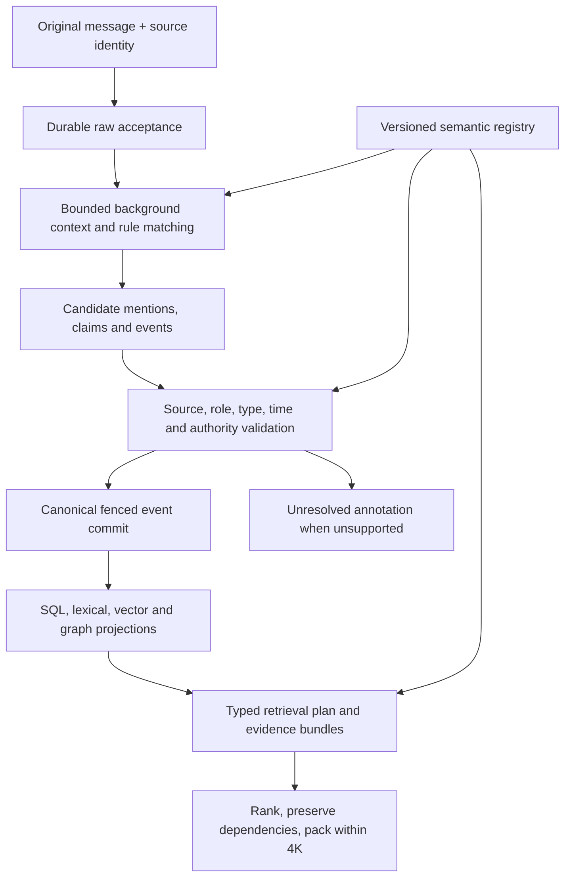

# Semantic registry: structure, responsibilities and use

## Owner selections — 2026-10-21 (supersedes earlier alternatives)

BI-Q1 A: unresolved source-bound mentions retain null canonical entity IDs and cited candidates/reasons. BI-Q2 B: adopt all **53 predicates and 44 property keys** in the coordinated rewrite; registration remains separate from tested extraction activation. BI-Q3 refined A: one versioned RoleSpec/RoleBinding contract is shared by events and claims; use event participants for occurrences and typed claim roles for non-event comparisons. No arbitrary qualifier dictionary or fabricated comparison event. BI-Q4 B: every effective ingestion-policy revision cancels/supersedes pending and in-flight old-revision work and requeues eligible sources under the latest revision. Cooperative cancellation alone is insufficient: commit fencing rejects old generations even if a model call finishes late. Preserve completed history; do not undo accepted effects or re-embed/copy historical data automatically. Current erasure/permission checks always apply. BI-Q5 B: every supported ingestion profile requires configured compatible embedding and vector capabilities; SQL-only ingestion is not a supported public profile. Lexical remains independently configurable and no generative LLM is required.

Selections are design acceptance, not completed runtime integration. Requeue must be durable, idempotent and bounded, with latest-revision coalescing, source-version/erasure checks and observable superseded/deferred states. Provider configuration is validated before admission; transient failure after raw acceptance must retain recoverable projection work rather than lose raw data or claim readiness. Role/type/unit constraints still need focused validation before extraction activation.

Date: 2026-10-18. Design refinement and usage guide; no runtime implementation. Accepted 43 predicates/nine properties and operating policies remain accepted. Catalog extensions and representation refinements below are proposed, not silently activated.

## Recommended structure

Use **one semantic registry** for predicate/property/type/role definitions, with versioned domain packs. Use **one canonical claim/event representation** across all memory layers. Keep evidence and original messages authoritative; stores are projections. A domain pack defines vocabulary and validation rules, not another memory store, write gateway or provider registry.



The registry is immutable for an operation. Pin its digest to the job/effect; a pack change produces a new digest, not a silent reinterpretation of stored data. Domain facts such as where someone lives remain claims; they never become registry entries.

## 1. Seven distinct concepts

| Concept | Question it answers | Example |
|---|---|---|
| Entity | Which individual or identifiable thing? | Hembad, Lisbon, a particular guitar |
| Predicate | What relationship/action/state? | owns, visited, has_measurement |
| Property specification | Which descriptive/measured property? | colour, distance, event_count |
| Typed value | What is the value? | blue; 5 km; a place reference |
| Domain event | Which real/planned occurrence? | One transfer, trip or move |
| Claim | Who asserted what, with what evidence/time? | Hembad stated a move destination |
| Evidence bundle | Which sources are needed to support a read result? | Move statement + country antecedent + time anchor |

Do not put polarity, planned/completed status, timestamps, source trust, sender IDs or schema versions in a free-form property bag. Those already have typed fields. Source text and entity labels are not safe unique identifiers.

## 2. File layout for the coordinated rewrite

This is a proposed target layout; files marked new do not exist yet. Preserve/replace existing canonical entry points directly, with no compatibility modules.

```text
src/memspine/
  schemas/durable/                 # existing package; affected shapes replaced together
    identity.py                   # scoped IDs and references
    assertion.py                  # single canonical claim envelope
    evidence.py                   # pinned support/binding/context
    temporal.py                   # aware resolved times, unresolved source text
    events.py                     # event-log envelope; domain occurrence kept distinct
    entity_mentions.py            # source-bound unasserted mentions
    erasure.py                    # manifests, generations and purge results
  semantics/                      # proposed new pure-domain package
    specs.py                      # PredicateSpec/PropertySpec/RoleSpec/TypeSpec
    registry.py                   # one immutable semantic registry facade
    validation.py                 # resolve definitions, cross-field semantic checks
    units.py                      # dimensions, explicit-unit conversions
    roles.py                      # event/claim role requirements
    packs/                        # versioned schema-validated data
      core.yaml
      human.yaml
      activities.yaml
      objects.yaml
      work.yaml
      operational.yaml
  derive/
    compile.py                    # existing canonical compiler, replace shape consumers
    temporal.py                   # reuse correct arithmetic and precision logic
    integration_stage.py          # existing state/conflict boundary
    entity_registry.py            # existing identity integration; no duplicate resolver
    rules/                        # proposed pure rule adapters, not another compiler
      en/                         # tested English rule packs
  read/
    pipeline/                     # existing retrieval/fusion/rerank/lift
    tiers.py                      # existing dependency-unit budgeting, target refinements
  providers/registry.py            # existing service-provider catalog: stays separate
```

The semantic registry validates meaning. The provider catalog constructs implementations such as Tantivy/OpenSearch or an embedding provider. Neither registry replaces or duplicates the other. Do not import a database client, model runtime or runner into the semantic registry.

## 3. Registry specification shape

Recommended PropertySpec fields (proposed):

| Field | Rule |
|---|---|
| key, version | Unique property identity in one pinned registry |
| category | descriptive / measurement / quantity / frequency |
| permitted_predicates | Explicit set; no key accepted just because it is a string |
| subject_types | Valid entity types, resolved through declared type hierarchy |
| value_kinds | Tagged text/entity/number/boolean/temporal as applicable |
| unit_dimension | Required for numeric measurements; null where not applicable |
| allowed_units | Explicit dimension-compatible units; preserve original unit |
| context_requirements | Required qualifiers, such as identifier scheme or capacity kind |
| cardinality | one / many / contextual; no generic latest-value replacement |
| evidence_origins | Allowed origins for assertions about this property |
| extraction_rule_ids | Tested rule IDs only; registration does not imply extraction |
| pack_id | Defining pack identity; included in registry digest |

PredicateSpec adds permitted property categories/keys, subject/value types, allowed event roles, modality and temporal requirements, state-transition policy and extraction rule references. RoleSpec declares role name, eligible value types, minimum/maximum cardinality and required evidence. Pack loader rejects duplicate/conflicting keys, missing dependencies and unsupported versions; no last-loaded-wins override.

Current review schema only permits attribute_key for has_attribute. **Proposed refinement:** retain the existing field name attribute_key, but validate it against the selected predicate's property category:

| Predicate | Property category | Example key |
|---|---|---|
| has_attribute | descriptive | colour |
| has_measurement | measurement | distance |
| has_quantity | quantity | item_count |
| explicit_frequency | frequency | occurrence_rate |
| Other accepted predicates | no generic key initially | null |

Adopting this requires updating the canonical schema validator; these examples are not accepted by today's review schema until that refinement is selected. Do not support an alias property_key alongside attribute_key. Currency and units remain in the typed numeric value, not duplicated as properties.

## 4. Domain packs and activation

| Pack | Responsibilities | Activation |
|---|---|---|
| core | Primitive types, identity/evidence rules, numeric dimensions, property validation | Foundation |
| human | Residence/origin, family, employment, human preferences | Existing starter subject to typed-role tests |
| activities | Reading/listening/playing, attendance and participation | Existing starter subject to rule tests |
| objects | Ownership, making, transfer, product/art descriptions | Existing starter subject to rule tests |
| work | Project lifecycle, roles, tasks and assignments | Lifecycle starter; new relations remain proposed |
| operational | Dependencies, tools, capabilities and resources | Proposed extension, off until selected/tested |
| catalogue | Optional external taxonomy/place/author mappings | No dataset/provider selected; disabled |

All 43 accepted predicates remain in the starter catalog; do not drop them merely to reorganise files. Distinguish **registered** (definition loaded), **extractable** (tested rule enabled), **queryable** (supported read operator) and **projected** (provider view caught up). None implies the others. Do not activate the extra ten predicates or 35 keys merely because their pack file exists.

Entity types are registry-controlled; not every predicate applies to person/agent/group interchangeably. born_in and kinship do not apply to software agents by default. Proposed animal/activity/role/task subtypes require reviewed type definitions; until then keep unmatched mentions unresolved or typed other without coercing them into human facts. Never create a canonical activity entity just from a similarity score.

## 5. How ingestion uses it

1. Caller supplies raw messages, identities and optional original timestamps through the canonical ingest API. The caller does not assign trust, grounding or entity merges.
2. Raw acceptance pins message/source version, sender, namespace and clock provenance.
3. Background job pins the semantic registry digest, rule policy, source snapshot and 4K operating profile.
4. Rules propose source spans, subject/predicate/property/value and event roles. BM25/embeddings can retrieve supporting candidates; they cannot authorise identity.
5. Registry validates names, type compatibility, property category, units, roles, negation/modality and event identity.
6. Compiler resolves support/binding and reliable temporal anchors; unsupported source/role/time leaves an unresolved annotation.
7. Integration preserves claims/history/conflicts; only supported transitions/corrections produce state change plans.
8. Fenced canonical commit records complete payloads, copy manifests and idempotent effects. Providers project from those events.

No universal natural-language parser is claimed. A new domain word needs a reviewed extraction rule or stays searchable raw text. Do not silently invent a predicate from a noun/verb phrase. Structured importer facts must still provide original source evidence; no public structured-fact API is introduced here.

## 6. Samples: accepted versus proposed shapes

These are readable fragments, not complete required Claim envelopes.

**A. Descriptive attribute — accepted starter shape**

Message: “My guitar is blue.”

```json
{
  "subject": {"entity_id":"guitar-17","mention_id":"mention-17"},
  "predicate":"has_attribute",
  "attribute_key":"colour",
  "object":{"kind":"text","text":"blue","language":"en"}
}
```

The guitar identity still needs supported binding. The schema alone cannot prove that the colour belongs to the guitar.

**B. Measurement — proposed key-category refinement**

Message: “I walked five kilometres.”

```json
{
  "subject":{"entity_id":"person-123","mention_id":null},
  "predicate":"has_measurement",
  "attribute_key":"distance",
  "object":{"kind":"number","amount":5,"unit":"km","currency":null},
  "event_id":"walk-22"
}
```

Attach distance to this walk, not a timeless personal profile. “I walk five kilometres daily” also supplies an explicit frequency; neither unit nor recurrence is guessed. Converting 5 km to 5,000 m is deterministic only with a versioned valid unit rule; retain original evidence/value.

**C. Transfer — role structure rather than duplicate events**

Message: “I gave Anita my blue guitar.”

```text
event: transfer-8
participants:
  giver     -> person-123
  recipient -> person-anita
  item      -> guitar-17
claim: person-123 gave guitar-17, event_id=transfer-8
```

Anita's later statement “I received the guitar” can support the same event if identity/time evidence establishes it. Do not count two transfers. Ownership change requires supported transfer semantics and scope/authority; a quoted story or hypothetical gift does not change current state.

**D. Comparison — qualifier refinement required**

Message: “I prefer swimming to running.”

```text
subject: person-123
predicate: prefers
preferred: swimming
alternative: running
```

The accepted binary claim shape alone does not fully encode the alternative. Proposed typed claim-role qualifiers preserve the comparison; until implemented keep the complete cited text instead of silently losing running. Do not infer dislikes running.

**E. Residence and time — accepted policy**

Message: “I moved from Porto to Lisbon last month,” with an explicit aware October source clock.

```text
domain event: one completed move
roles: mover=person-123, origin=Porto, destination=Lisbon
time: supported September period, month precision
state: Lisbon residence only where assertion supports a residence transition
history: close earlier Porto state only when justified
```

Without supported timezone/clock, preserve original temporal wording as unresolved text. Do not fabricate an exact move date or default UTC.

**F. Operational extension — proposed, not active**

“Project A depends on service B” maps to proposed depends_on with two resolved scoped entities. A dependency is not inferred because their names occur together. A tool or document cannot change registry definitions through content instructions.

## 7. How retrieval uses it

Example internal query plan, not a new public API:

```json
{
  "subject_ids":["person-123"],
  "predicate":"has_measurement",
  "attribute_key":"distance",
  "event_type":"walk",
  "time_view":"history",
  "required_roles":["actor"],
  "coverage":"observed_subset"
}
```

The router compiles supported query forms into typed constraints and searches scoped SQL/BM25/optional vectors. Hydration enforces current permission, source version, known-time and erasure. Rank compatible bundles, not isolated claims. Preserve all support/binding/negation/time endpoints and list branches within **4,096 tokens**. Missing branches become partial/unresolved; a high relevance score cannot repair them.

Predicate inverse/symmetric views must follow declared semantics only: parent_of inversion can expose child-of to a query without storing independent corroboration; friendship is not automatically reciprocal from one person's subjective claim. Derived views preserve provenance and assertion perspective.

## 8. Mapping to memory layers

| Memory representation | Uses the registry for | Does not do |
|---|---|---|
| Raw episodic L0 | Source identity and metadata validation | Rewrite the original text |
| Grounded facts | Typed claims/properties and source binding | Invent absent predicates or facts |
| Event/episode layer | Occurrence identity, participants, lifecycle and time | Merge similar stories without evidence |
| Graph | Project typed source-bound mentions and accepted relations | Treat co-mention as asserted relation |
| Profile/current state | Time-valid supported state and conflict policy | Overwrite with visits, suggestions or old imports |
| Summary/observation | Source lineage and typed context | Become independent support |
| Procedural/prospective | Explicit task/goal conditions with modality and provenance | Convert advice into adopted instructions |
| Shared views | Scope/access constraints and source authority | Merge namespaces automatically |

## 9. Guardrails and tests

- Reject unknown predicate/key, wrong property category, invalid unit dimension or missing required participant; preserve raw and unresolved reason.
- Registry packs are trusted configuration, never executed from conversation content. Declarative specs reference reviewed rule IDs; no arbitrary Python expressions from data.
- Canonicalise registry data deterministically; hash pack IDs/versions, typed specs, rule identities and unit tables. Stable iteration order; reject conflicting duplicate definitions rather than loading by accident.
- Exact IDs and evidence checks precede similarity. No automatic alias merge, unsupported personal inference or catalogue contamination.
- Test schema + semantic validators separately: correct JSON can still express an unsupported fact.
- Test same-name collisions, object-instance identity, role direction, comparison alternatives, negative/planned assertions, unknown timezones, copied-excerpt erasure and stale source races.
- No backward compatibility path. Selected envelope rewrite must update producers/consumers atomically for a release; no runtime schema change is made by this guide.

## 10. Implementation order

1. Finalise PropertySpec, role qualifiers and domain type constraints; update exact target schemas only after selection.
2. Build the pure immutable registry and validate the existing 43/9 definitions; no model or database required.
3. Implement explicit English rules by predicate family and measure accepted-link precision/unresolved rate.
4. Wire canonical compiler/state integration and fenced persistence, then projection/read dependencies.
5. Enable proposed extensions only after schema/role/unit tests; keep catalogue data separately selected.
6. Kernel-only cost checks and focused integration tests; no broad evaluation migration.

## Review outcome

Recommended structure is settled as this design proposal, not an activation. The six refinements in GENERIC_PREDICATE_ATTRIBUTE_CATALOG.md remain explicitly proposed where they change accepted schema semantics. [Review structure data](schema_review/semantic_structure_review.json) tracks the same boundaries. Accepted numeric defaults, aware-only temporal representation, persisted excerpts and erasure obligations are unchanged.

## Vector-assisted non-generative extraction — 2026-10-18

[BM25_VECTOR_ASSISTED_EXTRACTION.md](BM25_VECTOR_ASSISTED_EXTRACTION.md) specifies two distinct candidate indexes (semantic definitions versus prior evidence), optional vector-assisted labels/slots, source-grounded validation and unresolved outcomes. Existing static read prefilter is not an ingestion extractor; current model loader can download, so offline enforcement must be implemented before reuse. No Word2Vec library/model is selected and no generative call is introduced. Proposed per-segment label caps remain review values.

## CPU non-generative alternatives review — 2026-10-18

[CPU_NON_GENERATIVE_MODEL_OPTIONS.md](CPU_NON_GENERATIVE_MODEL_OPTIONS.md) compares sparse classifiers, static vectors, fastText, spaCy, small GLiNER extraction, sentence encoders and tiny rerankers with current code/packaging. Recommendations are research candidates, not model switches or measured speedups. Reuse named task profiles; no downloads, training, runtime changes or generative ingestion calls introduced.
