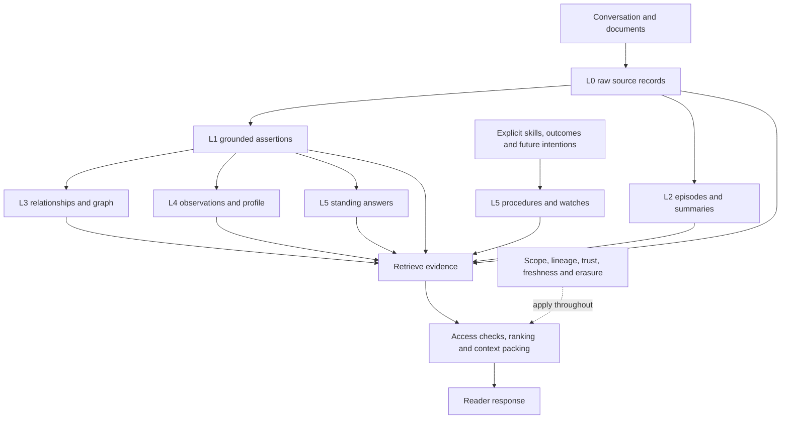

# MemSpine: memory types, layers and their relationships

Date: 2026-10-15. Source inspected on the `restructure` worktree. This is a code-backed explanation and targeted review, not a full certification of every mechanism. No engine code changed.

> Follow-up correction: actual session-close deposits use the plain-write route `summary`. The deeper real-engine probe found L1 with lineage off and L0 with lineage on, persisted unchanged through rebuild. See [the deeper forensic review](MEMORY_LAYER_FORENSICS_2026-10-15.md) for the corrected finding, 16-item register and reproduction evidence.

## 1. Four distinct concepts

| Concept | Meaning | Example |
|---|---|---|
| Memory type | Mechanism and behavioural category (`memory_type`) | episodic timeline, semantic conflict resolution, procedural skill lifecycle |
| Layer | Representation label (`layer`, L0–L5) | raw turn L0, extracted assertion L1, session summary L2 |
| Channel / provenance | How an item was produced and which source supports it | window extraction, session close, observation, user statement |
| Pipeline / retrieval leg | Work that produces or finds records | extract, consolidate, temporal search, graph traversal |

These are not four separate copies of the memory. A semantic record can be an L1 fact, L2 episode, L3 graph-derived assertion, L4 observation or L5 standing answer. Most records use the same event-sourced record substrate and projections. Some artefacts instead live as markers or graph links, so record counts alone are not a complete inventory.

Primary mapping: `src/memspine/store/layers.py`; typed record fields: `src/memspine/store/records.py`; type dependencies: `src/memspine/core/registry.py`.

## 2. All nine memory types

| Type | What it remembers | How it is written or updated | How it is used | Actual layer / caveat | Code |
|---|---|---|---|---|---|
| Working | Current context and pinned persona | Ordinary records; budget-driven page-outs are logged transitions | Hot context, stable persona prefix | L0 in the mapper; working context is an operational role, not a separate L6 | `memories/working/manager.py`, `paging.py`, `persona.py` |
| Episodic | What was said or happened in a conversational sequence | Raw turns through the ordinary write path; session/timeline grouping | Chronological recall, neighbouring-turn evidence, source of extraction | Raw turns are L0. Derived episode summaries are conceptually L2, often stored as semantic records | `memories/episodic/store.py`, `ingest/write.py` |
| Semantic | Facts and assertions about entities, attributes and events | Extraction or explicit writes; dedup, conflict ladder, supersession and validity history | Fact lookup and retrieval keys leading back to source turns | L1 normally; channel and explicit stamping can select other layers | `memories/semantic/store.py`, `facts.py`, `derive/pipeline/integrate.py` |
| Associative | Relationships among records/entities | LINK events, entity projection, optional extraction and edge compilation | Related records, graph walks, joins and one-hop retrieval | L3 conceptually; graph nodes/edges are not necessarily L3 record rows | `memories/associative/store.py`, `derive/pipeline/stages/edge_compiler_v2.py` |
| Reflective | Cited insights derived from experience | Explicit reflection API with parent/depth guards; optional pattern/profile processing | Higher-level interpretation and personalisation | Reflective records map to L4. Pattern observations can instead be semantic records explicitly stamped L4 | `memories/reflective/reflections.py`, `guards.py`, `derive/pipeline/stages/patterns.py` |
| Procedural | How to do something: skills, plans, prompt versions, lessons, exemplars | Versioned records; staged lifecycle; promotion rules and outcome receipts | Dedicated skill/lesson/example APIs and eligible active procedures | L5. Advisory lessons/mappings are withheld from ordinary search; storing a procedure is not executing it | `memories/procedural/skills.py`, `lifecycle.py`, `lessons.py`, `knn.py` |
| Prospective | What should be noticed or remembered later | Watches keyed to time or entity/attribute conditions; logged trigger state | Pending intentions and notices when conditions are met | L5. A trigger or advisory plan is not evidence that an action was completed | `memories/prospective/watches.py`, `triggers.py` |
| Shared | Who may access which memory across namespaces | Grant/revocation and subscription records; scoped access rules | Authorised shared retrieval and standing queries | Bookkeeping maps to L0; shared is an access dimension across types, not a new factual evidence layer | `memories/shared/grants.py`, `subscriptions.py`, `store/scope.py` |
| Resource | External document content | Ingestion/chunking with document/chunk provenance and PII metadata | Source retrieval, grounding and possible downstream extraction | L0. A document chunk is source material, not automatically a verified assertion | `memories/resource/store.py` |

### Type dependencies actually declared

| Enabled type | Required type |
|---|---|
| Reflective | Episodic |
| Prospective | Semantic |
| Associative | Semantic |
| Shared | At least semantic or episodic; semantic is the deterministic auto-enabled choice |

The remaining types have no extra hard type dependency in this registry. Type availability does not imply that every optional extractor, model, graph adapter or read leg is active.

## 3. Representation stack and relationships

| Layer | Intended role | Inputs | Outputs / consumers | What to preserve |
|---|---|---|---|---|
| L0 | Raw turns, document chunks, working/source records | Conversation, documents, tool/user input | All derived layers; raw retrieval | Exact source/version, actor, time precision, access policy |
| L1 | Supported assertions | Grounded extraction or explicit facts | Fact retrieval, graph compiler, histories, observations | Evidence and bindings, modality, polarity, event identity |
| L2 | Episodes and summaries | Groups of source turns and facts | Episode search and compact orientation | Membership, source chronology, coverage and citations |
| L3 | Relationships and entity/graph summaries | Assertions, entity resolution and links | Joins, relationship traversal, graph retrieval | Edge support, temporal validity, tentative vs asserted state |
| L4 | Observations and profile information | Repeated supported facts, explicit preferences, guarded profile operations | Personalised response context | Independent support, inference status, freshness and visibility |
| L5 | Standing answers, procedures and intentions | Reusable supported answers, validated skills, outcome receipts, future conditions | Task guidance, repeated questions, reminders | Invalidation, applicability, lifecycle and non-execution boundary |

The arrows are conceptual dependencies, not a guarantee that every stage runs. Generated layers should help locate and compress evidence; they should not silently replace source evidence or amplify their own repeated claims.

## 4. One invented example across the types

Suppose Noor says: “I moved from Porto in March. I prefer quiet trails. Remind me to book a walking tour next Friday.”

| Type / layer | Appropriate representation | What it must not imply |
|---|---|---|
| Episodic / L0 | The exact dated utterance and neighbouring turns | That all event dates equal the message timestamp |
| Semantic / L1 | Origin Porto, move month with its known precision, stated preference | A destination, year or exact day that was not established |
| Episode / L2 | A cited summary of the relocation and travel-planning session | An independent corroborating source |
| Associative / L3 | Supported person–move–origin relationships | An ungrounded destination or automatically completed booking |
| Reflective / L4 | A stated preference entry; a recurring pattern only if multiple suitable sources support it | A personality diagnosis from one preference |
| Prospective / L5 | A time-conditioned reminder anchored to a supported calendar interpretation | That a reminder has already fired or a booking was made |
| Procedural / L5 | A reusable booking procedure, if separately supplied or validated | That this single utterance already contains a complete procedure |
| Working | The active travel task and relevant constraints | Permission to overwrite durable history |
| Resource | An itinerary or tour document, if supplied | Proof of Noor's personal actions |
| Shared | Access granted to a travel companion, if authorised | Automatic visibility of private profile or source records |

## 5. What the current selected configuration actually exercises

| Configuration / mechanism | Observed status | Interpretation |
|---|---|---|
| `base` / `assistant` | Working, episodic and semantic types enabled; base reranker off | General library defaults are not identical to the adopted evaluation arm |
| `v2-PICK3-j` | Jina reranking, protected pool 8, tiers, relevance gate, trust rendering, decomposition, anaphoric index view; Qwen embedding configuration | A selected retrieval configuration; does not enable or validate the entire L0–L5 stack |
| Graph follow-up | Latest `FINAL_PICK.md` keeps graph opt-in | Supersedes the earlier graph-default-on direction for the selected configuration |
| Window extraction | Optional write path with validation, temporal, grounding, integration and optional recovery/resolution stages | Extractor and stage flags must be inspected in the effective configuration |
| Edge compiler | Optional sleep stage (`graph.edge_compiler_v2`) | Graph projection availability is not proof of immediate online graph freshness |
| Observations / standing answers | Offline optional stages; explicit L4/L5 override in the fact deposit path | They share semantic storage but represent different memory functions |
| Profile card v2 | Optional; event-log MARKER payload folded into session state | Not simply a collection of L4 `MemoryRecord` rows |

Sources: `config/templates/base.yaml`, `assistant.yaml`; `evals/arms/v2-PICK3-j.json`; `docs/v2/FINAL_PICK.md`; `derive/pipeline/stages/profile_card.py`; `derive/pipeline/stages/table.py`.

## 6. Findings from this trace

| ID | Finding | Evidence / verification | Consequence and next step |
|---|---|---|---|
| MT-01 | Session-close episode/summary labels do not match the layer enum expected by the stamping helper | `derive/pipeline/integrate.py:521` passes `episode` or `summary`; `derive/write.py:171` accepts only L0–L5, then falls back. Earlier semantic-route helper calls returned L1; actual summary-route deposits return L0 with lineage on and L1 with it off (follow-up verified) | Confirmed helper/call-site mismatch. Use explicit L2 semantics, inspect existing rows and add a full call-2 → persist → registry → episode-leg test before changing data |
| MT-02 | Legacy summary stamping can assign L0 | `derive/pipeline/stages/offline_door.py:stamp_summary` passes memory type `summary`; `stamp_derived` falls back through `derive_layer`, whose unknown types become L0. Synthetic call returned L0 | Confirmed helper behaviour. Check each summary caller and choose L2/L3 explicitly by actual representation, not one blanket summary label |
| MT-03 | Observations/standing answers are correctly overridden in one path, but the mapping is distributed | `derive/pipeline/integrate.py:421-434` supplies L4/L5; the constructors and generic channel mapper initially give L1. The override is active through the lineage-enabled door | Do not claim these records are always mislabelled. Consolidate the producer-to-layer contract and test flag-on, flag-off, replay and backfill behaviour |
| MT-04 | Profile representations and layer inventory need reconciliation | `profile_card.py` persists profile changes as MARKERs; `LayerRegistry.load` counts record rows; `read/router_rules.py` routes its profile leg using L5 | Design/integration risk, not proof that profiles are unreachable. Define whether this leg means profile cards, standing answers or both; test real stored artefacts end to end |
| MT-05 | Available, enabled, populated and selected are not the same | `LayerTemplate.from_config` enables L3 for a worker or graph store; `LayerRegistry.is_enabled` also returns true for populated layers. Final selected arm keeps graph optional | The registry is not itself an authorisation or execution gate. Expose separate capability/configuration/population/routing states in Studio and runtime reports |
| MT-06 | Memory type alone cannot specify prompt treatment | L0 includes shared bookkeeping; L2 includes anticipation cues; semantic records span several layers | Add or clarify representation purpose and evidence eligibility; prevent grants/cues/procedures from being rendered as factual evidence merely because of a layer label |
| MT-07 | Reported aggregate QA is not evidence for all memory types | PICK3 does not activate the complete derived stack | Evaluate each mechanism on its appropriate workload and then measure interactions under matched budgets |

### Executed checks

- Synthetic in-memory record/stamping probes, no model calls: observation + L4 → L4; standing + L5 → L5; session_close + episode → L1; session_close + summary → L1; legacy consolidation with type summary → L0.
- `tests/unit/wiring/test_ow_c_patterns_standing.py` and `tests/unit/lib/test_lib_23_router_rules.py`: **25 passed**. Existing pytest-asyncio fixture deprecation warnings occurred.
- These tests do not demonstrate that the complete layer inventory is correct. The reproduced session-close/legacy stamping behaviours need targeted integration coverage.

## 7. How to relate enhancement goals to memory types

| Goal | Primary memory mechanisms | Useful evidence gate |
|---|---|---|
| Recall exact conversations | Episodic + resource + working context | Source recall, citation correctness, sequence/date fidelity |
| Resolve changing facts | Semantic + temporal history | Correction order, A→B→A, repeated-event identity, unsupported supersession |
| Answer joins and relationships | Semantic + associative, with raw support | Complete multi-hop evidence at equal token budget |
| Understand a session compactly | Episodic summaries / L2 | Coverage, compression ratio and retained qualifiers |
| Personalise appropriately | Explicit semantic preferences + reflective/profile | Preference utility, false inferences, correction and erasure propagation |
| Reuse task knowledge | Procedural + standing answers | Applicability, successful outcomes, stale answer rejection |
| Remember future commitments | Prospective | Correct due conditions, duplicate suppression, cancellation and missed triggers |
| Share safely | Shared + scope/lineage across all types | Noninterference, revocation, derived visibility and cache invalidation |

Before adding another memory type, first establish a complete producer → persisted artefact → layer inventory → retrieval consumer → invalidation contract for each existing representation. Then test whether an additional layer contributes useful evidence or only duplicates content and consumes budget.
