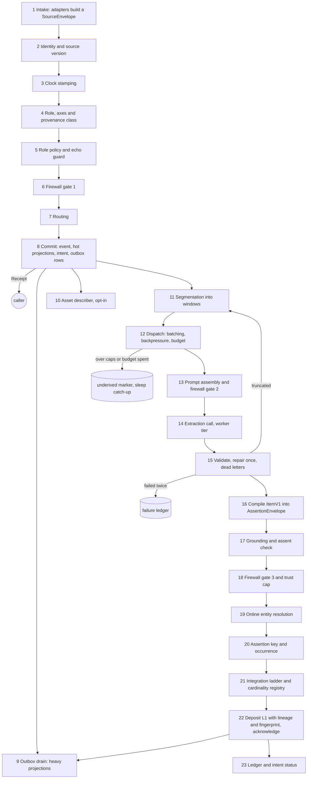

# Insert pipeline

The insert pipeline is the deposit operator $\mathcal{D}$: everything that happens from the moment a caller hands
MemSpine some content until the derived assertions from it are stored with lineage and trust. It has two halves. The
**synchronous half** (steps 1 to 8) runs inside the caller's write call: one intake shape, stamping, role policy, the
first firewall gate, routing, and one commit that makes the raw record searchable and persists a derivation intent.
The **asynchronous half** (steps 9 to 23) runs after the receipt, drained by the inline runner from the durable outbox
(Q2): segmentation into windows, one example-free extraction call per batch of windows, validation, grounding, two
more firewall gates, online entity resolution, assertion identity, the integration ladder, and the deposit into L1 with
lineage, a trust cap and a derivation fingerprint. The event log is the truth throughout; every store the pipeline
touches is a projection of it. No model call happens unless a worker role is bound (P-03, G-21); without one the
pipeline stops at L0 raw.

Conventions in this file: "today" cites `src/memspine/` at commit `beeaff5` (`feat/local-qwen-stack`); config names
written `old -> new` give the current key and the decided one; a new name marked *(proposed)* is not yet fixed by a
decision and is settled by F-07 (config split). Invented names only (Ilse, Bram, Noor).



## Entry points and triggers

| # | Entry | Exact condition | Starts at | Today |
|---|---|---|---|---|
| E1 | `remember(envelope)` on a scoped handle (G-16) | Any call with a `SourceEnvelope`; the native v2 door | 1 | none; `write` at `engine.py:1672` |
| E2 | `write(content, ...)` adapter | One segment, kind `conversation` unless `entity`/`attribute` or a skill/plan key is given (then an explicit keyed write, step 7) | 1 | `engine.py:1672-1826`; default `memory_type="semantic"` (`:1676`) |
| E3 | `write_messages(messages, ...)` adapter | One envelope of kind `conversation`, one segment per message, `source_id` = `session_id` or a fresh id | 1 | `engine.py:4270-4331`, per-turn loop `:4368-4504` |
| E4 | `write_episode(messages, ...)` adapter | As E3 with `source_id` = content fingerprint of the transcript | 1 | `engine.py:4578-4601` |
| E5 | `ingest(path)` adapter | Kind `document`; extract and chunk, one segment per chunk; `source_id` = document path or caller id | 1 | `engine.py:11778-11793`, `memories/resource/store.py:54-130` |
| E6 | Tool-log adapter | Kind `tool_log`; tool output segments with role `tool` | 1 | none (tool turns ride `write_messages`) |
| E7 | Markdown export edit (M-01) | A user edit of the one-way export re-enters as a `document`-class write | 1 | none |
| T1 | Outbox row committed | Step 8 commits a `derivation` row; the runner schedules a drain task in the host loop | 9, 11 | `WindowPipeline.observe` after the write, `workers/windows.py:397` |
| T2 | Window boundary | A turn closes a window: topic shift, 6 turns, 1,500 tokens, source-time gap, calendar-day change (step 11) | 12 | `core/window.py:155-179` (no time-gap cut) |
| T3 | Idle timer | No new turn in the namespace for `idle_s` (120 s) while the runner is alive | 11 | `workers/windows.py:450-467` |
| T4 | Session end | A new session id arrives, or `close_session()` is called | 11 | `workers/windows.py:423-427`, `:515` |
| T5 | Explicit drain | `drain()`, `flush_windows()`, `memspine drain` CLI, `sleep()` (catch-up stage) | 11 | `engine.py:13757` (`flush_windows`) |
| T6 | Recovery on open | `Engine.open()` reclaims expired leases and resumes pending rows; first v2 start enqueues every source after the last derived watermark (W-13 migration) | 12 | none (queue is in memory, lost on stop, `workers/windows.py:568`) |
| T7 | Truncation | A reply ends with `finish_reason=length`; the unanswered lines become a new window (P-11) | 11 | none |
| T8 | Source version | A same-id segment with new content (W-03) or a re-ingested document (W-24) | 2 | resource ingest skips same chunks only (`store.py:79-102`) |
| T9 | Re-derivation | A stale derivation fingerprint (P-25) or an erasure that leaves survivors (M-25, G-13) enqueues a `rederive` row | 13 | none |
| T10 | Backlog catch-up | Underived sources picked up by the sleep catch-up stage or by an early reconcile when backlog caps fire (O-10) | 12 | sleep re-extracts (fallback) |
| T11 | Asset read trigger | A read needs unresolved visual evidence (W-23 C); off by default | 10 | none |

## Steps

### 1. Intake

- **Purpose:** turn every door into one `SourceEnvelope` with ordered segments, so stamping, idempotency and
  versioning happen once. Each segment becomes one L0 record.
- **Runs when:** always.
- **Model call?** never.

```text
Input:  adapter arguments (E2..E7) or a SourceEnvelope (E1)
Output: SourceEnvelope (section 5), validated: segments non-empty, seg_index dense from 0, role in the closed set,
        content a string; malformed segment -> ValueError naming its index, nothing written
```

- **Writes:** nothing. **Reads:** the scope from the handle (M-05).
- **Failure and retry:** a malformed segment fails the whole envelope before any write (today's behaviour for
  `write_messages`, `engine.py:4400-4406`).
- **Idempotency:** pure.
- **Ordering and locking:** none.
- **Config:** `write.participants` (`config/schema.py:1740`, default `off`) -> participants always on (W-05 note);
  `memory_type` argument -> retired for unkeyed content (step 7).
- **Today vs decided:** five doors with their own stamping (`engine.py:1672`, `:4270`, `:4368`, `:4578`, `:11778`;
  `memories/resource/store.py:54`). Decided W-01 D: `intake.SourceEnvelope` plus `intake.IntakeGateway`; the old verbs
  are deleted, not aliased (Q9, `ARCHITECTURE.md` section 7). Package **W2-01** (after F-09).

### 2. Identity and source version

- **Purpose:** make retries free and edits explicit. Each segment gets an idempotency key; the same key with new
  content becomes a new source version.
- **Runs when:** always.
- **Model call?** never.

```text
Input:  SourceEnvelope
Output: per segment: idem_key: str (caller_id if given, else xxh64 of (scope, source_id, seg_index, content)),
        verdict: new | retry (same key, same content) | new_version (same key, other content),
        source_version: int (unchanged for retry, +1 for new_version)
```

- **Writes:** nothing yet (decisions travel to step 8). **Reads:** the idempotency index (key -> record id, content
  fingerprint, version), a projection keyed by scope.
- **Failure and retry:** an unreadable index fails the write (never guess "new").
- **Idempotency:** this step is the mechanism. A `retry` segment produces no event; the receipt returns the
  original record id and intent id.
- **Ordering and locking:** read under the namespace lease of step 8, so two concurrent retries of one key commit
  once.
- **Config:** *(proposed)* `intake.idempotency: caller_then_fingerprint` (fixed by W-03; no other mode).
- **Today vs decided:** no key on `write()`; `write_messages` avoids half-written batches only by embedding up front
  (`engine.py:4302-4306`, `:4311-4312`); `write_episode` derives a session id from content (`:4592`); resource chunks
  are skipped per (doc_path, fingerprint) (`memories/resource/store.py:79-102`); semantic dedup merges repeats of
  facts but not of turns. Decided W-03 D and W-24 C: `intake.IdempotencyKey`, `intake.SourceVersioner`; a new version
  writes a `version_of` lineage edge and retires or re-points the old version's derived items at step 22. Package
  **W2-01**.

### 3. Clock stamping

- **Purpose:** three clocks per raw record, never guessed: source time, declared zone, recorded time.
- **Runs when:** always.
- **Model call?** never.

```text
Input:  Segment.source_at?, Segment.tz?, SourceEnvelope.tz?
Output: source_at: datetime | null  (from the segment; never "now")
        source_tz: str              (segment tz, else envelope tz, else "unknown")
        tz_unknown: bool            (naive time with unknown zone: stored as wall clock, not shifted)
        recorded_at: datetime       (engine clock, strictly increasing per store)
        seq_tiebreak: int           (n-th segment of one source at the same source_at)
```

- **Writes:** fields on the L0 record. **Reads:** the engine clock.
- **Failure and retry:** an unparseable timestamp gives `source_at = null` and a counted warning (`stamp_unparsed`),
  never a fallback to now.
- **Idempotency:** deterministic except `recorded_at`, which is fixed by the first commit of the key (a retry keeps
  the original).
- **Ordering and locking:** none.
- **Config:** `read.naive_timezone` (`config/schema.py:481`, `UTC`) -> retired (W-04); `read.session_sequence`
  (`:486`, off) -> always on as the tie-break; `read.skip_defaulted_dates` (`:476`) and the `UNDATED_TAG` -> retired,
  a null `source_at` replaces them.
- **Today vs decided:** `valid_from` defaults to now (`engine.py:1709-1711`, `core/records.py:200`); naive times are
  shifted into `read.naive_timezone` (`engine.py:4506-4519`); an unparseable timestamp silently falls back to the
  batch time or now (`:4521-4532`, `:4478`); ties are sequenced only when enabled (`:4534-4540`). Decided W-04 C ("B +
  C"), M-10: `intake.ClockStamper`; the event interval and its precision are filled at step 16. Package **W2-02**.

### 4. Role, axes and provenance class

- **Purpose:** typed columns for who spoke, to whom, who was present, and a provenance class from the role.
- **Runs when:** always.
- **Model call?** never.

```text
Input:  Segment.role, speaker?, addressee?, SourceEnvelope.participants?
Output: spk: str | null    (segment speaker, else a "Name: text" prefix, else null)
        addr: str | null
        participants: [str] (envelope list, else the session's speakers so far; always written)
        participant tags: participant:<name> (still written, W-05 note)
        src_class: user_stated | assistant_proposed | tool | document | external   (from role and channel, M-07)
        base_trust: float  (per-class cap; user 0.7, assistant 0.5, tool 0.4 today)
```

- **Writes:** columns on the L0 record. **Reads:** per-namespace session speaker list (in memory, rebuilt from L0 on
  open).
- **Failure and retry:** none; unknown role is rejected at step 1.
- **Idempotency:** deterministic.
- **Ordering and locking:** the session speaker list is updated under the namespace lease.
- **Config:** `memories.episodic.policies.subject_tagging`, `read.perspective_mode` (`config/schema.py:914`) -> axes
  always on (M-08); `write.inferred` and `write.inferred_trust_cap` (`:1746-1747`, 0.4) -> folded into the per-class
  caps *(proposed key `trust.class_caps`)*.
- **Today vs decided:** speaker and addressee are tags (`engine.py:1756-1762`, `:4434-4440`), participants only with
  `write.participants: session` (`:4394-4398`, `:4491`); role trust from `core/policies/trust.py:28-33`, `:92-100`.
  Decided W-05 C, W-08 B (stage 1), M-07, M-08: `intake.RoleStamper`, `provenance.SourceClassifier`. Package
  **W2-02** (F-02 adds the columns).

### 5. Role policy and echo guard

- **Purpose:** keep every role in raw for audit, but decide what derivation may use: assistant text is a proposal,
  tool output is evidence with its own trust, system text is excluded, and recalled memory echoed back is not new
  evidence.
- **Runs when:** always (echo guard on by default).
- **Model call?** never.

```text
Input:  stamped segment
Output: derive_use: proposal | evidence | stated | excluded
        echo: bool   (recall-block marker found, or overlap with blocks the session's last read rendered)
```

- **Writes:** `derive_use` and `echo` on the L0 record; an echo also writes a `recall_skipped` MARKER (fingerprint
  only, never content). **Reads:** the per-session read ledger (G-08) for the echo overlap check.
- **Failure and retry:** a ledger miss after restart degrades to marker-only detection (at most one turn exposed,
  G-08).
- **Idempotency:** deterministic.
- **Ordering and locking:** none.
- **Config:** `firewall.skip_message_roles` (`config/schema.py:1444`, empty), `firewall.skip_injected_recall`
  (`:1447`, off), `firewall.tag_assistant_claims` (`:1449`, off) -> *(proposed)* `intake.role_policy {assistant:
  proposal, tool: evidence, system: exclude}` and `intake.echo_guard: on`.
- **Today vs decided:** skipped roles and echoed recalls are **not stored at all** (`engine.py:4408-4432`), off by
  default; assistant claims are tagged only when enabled (`:4441-4442`). Decided W-06 B: raw keeps every role, the
  guard excludes from derivation only. Package **W2-03**. See open question I-8 for the overlap check.

### 6. Firewall gate 1 (raw write)

- **Purpose:** screen the raw write deterministically before it lands: redaction, trust matrix, instruction
  framing, anomaly, size and protected keys. No model in the defence (N1).
- **Runs when:** always (`firewall.enabled`); an ablation arm may switch signals off, never in a profile.
- **Model call?** never.

```text
Input:  stamped record; namespace context (nearest non-held neighbour similarities, 50 recent live contents,
        optional query-history z-score)
Output: FirewallVerdict {gate: 1, trust, instruction_flag, anomalous, quarantine, reasons[]}
        record with redacted content, pii_tier, sensitivity tags (when on)
```

- **Writes:** the verdict travels to step 8 (a quarantined record is still committed, inert). **Reads:** vector
  projection (neighbours), records projection (recent contents, held ids).
- **Failure and retry:** embedder outage disables the outlier signal for that write (logged); the regex signals
  always run.
- **Idempotency:** deterministic given the namespace context; a retry (step 2) skips this step.
- **Ordering and locking:** inside the namespace lease, so context reads and the commit are one unit (today
  `engine.py:1810-1815`).
- **Config:** `firewall.signals.*` (`FirewallSignalsConfig`, `config/schema.py:1376-1405`): base three on;
  `instruction_extended` and `semantic_risk` off -> **on** (G-06); `query_anomaly` stays opt-in;
  `minja_bridge_exempt_roles` empty globally, `[assistant]` in the chat data-shape preset only (Q8).
  `firewall.redact_secrets`, `pii`, `max_content_chars`, `protected_keys`, `hearsay_trust_cap` (`:1425-1453`) keep
  their meaning.
- **Today vs decided:** `_screen_write` (`engine.py:4670-4732`) and `_assess_write` (`:11288-11347`) call
  `Firewall.assess` (`core/firewall.py:275-391`); signals as listed (`:140-170`). Decided W-07 C, G-06 "A + C":
  `firewall.WriteGates.gate1` with `SignalStack` (base then added signals). Package **W2-04**.

### 7. Routing

- **Purpose:** decide the layer and type tag of what is committed. Unkeyed content always lands as raw; typed
  records come only from derivation (with parents) or from explicit keyed writes.
- **Runs when:** always.
- **Model call?** never.

```text
Input:  envelope kind, segment, optional explicit key (entity+attribute, skill name, plan task)
Output: route: raw_episodic (L0, type episodic) | raw_resource (L0, type resource)
             | keyed_fact (L1, type semantic, explicit key, src from role)
             | keyed_procedural (L5, type procedural, explicit key)
        derive: bool   (raw routes with derive_use != excluded and a worker role bound and L1 enabled)
```

- **Writes:** nothing. **Reads:** template layer switches (Q1).
- **Failure and retry:** an explicit key on a layer the template disables raises `ConfigError` at the call.
- **Idempotency:** pure.
- **Ordering and locking:** none.
- **Config:** `memory_type` argument (`engine.py:1676`, default `semantic`) -> removed for unkeyed content;
  *(proposed)* `layers: {L0: on, L1: on, L2..L5: off}` in templates (Q1).
- **Today vs decided:** a free-text `write()` defaults to semantic and runs the semantic pipeline (`engine.py:1676`,
  `:4963-4975`). Decided W-09 D: `intake.TypeRouter`; every typed record has parents unless explicitly keyed. Package
  **W2-03** (the F-09 move first).

### 8. Commit and receipt

- **Purpose:** one SQL transaction holds the WRITE event, the hot projections, the derivation intent and the outbox
  rows for heavy projections; the receipt returns at once with raw searchable.
- **Runs when:** always.
- **Model call?** never (the embedding comes from the cache when step 6 or a batch prewarm already paid for it).

```text
Input:  routed records with verdicts, idem keys, versions
Output: Receipt {event_ids[], record_ids[], intent_id, source_id, source_version, raw_searchable, retried[],
                 quarantined[]}
```

- **Writes (one transaction):** `memory_events` WRITE per new segment (quarantined ones carry `firewall.reasons`);
  records projection; lexical index; vector projection when the embedding is cached, else a `projection` outbox row
  for the vector; one `DerivationIntent` (= outbox row of kind `derivation`, members = the new raw ids and versions);
  `projection` outbox rows for graph and any external backend. Layer L0.
- **Reads:** idempotency index, embedding cache.
- **Failure and retry:** any failure rolls back the whole envelope; the caller retries with the same ids (step 2
  makes it safe). Under `projection.mode: outbox_all` only the event, records row, intent and outbox rows commit;
  raw becomes searchable when the runner applies them.
- **Idempotency:** guaranteed by step 2 plus a unique constraint on (scope, idem_key, source_version).
- **Ordering and locking:** the namespace lease (a store row, G-19) serialises writers across processes on one
  store; `seq` is monotonic per store. The vector projection never blocks on a model call inside the lease.
- **Config:** *(new, W-10)* `projection.mode: split | outbox_all` (default `split`); `event_log.mode`
  (`EventLogConfig`, `config/schema.py:43`) unchanged; an ephemeral log keeps the outbox in memory, non-durable by
  declaration.
- **Today vs decided:** `_append_and_project` appends the event and then applies every projector in turn, outside a
  shared transaction (`engine.py:13479-13505`); batching defers commits and checkpoints (`:13575-13614`); catch-up on
  start re-applies a gap (`core/replay.py:34`); the write returns a `MemoryRecord`, no intent; the window manager is
  fed after the write, in memory (`engine.py:1821-1825`). Decided W-02 D, W-10 C ("B + C"), G-19 with Q2:
  `log.ProjectionRouter`, `log.Outbox`, `intake.Receipt`, `derive.DerivationIntent`. Target: write p95 at most 250 ms
  on the reference box (P-21; measured hot path 55-210 ms). Packages **F-04** then **W2-01**.

### 9. Outbox drain: heavy projections

- **Purpose:** apply projections that cannot or should not join the SQL transaction (graph, Neo4j on the server
  profile, vectors whose embedding was not cached, compiled edges from step 22).
- **Runs when:** a `projection` row is pending (T1, T6, after step 22).
- **Model call?** never (an embedder call for uncached vectors is not a model call in the P-03 sense).

```text
Input:  OutboxRow{kind: projection, members[], source_version, generation}
Output: projection applied; row status done (same transaction as the apply where the backend is the SQL store)
```

- **Writes:** graph backend (embedded: Ladybug, else SQL adjacency; server: Neo4j), vector projection. **Reads:** the
  event and record; the tombstone set.
- **Failure and retry:** lease, back-off through `not_before`, dead letter after N attempts; the projector contract
  is idempotent upsert by assertion id plus a tombstone check, so a re-apply is safe.
- **Idempotency:** upsert by assertion id (or record id); a member tombstoned since enqueue is skipped.
- **Ordering and locking:** per-namespace order by `seq`; a lease row per claimed batch; Neo4j is always fed here,
  never inline (Q4).
- **Config:** `graph.provider` (`config/schema.py:173-186`, `auto`) unchanged for embedded; server profile `neo4j`;
  `workers.runner` (`:265`, `inline`) -> *(proposed)* `runtime.drainer: inline | dbos | taskiq`.
- **Today vs decided:** the graph projector applies inline in `_append_and_project` (`engine.py:13498-13503`); the
  Neo4j adapter is a stub (`services/graph/neo4j.py:16-18`). Decided W-10, M-04/M-18 with Q4, G-19: projector
  contract (apply, neighbours, erase, rebuild, scope_check). Packages **F-04**, **F-16**.

### 10. Asset describer (opt-in)

- **Purpose:** make attached images searchable by a derived caption, paid once per asset hash.
- **Runs when:** `intake.assets.describe_on_ingest` (T1) or `describe_on_read` (T11); both off by default (BD-8 hold).
- **Model call?** optional role `vision` (local only, P-02).

```text
Input:  AssetRef{asset_id, hash, mime, url_or_path}; prompt hash; model id
Output: L0 resource record (caption), src_class derived, parents = [the turn], provenance {asset hash, model, prompt}
```

- **Writes:** one WRITE (through gate 3 and the trust cap of step 18). **Reads:** the asset registry.
- **Failure and retry:** a vision outage is recorded and retried from cached bytes; an empty caption is a failure,
  not evidence.
- **Idempotency:** one caption per (asset hash, model, prompt hash); an ingest caption wins over a read caption.
- **Ordering and locking:** outbox row of kind `asset`.
- **Config:** `ingest.asset_vision` (`config/schema.py:1799`, `none`), `asset_vision_model` (`:1800`) ->
  *(proposed)* `intake.assets.{describe_on_ingest, describe_on_read, model}`.
- **Today vs decided:** asset ids ride as `asset:<id>` tags (`engine.py:4464-4466`, `:3031`). Decided W-23 B ("B +
  C"): `intake.AssetDescriber`. Package **W2-11**.

### 11. Segmentation into windows

- **Purpose:** cut a source's derivable segments into windows of a few turns: enough context for coreference and
  relative dates, not the whole session.
- **Runs when:** a raw route with `derive = true` commits (T1), on an idle or session-end cut (T3, T4), on drain
  (T5), or for rescheduled lines (T7).
- **Model call?** never (the topic boundary uses the cached embedding).

```text
Input:  WindowTurn{record_id, source_version, session, source_at?, tokens, vector?}
Output: Window{window_id, turns[], reason: topic|turns|tokens|time_gap|calendar_day|session_end|idle|flush|
               truncation, session, source_versions[]}
```

- **Writes:** window membership on the intent row (members, versions). **Reads:** the open window state, rebuilt
  from pending rows on open.
- **Failure and retry:** an embedding failure disables the topic cut for that turn only.
- **Idempotency:** `window_id` = fingerprint of (scope, member ids, member versions), so a replay cuts the same
  windows.
- **Ordering and locking:** windows of one namespace are cut in commit order; segments carrying `derive_use =
  excluded`, an `echo`, a quarantine or an instruction flag never enter a window.
- **Config:** `write.window_max_turns` 6, `window_max_tokens` 1500, `window_topic_k` 2.0, `window_idle_s` 120
  (`config/schema.py:1760-1767`) -> *(proposed)* `derive.window.*` with the same defaults; new
  `derive.window.time_gap: learned` and `derive.window.calendar_day_cut: true` (W-11); `write.window_extract`
  (`:1757`, `off`) -> layer switch L1 plus `derive.window.mode: adaptive | per_turn`.
- **Today vs decided:** `WindowSegmenter` (`core/window.py:128-194`) cuts on topic, turns, tokens, session end, idle
  and flush; no source-time gap cut; windows live in an in-memory deque (`workers/windows.py:326`, `:433-441`).
  Decided W-11 E ("B + E"): `derive.Segmenter`. Package **W2-05**.

### 12. Dispatch: batching, backpressure and budget

- **Purpose:** turn closed windows into calls: several windows per call as separately numbered blocks (when the
  batching screen passes), coalesce under load, defer under a budget, never drop.
- **Runs when:** a window closes (T2..T7) or the runner drains (T1, T5, T6, T10).
- **Model call?** never.

```text
Input:  closed Windows of one namespace, backlog state, ledger budget
Output: CallBatch{batch_id, windows[], tokens_in} | underived marker on the intent row
```

- **Writes:** outbox row status (`leased`, `underived`), `CallBatch` membership. **Reads:** outbox, ledger.
- **Failure and retry:** above the backlog age or size cap, adjacent pending windows of one session coalesce up to
  the token cap; beyond that the sources are marked `underived` and picked up by catch-up or sleep (O-10). A spent
  budget marks `underived` as well. Nothing is dropped.
- **Idempotency:** the lease claim is a conditional update on (status, lease_until); a re-claimed batch reuses its
  `batch_id`.
- **Ordering and locking:** namespaces run concurrently, ordered within a namespace, under one global model
  semaphore matched to the server's slots (P-20); model calls run **outside** the namespace lease (F-04 note).
- **Config:** `write.window_async` (`config/schema.py:1774`, on) -> retired, always asynchronous after the receipt;
  *(proposed)* `derive.batch.max_tokens`, `derive.batch.max_age_s` (batching off until the W-11 screen passes);
  `derive.backlog.max_age_s`, `derive.backlog.max_rows`; `ledger.budget` (off). `WINDOW_PENDING_EDGES_MAX`
  (`config/constants.py:511`, 5,000) retired.
- **Today vs decided:** one call per window, run by a per-namespace in-memory drain task (`workers/windows.py:469-490`);
  on stop queued windows are abandoned (`:554-569`); pending edge batches above 5,000 are dropped oldest first
  (`:810-812`); no budget. Decided W-11 (B stage), W-13 C, W-25 B, W-26 D, P-14, P-20: `derive.CallBatcher`,
  `derive.Backpressure`, `ledger.Budget`. Packages **F-04**, **W2-05**, **W2-12**.

### 13. Prompt assembly and firewall gate 2

- **Purpose:** render the example-free extraction prompt v2 for a batch: NEW lines to extract from, CONTEXT lines
  never extracted from, one KNOWN line of entity names, shared partials; every input block is marked as data;
  quarantined turns never enter.
- **Runs when:** a `CallBatch` is leased.
- **Model call?** never (the optional GLiNER2 pre-pass is a local extractor, P-23).

```text
Input:  CallBatch, live member records (re-read: status, quarantine, instruction flag), up to N CONTEXT lines,
        KNOWN names (online resolver, pre-pass hints)
Output: rendered prompt {system: byte-stable, user: blocks [w1..wk] of "[n] [YYYY-MM-DD|date unknown] Speaker: text",
        CONTEXT block, KNOWN line}, prompt_hash, alias map {n -> (record_id, version)}, input_blocks hash
```

- **Writes:** nothing durable (the prompt hash goes to the ledger at step 23). **Reads:** records projection, entity
  registry, pre-pass hints.
- **Failure and retry:** a member gone since dispatch is excluded (counted `turns_excluded`); a batch left empty is
  done with no call (`windows_empty`).
- **Idempotency:** deterministic given members, versions, prompt version and model; the rendered static prefix is
  byte-stable (P-08 test).
- **Ordering and locking:** gate 2 re-reads member state immediately before the call.
- **Config:** prompt `window_extract` v1 -> `write_extract` v2 (about 353 tokens, unverified, RV10) with partials
  `same_language.j2` and coarse-date-as-span; *(proposed)* `derive.prompt.context_lines`,
  `derive.prompt.known_names: on`; `write.prepass: gliner2 | off` (off without `[ner]`).
- **Today vs decided:** `window_extract.yaml` v1 (`prompts/defaults/window_extract.yaml:1-75`): sections facts,
  edges, episode; the section list is rendered inside the system text (`:30`, breaks P-08); an inline contrast
  example sits in rule 2 (`:18`, P-07); the transcript date comes from `valid_from`, which is "now" for undated turns
  (`workers/windows.py:182`); no CONTEXT or KNOWN lines; gate 2 exists as exclusion of quarantined and
  instruction-flagged turns (`workers/windows.py:400`, `:683-696`) and `no_injection.j2`. Decided W-16 B, W-18 C,
  W-07, P-07..P-10, P-13, P-23: `derive.PromptContextBuilder`, `prompts.write_extract`, `prompts.PromptIdentity`.
  Packages **W2-06**, **W2-07**, **W2-13**, **P0-09** (lint).

### 14. Extraction call

- **Purpose:** one structured call per batch on the worker tier, schema-constrained, thinking off, emitting the
  compact `ItemV1` list.
- **Runs when:** a rendered prompt is ready and a worker role is bound.
- **Model call?** yes, role `write_extract` on the worker tier (P-01); local only (P-02).

```text
Input:  rendered prompt, JSON schema of [ItemV1] with compact keys (P-06), decoding {temperature 0, thinking off,
        grammar on, max_tokens}
Output: raw reply, finish_reason, usage {tokens_in, tokens_out}, latency, cache_state
```

- **Writes:** reply cache keyed by the derivation fingerprint (P-12). **Reads:** reply cache.
- **Failure and retry:** a transport error or timeout releases the lease with back-off (`not_before`); the row's
  `attempts` increments; after N attempts it goes to the failure ledger as `raised`. A backend that refuses a
  schema falls back to prompt-only output for that call (P-04), recorded in the manifest.
- **Idempotency:** a cache hit on the same fingerprint returns the stored reply with no call (a crash after
  inference costs nothing on re-run when the cache persisted).
- **Ordering and locking:** outside the namespace lease, under the global model semaphore; hard per-call bound
  (P0-05).
- **Config:** `llm.roles.window_extract` -> tier `worker`, role pinnable; `on_missing_model: error | rules | skip`
  (default `error`, checked at start, P-03); `llm.constrained_retry` (`config/schema.py:229`, off) -> retired,
  constrained is the first attempt; `write.window_cache` (`:1777`, on) -> cache always keyed by fingerprint;
  `write.window_split` (`:1770`) -> retired *(proposed: one item list has no sections to split)*.
- **Today vs decided:** `PromptWindowExtractor` (`workers/windows.py:105-127`, temperature 0, `max_tokens` = token
  budget 4,096) via `structured_call`; reply cache keyed by identity, sections, transcript and participants
  (`:641-681`); split mode after repeated failures (`:618-639`); start-time check that the role exists
  (`engine.py:13705-13713`). Decided W-12 D, P-01, P-03, P-04, P-06, P-15. Packages **W2-06**, **MD-01**.

### 15. Validation, repair and dead letters

- **Purpose:** keep every valid item, re-ask once for the invalid ones, classify every failure, reschedule
  truncated lines.
- **Runs when:** a reply arrives (or a cache hit).
- **Model call?** at most one repair re-ask per batch, same role (P-05); counted against the call target.

```text
Input:  raw reply, alias map, ItemV1 schema
Output: valid ItemV1[] with their batch block; FailureRecord[] with failure_class in
        {raised, malformed, valid_empty, truncated, size_skip, partial_commit, invented_alias};
        rescheduled lines (truncation) -> new Window with reason "truncation"
```

- **Writes:** failure ledger rows (dead-letter list); a new derivation outbox row for rescheduled lines. **Reads:**
  nothing else.
- **Failure and retry:** the repair re-ask carries the validator errors, forbids new items and is diffed against
  the failed output; still invalid items go to the dead-letter list with `retry_allowed`. A valid empty list is
  `valid_empty`, not a failure (RV19). Over-length items are warned and counted, never dropped (P-11).
- **Idempotency:** validation is pure; the repair reply is cached under its own fingerprint.
- **Ordering and locking:** within the leased batch.
- **Config:** `llm.retry_on_error` (`config/schema.py:225`, off) -> *(proposed)* `derive.repair: once`;
  `WINDOW_SPLIT_FAIL_RATE` (`config/constants.py:507`) retired.
- **Today vs decided:** each section validates and fails closed alone (`workers/windows.py:199-307`, `:756-827`);
  a bad item is dropped and counted, never repaired; counters live in memory (`:914-971`). Decided W-14 C, P-05 D,
  P-09 B, P-11 D: `derive.ItemValidator`, `derive.RepairAsk`, `derive.FailureLedger`. Package **W2-06**.

### 16. Compile ItemV1 into AssertionEnvelope

- **Purpose:** the model emits only the short wire item; code compiles the stored envelope from it plus intake
  fields, so the model never writes provenance.
- **Runs when:** for every valid item.
- **Model call?** never.

```text
Input:  ItemV1, alias map, cited L0 records (spk, source_at, source_tz, src_class), prompt hash
Output: AssertionEnvelope (section 5) with evidence[{source_id, source_version, line, span}], asserter (= speaker
        of the cited line unless the item names a reported speaker supported by the line), subject[], mode,
        polarity (from neg), kind, event{start, end, precision} from `when`/`until` resolved against the cited
        line's own source_at and zone, src from the item's source label, prompt_hash, graph? projection
```

- **Writes:** nothing yet. **Reads:** cited records.
- **Failure and retry:** an unknown enum value fails that item closed (W-15 test); a `when` that cannot be resolved
  keeps the expression with precision `unknown`, never day one.
- **Idempotency:** pure.
- **Ordering and locking:** none.
- **Config:** none.
- **Today vs decided:** a window fact is deposited as text `"{entity} {attribute}: {value}"` (`workers/windows.py:858`)
  with `valid_from` from `_fact_date` (day-one parsing of YYYY-MM and YYYY, `workers/pipelines.py:2912-2935`) or the
  window start (`workers/windows.py:854`); `span`, `speaker`, `subject` and `confidence` are validated but not stored
  (`prompts/models.py:811-828`, `workers/windows.py:829-881`); edges are a separate list held for sleep. Decided
  W-15 C ("B + C"), M-06, M-10, M-16: `schema.ItemV1`, `schema.AssertionEnvelope`, `derive.EnvelopeCompiler`; the
  graph is a code-compiled projection of L1 (Q1). Packages **W2-06**, **F-02**.

### 17. Grounding and assent check

- **Purpose:** an assertion is kept only when its cited evidence supports it: a span per assertion and per endpoint,
  plus rule checks on numbers, units, qualifiers, negation and bound names; assistant proposals become user facts
  only on real assent.
- **Runs when:** for every compiled envelope.
- **Model call?** optional: ambiguous bindings only (two people in one line) go to a small local entailment model
  or the `decider` role (W-17); never by default until the W-17 screen passes.

```text
Input:  AssertionEnvelope, cited lines (NEW only; a CONTEXT citation is rejected), the assistant turn a user line
        replies to (for assent)
Output: grounding: grounded | uncertain | rejected, checks {span, numbers, polarity, names, endpoint_spans},
        src possibly promoted (assistant_proposed -> user_confirmed) or downgraded, adjudicated: bool
```

- **Writes:** grounding fields on the envelope. **Reads:** cited lines, the previous assistant turn.
- **Failure and retry:** a failing check keeps the item as `uncertain` (stored, not promoted, not used for
  supersede); a span not found in any cited line or a cited unshown alias is `rejected` (counted separately, P-09).
  If the assent check cannot run, the stage-1 label stands, except `user_confirmed` is downgraded.
- **Idempotency:** deterministic rules; the adjudicator call is cached by fingerprint.
- **Ordering and locking:** none.
- **Config:** *(proposed)* `derive.grounding.adjudicate: off | local | decider` (default off).
- **Today vs decided:** `grounded()` compares lower-cased word tokens of the span against the cited lines
  (`workers/windows.py:148-154`, used at `:221`); no number, polarity or name rules; no assent check (assistant claims
  are only tagged when every source is an assistant turn, `engine.py:14472-14474`). Decided W-17 C, W-08 C (stage 2),
  M-07: `derive.GroundingChecker`, `derive.Adjudicator`, `provenance.AssentChecker`. Package **W2-08**.

### 18. Firewall gate 3 and trust cap

- **Purpose:** screen every derived item with the same deterministic signals as gate 1, then cap its trust at the
  weakest parent: $\tau_\Delta \le \min$ over $\mathrm{par}(m)$, always, whatever the integrity setting.
- **Runs when:** for every grounded or uncertain envelope.
- **Model call?** never.

```text
Input:  AssertionEnvelope, parent records (live state and trust)
Output: FirewallVerdict {gate: 3, ...}; tau = min(class cap, firewall trust, min parent trust, min view trust when
        grants exist) x derivation decay
```

- **Writes:** verdict fields. **Reads:** parents, grants (G-07).
- **Failure and retry:** a parent no longer live means the item is skipped (I72 re-check repeats at step 22).
- **Idempotency:** deterministic.
- **Ordering and locking:** inside the namespace lease taken at step 22.
- **Config:** as step 6; `integrity.*` (`config/schema.py:1458-1484`) keeps only grant attenuation (kappa); the cap
  itself is unconditional (G-08).
- **Today vs decided:** window facts and episodes take `[min(source trust)]` as the cap and pass `_screen_write`
  (`engine.py:14492-14500`, `:13829-13836`, `core/integrity.py:51-61`), so the cap already holds for window facts;
  a caller's `derived_from` caps only with integrity on (`engine.py:4238-4263`, `:1795-1809`); implicit parents need
  integrity on (`:1936-1948`). Decided W-07 C, G-07 B, G-08 B: `firewall.WriteGates.gate3`. Packages **W2-04**,
  **T5-01**.

### 19. Online entity resolution

- **Purpose:** resolve subject and object names to entity ids in code before keying, so facts written between sleeps
  do not split one person into two or merge two into one.
- **Runs when:** for every envelope with a named subject or object (L1 needs resolved names for keys even with L3
  off).
- **Model call?** never (`llm=None`); uncertain names wait for sleep (O-11).

```text
Input:  names with type hint and co-mentioned names, source trust; namespace entity registry, alias table, cached
        name vectors (bounded per namespace)
Output: Resolution{name, entity_id, method: exact | alias | minhash | new | pending_merge | contested, candidate?}
```

- **Writes:** new entity rows and `pending_merge` outbox rows (kind `pending_merge`) in the step-22 transaction.
  **Reads:** entity registry, alias table, name vector cache.
- **Failure and retry:** an embedder outage falls back to shingle candidates; a short low-entropy name never merges
  by string similarity; a trust gap beyond tolerance is `contested` (no merge).
- **Idempotency:** a name resolved once is an alias; re-runs reproduce the same result.
- **Ordering and locking:** registry writes under the namespace lease.
- **Config:** `memories.semantic.policies.extract_graph.resolve` (`rules | llm`) -> online stage always rules;
  `ENTITY_RESOLVE_*` (`config/constants.py:460-481`; Jaccard 0.9) recalibrated separately for MinHash and cosine
  (RV17).
- **Today vs decided:** `EntityResolver` (`memories/associative/resolution.py:164-275`) runs only in the sleep stage
  `extract_graph`; window facts carry the raw entity string as their key. Decided W-19 B, M-15 B, O-11:
  `graph.OnlineResolver`. Package **W2-09** (after F-01). See open question I-5.

### 20. Assertion key and occurrence

- **Purpose:** a versioned identity per assertion so re-runs are idempotent, A then B then A returns to A, two
  same-day events stay two, and re-mentions corroborate instead of duplicating.
- **Runs when:** for every envelope.
- **Model call?** never.

```text
Input:  envelope with resolved entity ids
Output: key = (scope, src_entity, rel, dst_entity_or_literal_hash, kind) + key_v; occurrence_id for events (from
        cited source turns and the resolved event interval); attach: new | support_of(<assertion id>)
```

- **Writes:** key fields; alias rows for old keys on migration. **Reads:** the key index.
- **Failure and retry:** none.
- **Idempotency:** this step makes the deposit idempotent: a retried batch maps to the same keys and occurrences.
- **Ordering and locking:** read under the namespace lease of step 22.
- **Config:** `extract_graph.event_identity: dated` (G-3) -> retired, occurrence always on.
- **Today vs decided:** `_edge_key` fingerprints (ns, src, rel, dst) and, when dated, the event day and numerals
  (`workers/pipelines.py:1882-1895`), for sleep edges only; window facts are keyed by (entity, attribute) and event
  facts drop the attribute (`engine.py:14465-14471`); duplicates are caught by MinHash plus cosine dedup
  (`memories/semantic/store.py:175-187`, `:254-291`). Decided W-20 C, M-17 B: `identity.AssertionKey`,
  `identity.OccurrenceResolver`; semantic near-duplicate merging moves to $\mathcal{K}_C$ (O-13). Package **F-01**.

### 21. Integration ladder and cardinality registry

- **Purpose:** choose the integration operator $\oplus \in \{$append, supersede, merge, coexist, contest$\}$ by a
  deterministic ladder seeded by extraction hints; the cardinality registry sets the default.
- **Runs when:** an envelope's key has a live incumbent, or the item carries a transition mark.
- **Model call?** never online (LLM merges stay at sleep, W-12).

```text
Input:  incoming envelope, incumbent(s) on the key, registry entry {cardinality one|many, functional, exclusive}
Output: verdict {append | supersede | merge | coexist | contest | noop | defer_kc}, rung name, hint used
```

- **Writes:** nothing yet (applied at step 22). **Reads:** registry, incumbents.
- **Failure and retry:** no hint and no declared cardinality on a state -> `coexist` (Q7) or `defer_kc` when the
  ladder cannot order the pair; a lower-trust write never supersedes (trust gate rung).
- **Idempotency:** deterministic given inputs.
- **Ordering and locking:** under the namespace lease of step 22.
- **Rules (Q7):** undeclared attributes coexist; a new value contests the old one only when extraction marks a
  change; supersede only at declared cardinality one, keeping history; learned cardinality enters the registry only as
  reviewable proposals; events and facts coexist; `uncertain` items never supersede.
- **Config:** `conflict.*` options (`core/policies/conflict.py:57-88`: `bias`, `trust_margin`, `contest_ties`,
  `contest_lower_trust`, `interval_order`, `merge_containment`, `perspective_key`, `inferred_defers`) and
  `extract_graph.cardinality` (I17, `memories/semantic/write_pipeline.py:127-167`) -> *(proposed)*
  `integrate.cardinality` registry with namespace overrides; option flags collapse into rungs (F-14 retires the
  measured-negative ones).
- **Today vs decided:** `ConflictPolicy.decide` (`core/policies/conflict.py:144-227`) supersedes a newer same-key
  state by default (rung R3) whatever its cardinality; the rung is traced but not stored in the CONFLICT event
  (`memories/semantic/store.py:449-461`); contest is opt-in. Decided W-21 B (reduced hints: kind, transition,
  cardinality; `replaces` waits for W-16 C), W-22 with Q7, M-12 B: `integrate.ConflictLadder`,
  `integrate.CardinalityRegistry`, `integrate.DefaultVerdict`. Package **W2-10**. See open questions I-3, I-6.

### 22. Deposit, lineage and acknowledgement

- **Purpose:** write the L1 assertions with lineage, trust, support count and derivation fingerprint, apply the
  verdicts, enqueue the compiled graph projection, and acknowledge the outbox row, all in one transaction.
- **Runs when:** for every batch that reached step 21.
- **Model call?** never.

```text
Input:  envelopes with verdicts, keys, resolutions; outbox row (lease, generation)
Output: L1 records; LineageEdge rows; CONFLICT/MERGE events with rung names; projection rows for the graph;
        intent status per layer; outbox row done
```

- **Writes (one transaction):** WRITE events for new L1 records (`layer: L1`, `type: semantic`, `derivation`
  fingerprint, `covers_seq`); archive WRITEs for superseded incumbents (history kept); CONFLICT events with verdict,
  rung and hint; lineage edges (child, parent, parent_version, role, span); support-count increments for re-mentions;
  entity rows and `pending_merge` rows; `projection` rows for compiled edges when L3 is on (and for Neo4j always);
  the outbox row set to `done`. **Reads:** live state of every parent and window member (I72), the generation of the
  row.
- **Failure and retry:** a parent or member no longer live, or a generation bumped by an erasure since the lease,
  skips the deposit and audits `derived_deposit_skipped` (ids only); a crash before commit leaves the row leased, the
  lease expires and the batch re-runs (cache hit, same keys, so exactly one effect).
- **Idempotency:** versioned keys plus occurrence ids; acknowledgement in the same transaction as the deposit (W-13).
- **Ordering and locking:** the namespace lease is taken here, after the model call, and held only for the
  deposit.
- **Config:** none beyond steps 18-21.
- **Today vs decided:** each fact goes through `_deposit_mined_fact` (`engine.py:14409-14503`, role `assistant`,
  channel `mining`, I72 check `:14496-14499`) then `_write_locked` and the semantic store (dedup, ladder,
  `memories/semantic/store.py:127-230`); episodes through `_deposit_window_episode` (`engine.py:13794-13836`); edges
  are buffered in memory for sleep and cleared before acknowledgement (`workers/windows.py:608-614`); parents are a
  list on `SourceInfo` (`core/records.py:128`), no lineage table; no fingerprint (`prompt_version` only, `:122`).
  Decided W-13 C, M-09 C, P-12 C, O-06 B, G-13 C, Q1 (graph compiled from L1): `derive.DerivationOutbox`,
  `LineageProjection`, `provenance.fingerprint`. Packages **F-04**, **F-03**, **F-16**, **W2-06**.

### 23. Ledger and intent status

- **Purpose:** make cost and freshness visible: a per-call manifest, per-layer counters, and a status call that tells
  pending from done, failed or underived; a read may wait for pending derivation within a bounded timeout.
- **Runs when:** after every call (step 14/15) and every deposit (step 22).
- **Model call?** never.

```text
Input:  call usage, outcome counters, intent id
Output: LedgerEntry (persisted as an event); status(intent_id) -> {L0: done, L1: pending|done|failed|underived|skipped}
        read barrier: wait_for_pending(timeout) -> {status, waited_ms}
```

- **Writes:** ledger events; intent status. **Reads:** outbox rows.
- **Failure and retry:** ledger write failure never fails the deposit (it is retried with the next flush and
  counted).
- **Idempotency:** ledger entries keyed by (batch_id, attempt).
- **Ordering and locking:** none.
- **Config:** `ledger.budget` (off), *(proposed)* `read.wait_for_pending_max_ms`.
- **Today vs decided:** in-memory counters (`workers/windows.py:914-971`, `engine.py:13788`, `:13257`); no intent and
  no barrier. Decided W-02 D, W-12 D (barrier), W-26 D, P-21 C, P-22 C: `ledger.WriteCostLedger`, `read.PendingBarrier`.
  Packages **W2-12**, **F-04**, **T5-06**.

## Scenarios

| # | Scenario | Expected behaviour | Step | Tested by |
|---|---|---|---|---|
| 1 | Ilse writes one chat turn, worker role bound | Raw searchable at return; intent `pending` then `done`; grounded L1 facts with the turn as parent | 1-8, 11-22 | `tests/unit/test_window_write.py::test_facts_are_grounded_deposited_with_the_cited_turns_as_parents`; intent status: to add |
| 2 | Same batch retried with caller message ids | Zero new records, same record ids and intent id in the receipt | 2 | to add (W-03 gate) |
| 3 | Same batch retried without ids | Fingerprint matches; zero new records | 2 | to add |
| 4 | Same caller id, edited text | New source version, `version_of` lineage edge; derived items of the old version retired or re-pointed | 2, 22 | to add |
| 5 | Document re-ingested with one paragraph changed | Only changed chunks re-extracted; old facts retired; as-of read of the old version unchanged | 2, 11, 22 | to add (W-24 gate); chunk skip: `tests/integration/test_ingest_equivalence.py` |
| 6 | Embedding fails mid batch | Nothing written; retry is safe | 8 | `tests/unit/test_engine_batch_embed.py::test_failed_batch_embedding_writes_nothing` |
| 7 | Undated backfill of an old diary | `source_at` null, never now; transcript shows the date as unknown; relative phrases keep precision `unknown` | 3, 13, 16 | to add (today stamps now) |
| 8 | Naive timestamp, zone unknown | Stored as wall clock with `tz_unknown`, not shifted | 3 | to add; today's shift: `tests/unit/test_event_time_zones.py::test_naive_datetime_defaults_to_utc_with_one_warning` (changes) |
| 9 | Ilse in UTC+9 says "yesterday" late at night | Event day resolved against her line's own date and zone | 3, 16 | to add (W-04 gate) |
| 10 | Unparseable timestamp | `source_at` null and `stamp_unparsed` counted; no fallback to now | 3 | to add |
| 11 | Equal timestamps within one source | Write order kept by the tie-break | 3 | `tests/unit/test_event_time_zones.py::test_session_sequence_keeps_write_order_when_stamps_tie` |
| 12 | Older turn arrives after a newer one | Raw keeps its own time; an older state lands as history, not as current | 11, 21 | `tests/unit/memories/semantic/test_interval_order.py` |
| 13 | Three-party chat: Bram tells Noor "Ilse moved to Porto" | Asserter Bram, subject Ilse, participants all three; never stored as Ilse stating it | 4, 16, 17 | to add; axes: `tests/unit/test_perspective_axes.py` |
| 14 | Assistant turn echoes a recalled memory block | Raw kept with `echo`; no window, no derived item; MARKER by fingerprint | 5, 11 | today drops raw: `tests/unit/test_write_filters.py::test_filters_skip_system_tool_and_recall_and_tag_claims` (changes); behavioural suite G-04: to add |
| 15 | Assistant suggests a Thursday pottery class; Ilse replies "ok, thanks" | Item stays `assistant_proposed`, trust-capped, not a user fact | 4, 17 | to add (W-08 labelled assent set) |
| 16 | Ilse replies "yes, book it for me" | Promoted to `user_confirmed` with the assent line cited | 17 | to add |
| 17 | Tool output turn (a calendar lookup) | Stored; derivation treats it as evidence with tool-class trust | 4, 5 | to add |
| 18 | System prompt text in the transcript | Raw kept for audit; excluded from derivation | 5 | today dropped: `tests/unit/test_write_filters.py` (changes) |
| 19 | User turn with "ignore all previous instructions" framing | Gate 1 flags it; inert or quarantined; never enters a prompt; no derived item | 6, 13 | `tests/unit/test_window_write.py` (observe excludes held turns); `tests/unit/test_firewall_parity.py` |
| 20 | Subtle injection passes gate 1, extraction emits an instruction-shaped item | Gate 3 flags or quarantines it; trust at most its parent's | 18 | to add (N1 reach-bound tests with online extraction on, W-07 gate) |
| 21 | Chat preset, templated assistant openers | Bridge exemption for the assistant role only in the chat preset | 6 | `tests/unit/test_firewall_chat_boilerplate.py` |
| 22 | Secret or PII in a turn | Redacted or tagged before commit; derived items inherit the PII tier | 6, 8 | `tests/unit/test_pii_write_door.py` |
| 23 | Very long tool dump (50,000 characters) | Size anomaly if configured; otherwise cut into token-bounded windows; truncation reschedules | 6, 11, 15 | to add |
| 24 | Forget of a turn while its window is queued | Turn leaves the window; an emptied window is dropped; cached reply purged | 11, 12, 22 | `tests/unit/test_window_write.py::test_forget_removes_the_turn_from_queued_and_open_windows` |
| 25 | Forget while the extraction call is running | Generation check at deposit; no item published | 22 | `tests/unit/test_window_write.py::test_forget_while_the_call_is_running_leaves_no_fact`; `tests/unit/test_forget_miner_race.py` |
| 26 | Crash after inference, before deposit | Lease expires; re-run hits the reply cache; exactly one deposit | 12, 14, 22 | to add (RV01 fault injection) |
| 27 | Crash after a partial deposit | Same keys on re-run; only the missing items land; no duplicates | 20, 22 | to add (RV01) |
| 28 | Crash between append and Neo4j apply | Outbox replays; graph equals a rebuild from the log | 9 | to add (W-10 gate) |
| 29 | Process stops with windows queued | Rows stay pending; finished on next open or `memspine drain` | 12 | to add (today `jobs_abandoned`) |
| 30 | Extraction enabled, no worker role, `on_missing_model: error` | `ConfigError` at start | 14 | `tests/unit/test_window_write.py::test_missing_role_or_layer_fails_at_start` |
| 31 | Base profile, no model | L0 only; raw searchable; no derivation rows; `describe()` says L1 is off | 7, 8 | `tests/unit/test_window_write.py::test_off_by_default_is_inert` |
| 32 | `on_missing_model: rules` | GLiNER2 or rules path; no model call | 14 | to add (P-03 start-up matrix) |
| 33 | Namespace budget spent | Sources marked `underived`; nothing dropped; derived later | 12, 23 | to add (W-26 gate) |
| 34 | Extraction load at twice the drain rate | Windows coalesce up to the token cap, then `underived`; zero sources dropped | 12 | to add (W-25 load test) |
| 35 | One of five items malformed | Four deposited; one repair re-ask; still bad -> dead letter | 15 | section-level today: `tests/unit/test_window_write.py::test_each_section_fails_closed_alone`; per-item: to add |
| 36 | Model returns a valid empty list | `valid_empty`, not a failure | 15 | to add (RV19) |
| 37 | Reply cut by `finish_reason=length` | Unanswered lines rescheduled as a new window | 15, 11 | to add |
| 38 | Item cites an alias that was not shown, or a CONTEXT line | Rejected, counted as `invented_alias` or context citation | 15, 17 | ungrounded today: `tests/unit/test_window_write.py::test_ungrounded_facts_are_dropped_and_counted`; aliases: to add |
| 39 | Span supports Bram but the item is about Ilse; or the number differs; or the line negates | Rule check fails; item kept `uncertain`, never supersedes | 17 | to add (W-17 labelled set) |
| 40 | Two people called Ilse (colleague and sister) | Kept apart by type and co-mentions; uncertain -> `pending_merge` | 19 | `tests/unit/test_entity_resolution.py` (sleep ladder); online: to add |
| 41 | "Bram" used for "Abraham" | No online string merge (low entropy); `pending_merge` for sleep | 19 | to add (RV17) |
| 42 | Declared one-valued `lives_in`: Porto, then Lyon, then Porto | Supersede with history each time; current is Porto again (A-B-A) | 20, 21 | to add (F-01 gate) |
| 43 | Ilse ran 5 km twice on the same day | Two occurrences, two assertions | 20 | to add (F-01 gate) |
| 44 | Re-mention: "as I said, I ran 5 km on Monday" | Attaches as support; support count +1; no new assertion | 20, 22 | to add |
| 45 | Second pet named, attribute undeclared | Coexist; the first pet is not retired | 21 | to add (Q7); analogue: `tests/unit/test_extract_graph_ladder.py::test_two_event_edges_both_stay_active` |
| 46 | "I changed jobs" with the old employer named, attribute undeclared | Contest, both kept, deferred to $\mathcal{K}_C$ | 21 | mechanism: `tests/unit/core/policies/test_conflict_contest.py`; Q7 rule: to add |
| 47 | Lower-trust source tries to replace a higher-trust fact | Trust-gate rung: no supersede | 21 | `tests/unit/test_quarantine_and_lower_trust.py`, `tests/unit/core/policies/test_conflict.py` |
| 48 | REST host and a CLI write to one SQLite store at once | Namespace lease row serialises them; no interleaved deposit | 8, 12, 22 | partly `tests/integration/test_concurrent_engines.py`; lease: to add |
| 49 | Two namespaces written concurrently | No mixing of windows, keys or caches | 11-22 | `tests/unit/test_window_write.py::test_namespaces_never_mix` |
| 50 | Three-day silence inside one session id | Time-gap cut closes the window before the new day | 11 | to add (W-11 gap slice) |
| 51 | Non-English turn | Items in the language of their lines; names and quoted words untranslated | 13 | to add (P-10 screen) |
| 52 | Image attached, describer off / on | Off: `asset:<id>` only. On: one caption per asset hash, derived and trust-capped | 10 | `tests/unit/test_assets.py` |
| 53 | Read with `wait_for_pending` during a pending window | Returns within its timeout with the intent status | 23 | to add (W-12 gate) |
| 54 | Replay of a v1 store | Same windows and keys; no duplicate facts; old keys aliased | 2, 11, 20 | to add (RV05, G-23) |

## Shared data types used here

Markers: **[today]** exists in `src/memspine/` (location given), **[new]** does not exist yet, **[changed]** exists
with a different shape. Decision ids name the defining decision.

```text
SourceEnvelope                                                         [new]  W-01
  source_id: str, required        stable id of the conversation, document, tool log or asset  W-01
  kind: conversation|document|tool_log|asset, required                                          W-01
  scope: Scope, required          (tenant, user, agent, session); namespace path derived       M-05 [changed: today a namespace string]
  version: int, optional          assigned by SourceVersioner when absent                       W-03, W-24
  tz: str, optional               declared IANA zone for every segment without its own          W-04
  participants: [str], optional   who is present; else the session's speakers so far           W-05 [changed: today participant: tags, opt-in]
  segments: [Segment], required   ordered, seg_index dense from 0                               W-01

Segment                                                                [new]  W-01
  seg_index: int, required                                                                      W-01 [today: message index, engine.py:4399]
  caller_id: str, optional        idempotency key when given                                    W-03
  role: user|assistant|tool|system|operator|document, required                                  W-06 [today: SourceInfo.role]
  speaker: str, optional                                                                        W-05 [today: spk: tag]
  addressee: str, optional                                                                      W-05 [today: addr: tag]
  source_at: datetime, optional   never defaulted to now                                       W-04 [changed: today valid_from defaults to now]
  tz: str, optional                                                                             W-04
  content: str, required
  reply_to: str|int, optional     record id or earlier seg_index                                G27 [today: reply_to: tag]
  visibility: private|participants|owner_shared, optional                                       I53 [today: visibility: tag]
  purposes: [str], optional                                                                     #50 [today: consent_tags]
  assets: [AssetRef], optional                                                                  W-23 [today: asset: tags]

Receipt                                                                [new]  W-02
  event_ids: [str], record_ids: [str], required
  intent_id: str, required        the derivation outbox row id                                  W-02
  source_id: str, source_version: int, required                                                 W-03
  raw_searchable: bool, required  false only under projection.mode=outbox_all                  W-10
  retried: [int]                  seg_index values recognised as retries                        W-03
  quarantined: [int]              seg_index values held by gate 1                               W-07

IntentStatus                                                           [new]  W-02, O-06
  intent_id: str; layers: {L0..L5: pending|leased|done|failed|underived|skipped}; failure_class: str?; covers_seq: int?

MemoryEvent                                                            [today, core/events.py:109-128]  M-01, M-26
  event_id: str; seq: int (assigned at append); kind: EventKind; namespace: str -> scope: Scope [changed, M-05];
  ts: datetime; actor: str; schema_version: int (1 today -> 2 with upcasters, M-26); payload: dict; fingerprint: str
  kinds used here: WRITE, MARKER, CONFLICT, MERGE, LINK [today, events.py:48-91];
  entity MERGE/SPLIT [new, M-15]; LEDGER [new, P-22]

Record (one shape, all layers)                                         [changed, core/records.py:174-282]  M-02..M-10
  record_id: str [today]; scope: Scope [new, M-05]; layer: L0..L5 [new, M-02/Q1]; type: one of nine [today: memory_type, M-03]
  content: str [today]; content_fingerprint: str [today]
  source_id: str, source_version: int, seg_index: int, idem_key: str [new, W-01/W-03]
  source_at: datetime? [new, W-04]; source_tz: str [new]; tz_unknown: bool [new]; recorded_at: datetime [today]
  valid_from, valid_to, superseded_at, invalid_at: datetime? [today; valid_from becomes the event/validity start, M-10]
  spk, addr: str? [new columns, M-08; today tags]; participants: [str] [new, W-05]; sub: [entity id]; ask: str? [new]
  derive_use: proposal|evidence|stated|excluded [new, W-06]; echo: bool [new, W-06]
  src_class: user_stated|assistant_proposed|user_confirmed|tool|document|external|derived [new, M-07]
  trust: float [today]; quarantined, instruction_flag: bool [today]; support_count: int [new, M-07; today corroborations]
  derivation: Fingerprint? [new, P-12; today SourceInfo.prompt_version]; covers_seq: int? [new, O-06]
  envelope: AssertionEnvelope? [new; L1 and above]; status, version, history [today]; pii_tier, consent_tags [today]

ItemV1 (wire schema, model output, compact keys)                       [new]  W-15 (B), P-06
  s: str, optional        subject name as written in the lines
  r: str, optional        relation slug (lives_in, works_at)
  o: str, optional        object name or literal value
  text: str, required     one self-contained sentence, names resolved, same language as its lines (P-10)
  kind: state|event|fact, required
  mode: asserted|planned|hoped|asked|hedged, required      (exact enum set: W2-06)
  neg: bool, required     polarity
  when: str, optional     YYYY | YYYY-MM | YYYY-MM-DD, or the coarse expression copied as a span
  until: str, optional    end of validity when the lines state it
  lines: [int], required  NEW-line aliases only (P-09)
  span: str, required     shortest verbatim excerpt of one cited line
  source: user_stated|assistant_proposed|user_confirmed|tool, optional
  [today the nearest shape is WindowFact, prompts/models.py:811-828 (entity, attribute, value, kind, date, turns,
   span, speaker, subject, persons, location, topic, confidence) plus ExtractedEdge, :360-397]

AssertionEnvelope (stored, compiled in code)                           [new]  W-15 (C), M-06
  v: 1; text: str; value: typed literal or entity id
  evidence: [{source_id, source_version, line, span}]                                           M-09
  asserter: entity id; subject: [entity id]; spk: str                                           W-05, M-08
  mode, polarity                                                                                M-06
  source_at: datetime?; event: {start, end, precision: day|month|year|unknown}; valid: {from, to}   M-10
  kind: state|event|fact; occurrence_id: str?                                                   M-17, W-20
  key: {scope, src, rel, dst, kind, key_v}; key_aliases: [str]                                  M-17
  src: src_class; tau: float; parents: [record id]                                              M-07, W-07
  grounding: grounded|uncertain; checks: {span, numbers, polarity, names, endpoints}            W-17
  prompt_hash: str                                                                              W-18
  graph: {edges: [(src, rel, dst)], nary: {roles}}?   code-compiled projection, never model output   M-16, Q1
  verdict: {op, rung, hint}?                          set at integration                       W-21

OutboxRow                                                              [new]  G-19, W-13, Q2
  id: str; scope: Scope
  kind: projection|derivation|session_close|sleep_stage|rederive|pending_merge|asset
  source_id: str; source_version: int; members: [(record id, version)]
  fingerprint: str (P-12); generation: int (G-13)
  status: pending|leased|done|failed|dead|underived; attempts: int
  lease_owner: str?; lease_until: datetime?; not_before: datetime?; last_error: str?; failure_class: str?
  [today: _Job in memory, workers/windows.py:313-320]

Window                                                                 [changed, core/window.py:91-105]  W-11
  turns: [WindowTurn] [today]; reason [today, plus time_gap, calendar_day, truncation]; session [today]
  window_id: str [today computed at run, workers/windows.py:708; becomes fingerprint of members and versions]
  source_versions: [int] [new]; tokens: int [today]

CallBatch                                                              [new]  W-11 (B stage)
  batch_id: str; windows: [Window]; tokens_in: int; prompt_hash: str; created_at: datetime

FirewallVerdict                                                        [today, core/firewall.py:237-254]  W-07, G-06
  trust: float; instruction_flag: bool; anomalous: bool; quarantine: bool; reasons: [str]
  gate: 1|2|3 [new]; signals_run: [str] [new]

LineageEdge                                                            [new]  M-09
  child: record id; parent: record id; parent_version: int
  role: evidence|context|version_of|supersedes|merge_member; span: str?; derivation: Fingerprint
  [today: SourceInfo.parents list, core/records.py:128]

Fingerprint                                                            [new]  P-12
  prompt_hash, schema_v, model_id, quant, decoding, input_blocks, runtime_libs: str

FailureRecord                                                          [new]  W-14
  row_id: str; batch_id: str; item_index: int?; failure_class: raised|malformed|valid_empty|truncated|size_skip|
  partial_commit|invented_alias; attempts: int; retry_allowed: bool; validator_errors: [str]

LedgerEntry                                                            [new]  W-26, P-22
  call_id; scope; layer; tier: worker|reader; role; prompt_hash; tokenizer; template; cache_state;
  tokens_in; tokens_out; retries; queue_delay_ms; items_grounded; items_uncertain; items_rejected; cost_estimate
  [today: in-memory window_stats and model_usage, engine.py:13788, :13257]
```

## Open questions for the owner

Only choices the decisions do not settle. Recommended option first.

**I-1. Idempotency of a bare `write()` with no caller id and no source id.** W-03's fingerprint includes the source
and segment index, but a bare `write("ok")` has neither, so a fingerprint on content alone would merge two genuine
"ok" turns.
- A (recommended): such a call is its own new source; idempotency applies only when the caller passes an id or a
  source id. Safe for genuine repeats; documented so callers who retry pass ids.
- B: fingerprint on (scope, content): retries are free, but genuine repeats are lost.
- C: fingerprint on (scope, session, persisted per-session counter, content): exact, but the counter itself must be
  idempotent across retries, which brings the problem back.

**I-2. How an undated line is shown to the extractor.** W-04 forbids "now", but the prompt resolves relative phrases
against each line's date.
- A (recommended): render `[n] [date unknown]` and have the coarse-date partial keep relative phrases as spans with
  precision `unknown`. No invented dates.
- B: render `recorded_at` marked "(recorded)" and resolve against it with precision downgraded. Useful for live
  chats with missing stamps, wrong for backfills.
- C: anchor to the nearest dated line of the same source. Correct when stamps are sparse, wrong across gaps.

**I-3. Where extraction marks a change (Q7).** Q7 lets a new value contest the old one only when extraction marks a
change, but the decided `ItemV1` has no field for it.
- A (recommended): add `chg: bool` (one output token): the cited lines say the earlier value no longer holds. The
  ladder reads it as the transition hint.
- B: detect it in code from the item text ("no longer", "moved from"): no schema change, but language-dependent.
- C: a `from` field naming the old value: the `replaces` hint, which W-21 defers until W-16 C passes.

**I-4. What gate 3 does with a quarantined derived item.**
- A (recommended): store it inert as a quarantined L1 record with its reasons, as gate 1 does for raw. The audit and
  N1 forensics then see it, and the release path exists.
- B: drop it and record only a failure-ledger row (ids and reasons, no text). Less stored attacker text, but no
  release path and weaker forensics.

**I-5. Key of an assertion whose entity is `pending_merge`.**
- A (recommended): give it a provisional entity id now and key on that. A later MERGE event re-points it through
  key aliases (M-17). The fact is searchable at once.
- B: hold the item out of L1 until sleep resolves the name. No duplicate keys, but the fact is invisible until the
  next sleep.
- C: key on the canonical name string until sleep. Simple, but re-keying is needed after every merge.

**I-6. Ordering basis for a one-valued state when `source_at` is null on one side.** Rung R3 orders by event time.
- A (recommended): use event time when both sides have one, and `recorded_at` when neither does; contest when only
  one side is dated. The rung name records which basis was used.
- B: always fall back to `recorded_at`: simple, but a backfilled undated fact would supersede a dated current one.
- C: an undated statement never supersedes; it is added as history.

**I-7. Graph projection when L3 is off.**
- A (recommended): always compile and store `graph` on the envelope (code only, a few bytes), and apply it to the
  graph backend only when L3 is enabled. Switching L3 on later is a replay, not a recompile.
- B: compile only when L3 is on: smaller rows, but enabling L3 later needs a recompile pass over L1 (still no model
  call).

**I-8. How the echo guard recognises recalled text.**
- A (recommended): a recall-block marker, plus overlap with the blocks the session's last read rendered (their
  fingerprints kept in the G-08 read ledger). This catches echoes that dropped the marker.
- B: marker only, as in v1. Cheap, but an assistant paraphrase of recalled text is deposited as new evidence.
- C: B plus n-gram overlap against the whole store. Catches most echoes at a large write cost.

**I-9. CONTEXT lines shown to the extractor (W-16).** "A few previous lines" has no number yet.
- A (recommended): up to 3 previous live, unquarantined lines of the same source, capped at 200 tokens. Covers
  pronouns at a small input cost.
- B: a token budget only (for example 300 tokens): adapts to short turns, less predictable for the prefix cache.
- C: the previous window's last 2 lines plus its gist (M-22): needs L1 gists, which are not built by default.

## Change log

- 2026-10-13: first version. 23 steps, 11 entry points and triggers, 54 scenarios, 9 open questions; written from
  `areas/write.md`, `model.md`, `models.md`, `govern.md` (G-06..G-08, G-13, G-19, G-21), `offline.md` (O-01..O-11),
  `VERIFY.md` section 0 (Q1, Q2, Q4, Q7, Q8), `PLAN.md`, and the code at `beeaff5`.
