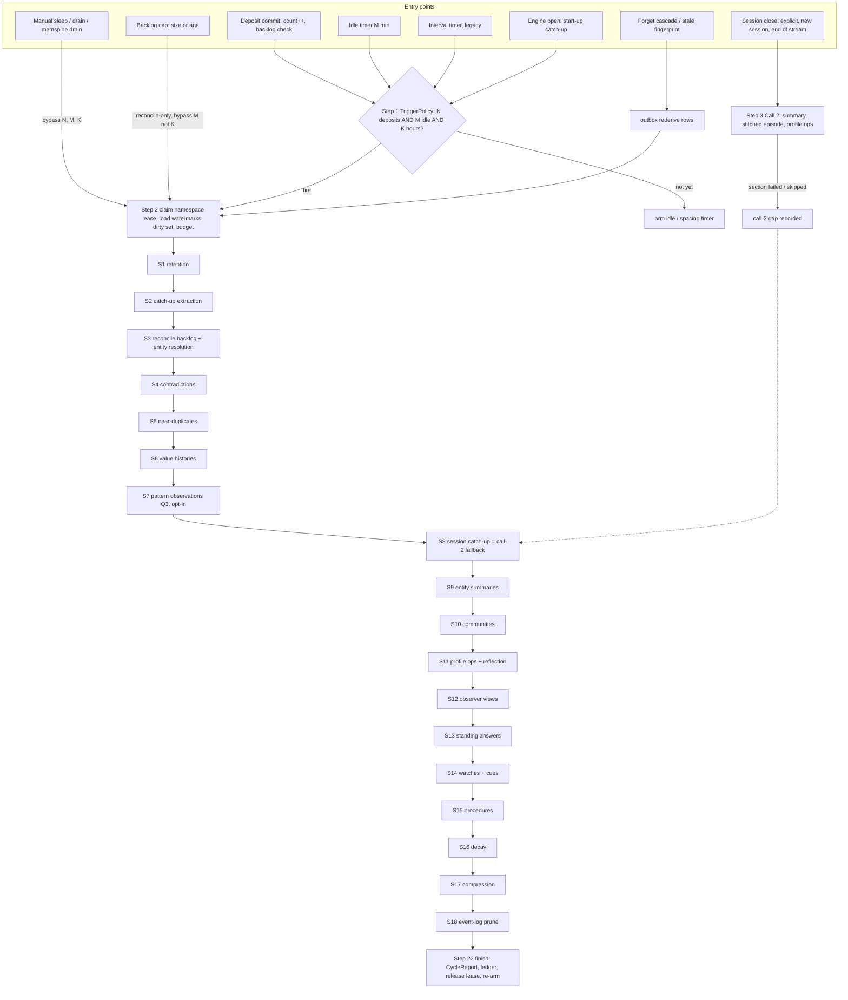

# Offline pipeline

The offline pipeline is everything MemSpine derives **after** a write has committed and returned: the session-close
call (call 2) and the background sleep cycle (call 3), started by deposits, idle time, a minimum gap since the last
run, an interval timer, a session close, a manual `sleep()`, engine start-up or a backlog cap. In the paper's terms it
is $\mathcal{K}_C$ (consolidate) and $\mathcal{K}_P$ (personalise). It reads the event log and the L0/L1 records the
insert pipeline wrote, and it writes derived records (L1 maintenance, L2 summaries and episodes, L3 graph groupings,
L4 observations and profile, L5 standing answers, watches, cues and procedures), always with lineage, trust capped at
the weakest parent, a derivation fingerprint and `covers_seq`. It runs in the host process (G-19 A, inline runner) and
gets its restart safety from state persisted in the same store: the durable outbox (Q2), a per-namespace lease and
per-stage watermarks (O-03). **It is off by default** (O-02), so evaluations stay deterministic, and **no stage needs a
model**: every stage that can call one has a rules-only or skip mode (P-03, O-11, O-12).

Boundary: call 1 (window extraction) belongs to the insert pipeline (`insert.md`); this pipeline consumes its outputs
(L1 assertions, `pending_merge` rows, underived marks). Reading derived layers (lifting, freshness reporting) belongs to
the retrieve pipeline (`retrieve.md`).



## Entry points and triggers

All triggers are evaluated **per namespace** and only while a host process is alive (G-19 A). Nothing in this
pipeline runs unless `derive.triggers.enabled` is true, a manual verb is called, or a session is closed with call 2
configured. "Fire" means: create (or join) the namespace's sleep job (step 2).

| # | Entry point | Exact condition | Today (file:line) |
|---|---|---|---|
| E1 | **Deposit commit** (`DerivationScheduler.on_commit(ns, seq)`) | Every committed L0/L1 deposit increments the namespace's `deposits_since_run`. If `deposits_since_run >= N`, (re)arm the idle timer for M minutes. Also checks the backlog caps (E6). Never fires a job by itself while the namespace is active. | None; window idle timers only (`workers/windows.py:450-467`) |
| E2 | **Idle timer** (long-lived engine) | Fires when the namespace has had no deposit for M minutes AND `deposits_since_run >= N` AND `now - last_run_at >= K` hours. If K is not yet met, re-arm for `last_run_at + K`. | None |
| E3 | **Minimum gap K** | A guard on E2, E4, E6 and E9, not a trigger. A job never starts within K hours of the namespace's last completed run, except for manual verbs (E5). | None |
| E4 | **Interval timer** (legacy `workers.sleep_interval_seconds`) | Every `interval` seconds, evaluate every namespace with N=0, M=0, K=`interval`. Kept so v1 configs keep their behaviour (O-02 migration). Disabled on `:memory:` stores. | `workers/scheduler.py:37-81`; started at `engine.py:1566-1589` |
| E5 | **Manual** `Engine.sleep(ns=None)`, `Engine.drain()`, CLI `memspine drain` | Always fires; bypasses N, M and K; still takes the namespace lease (O-02). `sleep()` first flushes call-1 windows (today's behaviour). `drain()` only drains outbox rows and evaluates triggers (no forced cycle). | `engine.py:13314-13334` (sleep, global, no lease) |
| E6 | **Backlog cap** (O-10 B) | `pending_merge` + unreconciled outbox rows for the namespace exceed `backlog.max_items`, or the oldest is older than `backlog.max_age_minutes`. Fires a **reconcile-only** job (S2-S6). Bypasses M, respects K (`backlog.min_spacing_minutes` if set lower). | None; `workers/windows.py:808-812` drops oldest edge batches above `WINDOW_PENDING_EDGES_MAX` |
| E7 | **Session close** | `Engine.close_session(ns, session_id)`; a new session id observed in the same namespace; `flush_windows(final=True)` at end of a stream. Enqueues one outbox row `kind=session_close`; runs call 2 (step 3). Does **not** take the namespace lease. | `engine.py:13771-13786`, `workers/windows.py:421-427, 515-552`, stub `workers/pipelines.py:3669` |
| E8 | **Start-up catch-up** (`Engine.open()`) | Reclaim leases whose `lease_until < now`; resume `pending`/`leased` outbox rows; evaluate E2 for every namespace with `deposits_since_run > 0` using the persisted `last_deposit_at` (so idle time while no process ran counts); scan for stale derivation fingerprints (P-25). | `engine.py:1561-1565` (rolling prune at boot only) |
| E9 | **Forget cascade / re-derivation** (G-13 C, M-25 B, P-25 C) | A hard forget, erasure or retention expiry deletes affected derived records at once and enqueues `kind=rederive` rows; a stale fingerprint found at E8 enqueues the same. Drained as a single-stage job under the namespace lease, generation-checked. | `engine.py:9657` (forget), `:9699`, `:9731`; no re-derivation queue |
| E10 | **Budget** (O-05) | Not a trigger that starts work; a gate. A spent budget defers the rest of the cycle, keeps the work dirty and counted; deferred units count toward N, so the next E2 fires normally. | None |

### Trigger matrix

| Trigger | Condition (all must hold) | What runs | Lock taken | Model calls |
|---|---|---|---|---|
| Deposit commit | `deposits_since_run >= N` | Arms or re-arms the idle timer; checks backlog caps | None (counter update inside the deposit transaction) | None |
| Deposit commit | Backlog over size or age cap, `now - last_reconcile_at >= K_reconcile` | Reconcile-only job: S2-S6 | Namespace lease | Optional (S2, S3, S4) |
| Idle timer | M minutes idle, `deposits_since_run >= N`, `now - last_run_at >= K` | Full sleep job S1-S18 for that namespace | Namespace lease | Optional, budgeted |
| Idle timer | M minutes idle, N met, K **not** met | Nothing; re-arm for `last_run_at + K` | None | None |
| Interval timer (legacy) | Every `interval` s; N=0, M=0, K=`interval` | Full job for every namespace with dirty work, oldest dirty first | One namespace lease at a time | Optional, budgeted |
| Manual `sleep(ns)` | Always | Flush call-1 windows, then full job for `ns` (or every dirty namespace) | Namespace lease (waits for holder, see open question 1) | Optional, budgeted |
| Manual `drain()` / `memspine drain` | Always | Drain outbox rows (call 1, call 2, rederive), then evaluate E2/E6 | Outbox row lease per row; namespace lease for jobs it fires | Optional |
| Session close | Session has at least one live turn; call 2 enabled and model role bound | Call 2 (step 3), one structured call | Outbox row lease; short write lock per section deposit | One call (worker tier) |
| Session close | Call 2 off, no model, `on_missing_model: skip`, or budget spent | Records `session_closed` marker and a call-2 gap; S8 catches up at next sleep | Short write lock | None |
| Session idle past `passive_after` (no explicit close) | Last turn older than the horizon | Marked closed inside S8 at the next sleep; S8 runs its call-2 fallback | Namespace lease (inside job) | Optional |
| Engine open | Always at start | Reclaim expired leases; resume outbox; evaluate E2 for each namespace; stale-fingerprint scan | Lease reclaim is a conditional update | None until a job fires |
| Forget / erasure / retention expiry | A derived record had the erased record as parent | Delete derived now; `rederive` row; single-stage job | Write lock for the delete; namespace lease for the re-derivation | Optional (none when no role: delete only) |
| Stale fingerprint (P-25) | `derivation.fingerprint != current` | `rederive` rows, oldest-used last | Namespace lease | Optional, budgeted |
| Budget spent | Ledger total for (namespace, cycle) >= budget | Remaining model-calling stages defer; no-call fast paths and S1, S16-S18 still run | (inside job) | None further |

## Steps

Conventions for every step: "write lock" is the short per-namespace serialisation that every write verb holds
(today an in-process `asyncio.Lock`, `engine.py:13616`; in v2 the SQL transaction plus that lock), held only around a
deposit commit. "Lease" is the persisted namespace job lease of step 2. **Model calls never run under the write lock**
(F-04 note): a stage reads inputs, calls the model, then takes the write lock, re-checks that every parent is still
live (I72, `engine.py:13621`) and that the erasure generation is unchanged (G-13), and only then deposits.
Every derived record carries `layer`, `derivation.fingerprint`, `covers_seq`, lineage rows and `trust <= min(parents)`.
Every stage returns a `StageReport`.

### 1. Trigger evaluation

- **Purpose**: decide when a namespace needs a sleep job; keep idle namespaces free.
- **Runs when**: `derive.triggers.enabled` (off by default), or the legacy interval is set, or a manual verb.
- **Model call?** Never.
- **Input / Output**:
  ```text
  TriggerInput
    ns: str                      required  namespace
    event: TriggerKind           required  commit | idle_timer | interval | manual | open | backlog | rederive
    seq: int                     optional  committed event seq (commit only)
  NamespaceTriggerState          (persisted row, new, O-02/O-03)
    deposits_since_run: int      required
    last_deposit_at: datetime    required
    last_run_at: datetime|null   required  end of last completed full job
    last_reconcile_at: datetime|null
    deferred_units: int          required  from O-05 deferrals; counts toward N
  TriggerDecision
    fire: bool; job_kind: full | reconcile_only | rederive | none
    reason: str; next_check_at: datetime|null
  ```
- **Writes**: `NamespaceTriggerState` (updated in the same transaction as the deposit for E1); no events.
  **Reads**: outbox backlog counts, `NamespaceTriggerState`, config.
- **Failure and retry**: a failed evaluation is logged and re-evaluated at the next commit, timer or open. A process
  that exits before the idle timer fires defers the work to the next open (E8), documented behaviour (G-19).
- **Idempotency**: pure function of the persisted state and the clock; firing twice resolves at step 2 (one lease).
- **Ordering and locking**: no lock; timers are per namespace, one armed timer at a time (re-armed on commit).
- **Config**: `workers.sleep_interval_seconds` -> `derive.triggers.interval_seconds` (None);
  new `derive.triggers.enabled` (false), `derive.triggers.min_deposits` N, `derive.triggers.idle_minutes` M,
  `derive.triggers.min_spacing_hours` K (defaults: open question 2), `derive.backlog.max_items`,
  `derive.backlog.max_age_minutes`. HEAT trigger retired.
- **Today vs decided**: today a fixed global interval loop (`workers/scheduler.py:37-81`, started at
  `engine.py:1566-1589`) and `ConsolidationTrigger` with an unwired HEAT (`core/policies/consolidation.py:30-33`,
  warning at `workers/pipelines.py:416-432`). Decided: `memspine.derive.triggers.TriggerPolicy` (O-02 C), evaluated on
  commit, idle timer and open (G-19 A); legacy interval mapped to N=0, M=0. Work package **O4-01**.

### 2. Job claim: lease, watermarks, dirty set and budget

- **Purpose**: make one namespace job the only writer of derived state for that namespace, across processes, and
  bound its work to what changed.
- **Runs when**: a trigger fired (step 1) or a manual verb / rederive row.
- **Model call?** Never.
- **Input / Output**:
  ```text
  JobRequest
    ns: str; job_kind: full | reconcile_only | rederive; manual: bool; requested_by: str
  NamespaceLease                 (persisted row, new, O-03)
    ns: str PK; owner: str (process id + nonce); lease_until: datetime; job_id: str; heartbeat_at: datetime
  StageWatermark                 (persisted row, new, O-03)
    ns: str; stage: StageName; seq: int  (highest event seq the stage has committed for ns)
  DirtySet (in memory, per stage)
    events: [MemoryEvent] with seq > watermark, filtered to the kinds the stage consumes,
            excluding events the stage itself emitted
    neighbours: [record_id]  records one hop from a changed record (lineage, entity, session)
  DerivationBudget
    tokens_total: int|null (null = unlimited); spent: int; by_class: {reconcile, summarise, personalise, maintain}
  ```
- **Writes**: lease row (conditional insert/update: claim only if absent or `lease_until < now`); a `job_started`
  ledger row. **Reads**: watermarks, the log tail past the minimum watermark, budget config, ledger.
- **Failure and retry**: claim lost (another holder) -> the trigger is satisfied (for manual: open question 1). Holder
  dies -> lease expires after `lease.ttl_seconds`; heartbeat extends it every `ttl/3` while stages run; E8 or the next
  trigger reclaims it.
- **Idempotency**: watermarks start at 0 on first v2 run, so the first job is a full pass (O-03 migration); after that
  each stage only sees events past its own watermark.
- **Ordering and locking**: the lease is a store row (SQLite by default, Postgres in the server profile), so two
  processes on one file, or a REST host plus a CLI, never overlap (G-19). One job per namespace at a time. Jobs of
  different namespaces may run concurrently (open question 5) in order of oldest dirty first (open question 6).
- **Config**: new `derive.lease.ttl_seconds` (proposed 300), `derive.budget.tokens_per_cycle` (null = off, O-05),
  `derive.max_concurrent_jobs` (proposed 1 on SQLite).
- **Today vs decided**: today there is no lease and no namespace job: `run_sleep_cycle` loops stages, and every stage
  loops all namespaces (`workers/schedule.py:83-101`, `workers/pipelines.py:461, 885, 929, 2047`), O(store). Done-ness
  lives in log markers folded by an in-memory `SessionIndex` per process (`workers/pipelines.py:2985-3117`,
  `stage_marker` at `:2947`). Decided: `memspine.derive.job.NamespaceJob`, `NamespaceLease`, `StageWatermark` (O-03 B),
  budget `memspine.derive.budget.DerivationBudget` writing to the P-22 ledger (O-05 C). Package **O4-01** (after
  **F-04** outbox, **F-15** stage split).

### 3. Call 2 at session close

- **Purpose**: produce the session's artefacts at close, not at the next sleep: summary (L2), stitched episode (L2)
  and profile operations (L4), in one structured call (O-07 B).
- **Runs when**: E7 fires; layer L2 and/or L4 enabled for the template (Q1); a worker-tier role bound
  (`session_close`), or `on_missing_model` decides (P-03): `error` fails at start, `rules` writes the extractive
  summary only, `skip` records a call-2 gap.
- **Model call?** Optional role `session_close` (worker tier, thinking off, schema-constrained, P-01, P-04, P-15). One
  call per closed session.
- **Input / Output**:
  ```text
  SessionClosed                  (exists: workers/pipelines.py:221; fields marked new)
    namespace: str               required  (exists)
    session_id: str              required  (exists)
    windows: int                 required  window count (exists)
    member_ids: [str]            required  live turn ids (new)
    members_fp: str              required  fingerprint of member ids + content fingerprints (new)
    reason: explicit | new_session | end_of_stream | idle_fallback   (new)
  Call2Input
    turns: [Turn]                live, unquarantined, instruction-flagged turns wrapped as data (B9)
    fragments: [Record]          call-1 episode fragments of the session (L2, O-09 A)
    previous_summary: Record|null      for the incremental fold (O-08)
    card: ProfileCard|null       current card entries (O-19), persona excluded (O-18 A)
  Call2Result (wire, model output; compiled in code)
    summary: {text: str, folded: bool}                optional section
    episode: {text: str, cites_windows: [str], when: DateLabel}   optional section
    profile_ops: [ProfileOp]                          optional section
  ```
- **Writes**: per section, independently: an L2 summary record (channel `consolidation`, supersedes the previous with an
  `evolve_to` chain), an L2 stitched episode (parents = fragments, never deleting them), applied ProfileOps (L4,
  supersede-with-history for delete); `CONSOLIDATE` event with members and `session_close_done` marker keyed
  `(session, members_fp)`; ledger row. **Reads**: members, fragments, previous summary, card.
- **Failure and retry**: each section validated and deposited on its own; a failed section does not lose the others
  and is recorded as a call-2 gap for that section. The outbox row retries with backoff (`not_before`), then
  dead-letters after `outbox.max_attempts` (D-18 severity); S8 fills only the missing sections. Guard rejections
  (SummaryGuard: fewer than 35% distinct 4-grams, over cap, or a named entity of the previous version dropped) keep
  the old summary and are counted (O-08).
- **Idempotency**: key = hash(`session_close`, ns, session_id, members_fp, section, derivation fingerprint). A deposit
  whose key exists is skipped. Shared with S8, so an artefact is never produced twice (O-07).
- **Ordering and locking**: drained from the outbox after the session's queued call-1 windows (queue order per
  namespace, as today `workers/windows.py:474-490`); the model call runs outside the write lock; each section
  deposit takes the write lock, rechecks parents and generation. Does not take the namespace lease; collisions with
  a running S8 are resolved by the idempotency key under the write lock.
- **Config**: new `derive.session_close.enabled` (off), `llm.roles.session_close`, `derive.session_close.sections`
  (`[summary, episode, profile_ops]`), `consolidation.session_summary.rebuild_every` -> `derive.summary.rebuild_every`
  (8, `config/constants.py:709`), `CONSOLIDATION_SUMMARY_MAX_CHARS` -> `derive.summary.max_chars` (600).
- **Today vs decided**: today `session_close` is a stub that writes a `session_closed` marker
  (`workers/pipelines.py:3665-3699`), called from `engine.py:13753-13786` and `workers/windows.py:544-552`; summaries
  come from sleep `consolidate` (`workers/pipelines.py:435-517`, incremental fold `:721-774`). Decided:
  `memspine.derive.session.SessionCloser`, `SummaryGuard`, `EpisodeStitcher`, `ProfileOps` (O-07 B, O-08 C, O-09 B,
  O-18 B, M-14 B). Package **O4-02** (screen: G-C9-style on LoCoMo+cat5; f-gc9 was net +15 before the thinking fix).

### 4. S1 Retention

- **Purpose**: expire records past their profile's retention TTL before anything derives from them (G-14 D).
- **Runs when**: a retention class is configured for the profile (assistant: working and session records with TTL;
  regulated: explicit TTLs; coding: rolling log). Otherwise skipped.
- **Model call?** Never.
- **Input / Output**:
  ```text
  RetentionInput:  classes: [RetentionClass{match, ttl, applies_to_layers}]; now: datetime
  RetentionOutput: expired: [record_id]; held: [record_id] (legal hold); rederive_rows: int
  ```
- **Writes**: hard forget through the normal forget path (FORGET events, cascade, `memory.audit` event with ids and
  reason, G-15), `rederive` outbox rows for surviving derived parents (M-25). **Reads**: records by class, legal holds.
- **Failure and retry**: per-record failure reported as `partial`; retried next job. Watermark not used (time-driven).
- **Idempotency**: an already-forgotten record is skipped.
- **Ordering and locking**: first stage (O-04), under the lease; each forget takes the write lock.
- **Config**: `retention.classes` (`config/schema.py:1575`, empty) -> `ops.retention` per profile (G-14 D).
- **Today vs decided**: today `retention_expire` (`workers/pipelines.py:380-386`) prepended only when classes exist
  (`workers/schedule.py:94-95`), calling `engine.py:10740` `expire_retention`. Decided: same stage, per profile, under
  the namespace job (G-14 D, O-04). Package **T5-05**, **O4-01**. Time-driven gap: open question 4.

### 5. S2 Catch-up extraction for underived sources

- **Purpose**: derive L1 facts for every source that call 1 did not cover: marked underived under backpressure or
  budget (W-25 B, W-26 D), call-1 failures and dead letters retried, in-flight v1 buffers lost at upgrade (O-10
  migration), sources with no derived record at cut-over (G-19 migration).
- **Runs when**: L1 enabled (default-on when a write model is bound, Q1); underived sources exist.
- **Model call?** Optional role `window_extract` (same prompt v2 and ItemV1 schema as call 1, P-04); rules mode uses the
  GLiNER2/rules path (P-03, P-23); skip leaves them marked.
- **Input / Output**:
  ```text
  CatchUpInput:  sources: [record_id] with underived mark or no derived child; batch_tokens: int
  CatchUpOutput: assertions: [AssertionEnvelope] (compiled from ItemV1 in code); pending_merges: [PendingMerge];
                 still_underived: int
  ```
- **Writes**: L1 assertions through the semantic door (grounding, firewall, ladder, trust cap), `pending_merge` rows,
  clears the underived mark in the same transaction. **Reads**: underived marks, source turns, KNOWN lines.
- **Failure and retry**: per window as in call 1 (one repair re-ask, W-14 C); failed windows stay underived.
- **Idempotency**: deposits keyed by assertion key + occurrence (W-20, M-17); a re-run skips existing keys.
- **Ordering and locking**: after S1 (so expired turns are not extracted), before S3 (so new names join resolution).
  Model calls outside the write lock.
- **Config**: reuses `write.window_*` and `llm.roles.window_extract`; new `derive.catch_up.max_sources_per_cycle`.
- **Today vs decided**: today `extract_graph` extracts uncovered turns itself after taking call-1 edges
  (`workers/pipelines.py:1983-2190`, `take_edges` at `workers/windows.py:608-614`, which clears before ack), and the
  session miners `mine_facts` (`:3295`), `project_facts` (`:3394`) and `predict_calibrate` (`:3598`) mine per
  consolidated session. Decided: catch-up of underived sources (W-25 B, W-13 C, O-04); fate of the v1 session miners
  is open question 3. Packages **O4-01**, **W2-06**.

### 6. S3 Reconcile backlog and resolve entities

- **Purpose**: drain persisted `pending_merge` rows and resolve entity names with the staged ladder (O-10 B, O-11 C).
- **Runs when**: L1 enabled and pending rows exist; L3 projection updated when the graph layer is on.
- **Model call?** Optional role `resolve_entity` (batched, 50 names per call, one evidence line per side). Rules-only
  (stages 1-2) when `on_missing_model: rules` or the budget is spent.
- **Input / Output**:
  ```text
  PendingMerge (outbox row kind=pending_merge, new, W-19 B)
    id; ns; name: str; entity_type: str|null; mention_record_id: str; source_trust: float;
    co_mentions: [str]; evidence_line: str; created_at
  ResolutionDecision (exists as entity_resolved marker entries, workers/pipelines.py:1769-1778; new fields marked)
    name: str; target_entity_id: str|null; method: exact|alias|minhash|llm|contested|possible_same|new
    candidate: str|null; confidence: float (new); evidence_ids: [record_id]; group: int
  ```
- **Writes**: merges as reversible logged events (M-15), alias rows, `possible_same` links for low confidence (no
  merge, new link kind), contested-merge records (trust guard: |trust gap| > 0.2), acknowledgement of each pending
  row in the same transaction as its merge (O-10). Re-dirties S9 for each touched entity. **Reads**: pending rows,
  known entities scoped by type and co-mentions, alias table.
- **Failure and retry**: an LLM failure leaves rows pending (retried next job); rules decisions still commit.
- **Idempotency**: an acknowledged row is never re-applied; a merge event keyed by (name, target, evidence ids).
- **Ordering and locking**: before S4 (contradictions need resolved subjects). Ladder: (1) exact, alias, MinHash
  Jaccard 0.9 with the entropy gate and the generational/plural guard; (2) candidates restricted by type and
  co-mentions; (3) batched LLM. Each stage only narrows the next.
- **Config**: `memories.semantic.policies.extract_graph.resolve` (`off|rules|llm`) -> `derive.resolve.mode`;
  `ENTITY_RESOLVE_*` (`config/constants.py:460-481`: TOP_K 15, JACCARD 0.9, LLM_BATCH 50, TRUST_TOLERANCE 0.2) ->
  `derive.resolve.*`, thresholds to calibrate (RV17); new `derive.backlog.*` caps.
- **Today vs decided**: today resolution runs inside `extract_graph` once per sweep (`workers/pipelines.py:1713-1804`)
  using `EntityResolver` (`memories/associative/resolution.py:164-275`), with no type scoping, no possible-same link,
  and the pending edge buffer in memory (`workers/windows.py:608`, `:808`). Decided: `memspine.derive.reconcile.
  BacklogReconciler` and `memspine.derive.resolve.EntityResolver` with `ResolutionStage` list (O-10 B, O-11 C, W-19 B,
  M-15 B). Package **O4-03** (after **W2-09**).

### 7. S4 Contradictions and invalidation

- **Purpose**: catch cross-key contradictions ("moved to Ghent" vs "lives in Utrecht") and close validity, keeping
  history (O-12 C).
- **Runs when**: L1 enabled and new live facts since the watermark. Stage 3 (adjudication) only with a model bound.
- **Model call?** Optional role `adjudicate` (batched). Stage 1 only when no model or budget spent.
- **Input / Output**:
  ```text
  ContradictionCandidate: new_fact_id; old_fact_id; source: same_key | word_overlap | predicate_family | embedding
  ContradictionVerdict:   pair; verdict: supersede | contest | coexist; reason_code: str; adjudicator: rules|llm
  ```
- **Writes**: supersede (closes `valid_to`, `superseded_at`, history kept), contest (open conflict record), coexist
  (no change, verdict cached); CONFLICT events; re-dirties S6 and S13. **Reads**: new facts past the watermark;
  candidates = (B) top word-overlap facts on the same subject ∪ (C) same subject + predicate family, or embedding
  neighbours, inside the validity window; deduplicated, capped at about 5 per fact.
- **Failure and retry**: a failed adjudication leaves the pair unjudged and the fact's watermark not advanced past it.
- **Idempotency**: verdict keyed by (new, old, fingerprints); a re-run with the same pair returns the cached verdict.
- **Ordering and locking**: stage 1 (the deterministic 13-rung same-key ladder, W-21) always first; after S3; Q7: an
  undeclared attribute coexists unless extraction marked a change.
- **Config**: `extract_graph.contradictions` (opt-in) -> default-on when a model is bound (O-12 migration);
  `CONTRADICTION_CANDIDATES = 3` (`config/constants.py:869`) -> `derive.contradict.max_candidates` (5).
- **Today vs decided**: today `_retract_contradicted` (`workers/pipelines.py:1902-1957`) checks only `extract_graph`
  facts on the same subject by word overlap, top 3, one call each, inside `extract_graph` under the namespace lock
  (`:2048`, `:2287-2288`). Decided: `memspine.derive.contradict.ContradictionSweep` (O-12 C, W-21 B, M-12 B, Q7).
  Package **O4-03**.

### 8. S5 Near-duplicates

- **Purpose**: merge paraphrased repeats; the richer text wins; repeats raise a reinforcement count (O-13 B).
- **Runs when**: L1 enabled. No model.
- **Model call?** Never.
- **Input / Output**:
  ```text
  DedupPair: keep_id; drop_id; cosine: float; guard: pass | numbers_differ | dates_differ | negation_differs
  DedupOutput: merged: int; blocked_by_guard: int; reinforcement_updates: int
  ```
- **Writes**: merge event (dropped record archived with `evolve_to` keep), `support_count` increment on the kept
  record (M-07), lineage rows from the dropped record's parents. **Reads**: changed facts and their embedding
  neighbours.
- **Failure and retry**: per pair; failures leave both live.
- **Idempotency**: a merged record is archived, so it is not paired again.
- **Ordering and locking**: after S4 (do not merge a superseded value into a live one). QualifierGuard (code only)
  blocks merges differing in numbers, dates or negation.
- **Config**: `DEDUP_COSINE_THRESHOLD = 0.92` (`config/constants.py:55`) -> `derive.dedupe.threshold` per embedding
  model (needs measurement, RV17).
- **Today vs decided**: today dedup happens only at write time in the semantic door (corroborations); no sleep stage.
  Decided: `memspine.derive.dedupe.NearDuplicateMerger` + `QualifierGuard` (O-13 B; R-16 B boost off until
  screened). Package **O4-04**.

### 9. S6 Value histories

- **Purpose**: one compact, rebuildable "how did X change" note per (subject, attribute) (O-14 B, M-13).
- **Runs when**: L1 enabled (a code view, no new layer). No model.
- **Model call?** Never.
- **Input / Output**:
  ```text
  ValueHistoryView (projection, new)
    ns; subject_id; attribute; values: [{value, effective_from, effective_to, source_dates, record_id}]
    current: record_id|null; open_contests: [record_id]; covers_seq: int
  ```
- **Writes**: the view projection rows for changed keys only (no new facts, no events beyond a watermark).
  **Reads**: superseded, contested and live records with validity intervals for keys touched since the watermark.
- **Failure and retry**: rebuild the key from records; the view is disposable.
- **Idempotency**: deterministic; incremental result must equal a full rebuild (property test).
- **Ordering and locking**: after S4 and S5. A-B-A returns to A (RV05, depends on F-01 key identity).
- **Config**: new `derive.value_history.enabled` (true when L1 exists).
- **Today vs decided**: no v1 view (G-W29); history is in records (`core/records.py:165, 216`). Decided:
  `memspine.derive.history.ValueHistoryView` (O-14 B, M-13). Package **O4-04**.

### 10. S7 Pattern observations (Q3, opt-in L4)

- **Purpose**: one cited observation per recurring pattern ("Ilse goes climbing most weekends"), patterns only.
- **Runs when**: L4 `observations` enabled for the template (off by default). Needs measurement before default.
- **Model call?** Optional role `observe`, only for groups whose membership changed since the last cycle; groups
  are formed in code. Without a model: no observation is written (rules mode keeps the group as an uncited count only
  in the report).
- **Input / Output**:
  ```text
  PatternGroup: ns; subject_id; predicate_family; member_ids: [record_id]; recurrence: int; members_fp: str
  PatternObservation (Record, layer=L4, type=reflective, new)
    text: str; parents: member_ids (all cited); support_count: int; trust: min(parents); covers_seq: int
  ```
- **Writes**: L4 observation records (supersede the previous version of the same group), lineage rows. Re-dirties
  S13. **Reads**: L1 facts grouped by (subject, predicate family) with recurrence >= threshold.
- **Failure and retry**: failed wording keeps the previous observation; group stays dirty.
- **Idempotency**: key = (group key, members_fp, fingerprint); unchanged groups make no call.
- **Ordering and locking**: after S6 (Q3), before S8.
- **Config**: new `derive.observations.enabled` (false), `derive.observations.min_recurrence`.
- **Today vs decided**: none in v1 (`workers/schedule.py:59-71` miners are fact miners). Decided: Q3 reopened O-15 to
  "patterns only"; M-13 D. Package **O4-05** (gate: OP-Bench, PrefEval, MAB-CR non-inferior; under 0.05 extra sleep
  calls per turn).

### 11. S8 Session catch-up (call-2 fallback)

- **Purpose**: produce session artefacts for sessions with no committed call-2 result: call 2 failed, was skipped (no
  model, budget, tier off), or the session never closed explicitly (O-07 A). Also marks idle sessions closed.
- **Runs when**: L2 and/or L4 enabled and at least one session has a call-2 gap or passed `passive_after`.
- **Model call?** Optional (`summarize`, `reflect`); no model -> extractive summary
  (`core/policies/consolidation.py:127-142`), no profile ops.
- **Input / Output**:
  ```text
  SessionGap: ns; session_id; members_fp; missing_sections: [summary|episode|profile_ops]; reason
  Output: same records as step 3 for the missing sections only; passive sessions: [session_id]
  ```
- **Writes**: SESSION events (idle -> closed/passive, replayable, ADR-037), then the missing step-3 artefacts under the
  same idempotency key. **Reads**: session membership, `session_close_done` markers, gaps.
- **Failure and retry**: per session; failures keep the gap for the next job.
- **Idempotency**: the shared step-3 key; a session reopened by a later turn changes `members_fp`, so the summary is
  re-folded (old one archived with `evolve_to`).
- **Ordering and locking**: after reconciliation (S3-S7) and before the profile (S11), so summaries read reconciled
  facts (O-04).
- **Config**: `episodic.policies.consolidation.*` -> `derive.session.*`; `sessions.passive_after` ->
  `derive.session.idle_close_after`; `SESSION_GAP_MINUTES = 30`, `CONSOLIDATION_MIN_SESSION_RECORDS = 3`
  (`config/constants.py:170, 174`).
- **Today vs decided**: today `consolidate` summarises every closed session by gap detection across all namespaces
  (`workers/pipelines.py:435-517`), `session_lifecycle` passivates (`:821-865`), `reflect_profile` reflects
  (`:3484-3514`). Decided: `memspine.derive.session.SessionCatchUp` (O-07 A as fallback). Package **O4-02**.

### 12. S9 Entity summaries

- **Purpose**: one dated summary per changed entity (O-16 B), an extra grouping kind (M-19).
- **Runs when**: L3 enabled and `entity_summaries` on (off by default); graph projection present.
- **Model call?** Optional `summarize_entity`, batches of 30; no-call fast path when dated lines fit 2,000 characters;
  no role or failure -> newest lines that fit.
- **Input / Output**:
  ```text
  EntityWork: node_id; display_name; member_ids; members_fp; lines: [str]
  EntitySummary (Record, layer=L3, channel=entity_summary): text; parents=member_ids; trust=min; covers_seq
  ```
- **Writes**: summary record (supersedes the old), `entity_summarized` marker with fingerprint. **Reads**: `mentions`
  edges, live members.
- **Failure and retry**: failed batch falls back to extractive lines and is reported `partial`.
- **Idempotency**: membership fingerprint watermark; unchanged entities skip.
- **Ordering and locking**: after S3 and S4, so summaries never describe merged-away duplicates; S3 re-dirties.
- **Config**: `memories.associative.policies.entity_summaries` (`free_chars` 2,000, `batch_size` 30;
  `config/constants.py:439-442`) -> `derive.entity_summary.*`.
- **Today vs decided**: today `summarize_entities` (`workers/pipelines.py:2621-2786`) holds the namespace lock across
  the LLM batch (`:2659`). Decided: `memspine.derive.entity_summary.EntitySummariser`, model call outside the lock.
  Package **O4-06**.

### 13. S10 Communities

- **Purpose**: Leiden + LPA communities with summary parents (O-17 B, M-19 A).
- **Runs when**: L3 enabled and `community` on (off by default); `[community]` extra or `algorithm: lpa`.
- **Model call?** Optional `summarize` for parents of communities of 3 or more; extractive otherwise.
- **Input / Output**:
  ```text
  PartitionResult: ns; anchors: {node: anchor}; mode: full | incremental; collapsed: bool
  CommunityParent (Record, layer=L3): text; parents=member ids; trust=min; key=membership fingerprint
  ```
- **Writes**: parent records, `community` LINK events, `community_partition` MARKER deltas, archive of stale parents.
  **Reads**: graph edges except `community` and `mentions`.
- **Failure and retry**: per namespace and per community (`partial`); collapse guard keeps the old partition.
- **Idempotency**: membership-fingerprint key; `summary_keep_jaccard` keeps near-identical parents.
- **Ordering and locking**: after S9. No read leg until a global-question workload exists.
- **Config**: `memories.associative.policies.community` (`config/constants.py:74-119`) unchanged.
- **Today vs decided**: `reorganize` (`workers/pipelines.py:1176-1331`), unchanged in behaviour; moves into the
  namespace job. Package **O4-06**.

### 14. S11 Profile operations and reflection

- **Purpose**: keep a typed, capped profile card current through guarded operations; write one cited reflection per
  closed session (O-18 B, O-19 B, O-20 B).
- **Runs when**: L4 `profile` enabled (opt-in). Reflection off by default. Persona (`set_persona`) is never edited.
- **Model call?** Optional `reflect`, one per closed session, depth cap 2. Ops come from call 2 (step 3) or S8; this
  stage replays `profile_ops` for sessions with none committed and turns accepted reflections into ops.
- **Input / Output**:
  ```text
  ProfileOp (new, O-18): op: add|update|delete|none; entry_type: identity|attribute|relationship|instruction
    key: str; value: str; observed_at: date; stance: stated|inferred; cites: [record_id]
  ProfileCard (Record, layer=L4, new, O-19/M-20): entries: [CardEntry{key, type, value, cites, stance, since}]
    caps: per entry and total; inferred off by default
  Reflection (Record, layer=L4, type=reflective): text; evidence ids; depth <= 2; trust=min(evidence)
  ```
- **Writes**: card entries (delete = supersede with history), reflection records. Applied only if newer, cited,
  within caps and stated (unless inferred enabled). **Reads**: reconciled facts, value histories, observations (if
  on), session summaries.
- **Failure and retry**: rejected ops counted; a failed reflection retries next job.
- **Idempotency**: op key = (session, entry key, value, observed_at); reflections keyed `reflected:<session>`.
- **Ordering and locking**: after S3-S8, so the profile never builds on facts this cycle invalidates (O-04). Lowest
  priority under budget with S13 (O-05).
- **Config**: `consolidation.reflect_profile` -> `derive.profile.reflect`; `PROFILE_HEADER_TOP_K = 8`,
  `PROFILE_PACK_MAX_SHARE = 0.5` (`config/constants.py:327, 705`); `REFLECTION_DEPTH_CAP = 2` (`:122`). The
  `PROFILE NOTES` header is retired when the card is on.
- **Today vs decided**: today `reflect_profile` (`workers/pipelines.py:3484-3514`) runs **before** `extract_graph`
  (`workers/schedule.py:32-53`), writing uncited-as-card insights; persona at `engine.py:9611`. Decided:
  `memspine.derive.profile.ProfileOps`, `ProfileCard`, `memspine.derive.reflect.Reflector`. Package **O4-07**.

### 15. S12 Observer views

- **Purpose**: "about X as seen by Y" views for the multi-agent template (O-26 B, M-24 C).
- **Runs when**: `multi_agent` template only. No model by default (card wording optional).
- **Model call?** Optional; the fact list is built in code from perspective tags.
- **Input / Output**:
  ```text
  ObserverView (Record, layer=L4, new): observer_id; subject_id; fact_ids: [record_id]; card: ProfileCard
    trust = min(parents); grant scope respected (G-07 reach bound)
  ```
- **Writes**: view records per changed (observer, subject) pair. **Reads**: `spk`, `addr`, participants (M-08) and
  grants.
- **Failure and retry**: per pair. **Idempotency**: key = (observer, subject, members_fp).
- **Ordering and locking**: after S11 (same card schema). Bounded by budget (pairs grow quadratically).
- **Config**: new `derive.observer_views.enabled` (template).
- **Today vs decided**: none; tags at `core/perspective.py:163`. Decided: `memspine.derive.views.ObserverViews`.
  Package **O4-11**.

### 16. S13 Standing answers

- **Purpose**: refresh host-registered standing questions by section edits when a cited source moves (O-21 B).
- **Runs when**: L5 enabled and questions registered (later scope).
- **Model call?** Optional, one per changed answer.
- **Input / Output**:
  ```text
  StandingQuestion: id; ns; text; sections: [str]
  StandingAnswer (Record, layer=L5, new): question_id; sections: [{text, cites, covers_seq}]
  ```
- **Writes**: only changed sections; unchanged sections stay byte-identical; citations pruned when parents are
  forgotten. **Reads**: facts, value histories, summaries and pattern observations (Q3) past each section's
  `covers_seq`.
- **Failure and retry**: section keeps its old text, reported stale (O-06). **Idempotency**: section key + covers_seq.
- **Ordering and locking**: after S11. Lowest budget priority.
- **Config**: new `derive.standing.enabled` (false).
- **Today vs decided**: none (G-W39). Decided: `memspine.derive.standing.StandingAnswers`. Package **O4-08**.

### 17. S14 Watches and cues

- **Purpose**: (A, always on with prospective memory) surface watches due or invalidated, pull delivery via
  `Engine.due()`; (B, opt-in) write anticipated-question cues as retrieval keys, never content (O-23).
- **Runs when**: watches: `memories.prospective.enabled`; cues: `derive.cues.enabled`.
- **Model call?** Watches never; cues optional `anticipate`, one per closed session, low budget priority.
- **Input / Output**:
  ```text
  WatchReport: due: int; invalidated: int; fired: [record_id]
  Cue (Record, tag=cue, new layer field: L5 key): text; target_turn_id; trust <= target; firewall screened
  ```
- **Writes**: watches: none (read-only log line); cues: cue records through `add_cues`. **Reads**: prospective
  records, CONFLICT events since the watermark, closed sessions.
- **Failure and retry**: per namespace / per session. **Idempotency**: cue stage marker per session.
- **Ordering and locking**: watches first, then cues; after S13. Cues never enter assembled context (H8).
- **Config**: `consolidation.anticipate` -> `derive.cues.enabled`.
- **Today vs decided**: `check_watches` (`workers/pipelines.py:977-1041`, one full log scan for CONFLICT),
  `anticipate` (`:3446-3481`) runs early today (`workers/schedule.py:35`). Decided: `memspine.derive.prospective.
  Watches`, `CueWriter`; watch invalidation reads only events past the watermark. Package **O4-10**.

### 18. S15 Procedures

- **Purpose**: template lessons from outcome receipts (A, always on with procedural memory); slot-filled cases from
  trajectories when capture is on (B, advisory only) (O-24).
- **Runs when**: procedural memory enabled; cases only with trajectory capture.
- **Model call?** Lessons never; cases optional, one extraction call per trajectory into fixed slots.
- **Input / Output**:
  ```text
  OutcomeReceipt (exists: memories/procedural/lessons.py:52)
  LessonCase (Record, layer=L5, new): lesson_key; steps; preconditions; outcome; stage=ADVISORY
  ```
- **Writes**: lessons keyed by `lesson_key` (`lessons.py:117`), reinforcement on repeat. **Reads**: receipts and
  trajectories since the watermark.
- **Failure and retry**: slot validation failure drops the case (counted). **Idempotency**: lesson key.
- **Ordering and locking**: after S14. A case cannot carry instructions outside its slots.
- **Config**: new `derive.procedures.cases` (false).
- **Today vs decided**: lessons exist outside the sleep cycle (`memories/procedural/lessons.py:52-117`). Decided:
  `memspine.derive.procedural.LessonBuilder`, `CaseExtractor`. Package **O4-10**.

### 19. S16 Decay

- **Purpose**: lossless access tiers hot -> warm (7 d) -> cold (30 d) -> dormant (90 d); access restores hot (O-22).
- **Runs when**: always (in the job). **Model call?** Never.
- **Input / Output**:
  ```text
  TierInput:      records of ns (not deleted, not quarantined, not pinned); now: datetime; DecayPolicy per type
  TierTransition: record_id: str; from_tier: hot|warm|cold|dormant; to_tier: same enum; reason: idle   (today)
  ```
- **Writes**: DECAY_TRANSITION delta events (never snapshots). **Reads**: records, `last_accessed_at`.
- **Failure and retry**: per record (`partial`). **Idempotency**: emits only on a tier change.
- **Ordering and locking**: after all derivation; quarantined and pinned records frozen. Tiers do not change ranking.
- **Config**: `DECAY_*_DAYS` (`config/constants.py:131-133`) -> `derive.lifecycle.*`.
- **Today vs decided**: `decay_sweep` (`workers/pipelines.py:868-918`), O(store) every cycle. Decided:
  `memspine.derive.lifecycle.TierSweep`; per namespace. Time-driven gap: open question 4. Package **O4-09**.

### 20. S17 Compression

- **Purpose**: zstd cold content with no change in meaning; build multi-resolution text (gist, note, full pointer)
  for derived units when M-22 passes its gate.
- **Runs when**: always for cold-tier zstd; multi-resolution behind `derive.multires.enabled`.
- **Model call?** zstd never; gist/note optional (worker tier) after M-22 screen.
- **Input / Output**:
  ```text
  CompressInput:  records with tier=cold (CompressionPolicy.should_compress), RetentionPolicy legal holds
  CompressResult: record_id: str; content_zstd: bytes (today); res: {gist, note, full_ptr}|null (new, M-22)
  ```
- **Writes**: DECAY_TRANSITION delta with compressed content. **Reads**: cold records, legal holds.
- **Failure and retry**: per record. **Idempotency**: `should_compress` false once compressed.
- **Ordering and locking**: after S16; legal hold skips; zstd off the event loop (`asyncio.to_thread`).
- **Config**: compression policy per type; `config/schema.py:1007` `gist_after` -> `derive.multires.*`.
- **Today vs decided**: `compress` (`workers/pipelines.py:921-974`); `sleep_compute` no-op hook after it
  (`:1060-1066`, `workers/schedule.py:50-52`), not in O-04 (open question 3). Package **O4-09**.

### 21. S18 Event-log prune

- **Purpose**: rolling-log retention (coding profile) (G-14 D).
- **Runs when**: `event_log.mode = rolling` only. **Model call?** Never.
- **Input / Output**:
  ```text
  PruneInput:  mode: rolling; retention_days: int; watermarks: [StageWatermark]; pending OutboxRow source seqs
  PruneResult: pruned: int (today); cutoff: datetime; min_watermark_seq: int (new)
  ```
- **Writes**: deletes applied events older than `retention_days` **and** below every stage watermark and every
  pending outbox row's source seq. **Reads**: watermarks, outbox.
- **Failure and retry**: next job. **Idempotency**: by cutoff.
- **Ordering and locking**: last stage; also at engine open (`engine.py:1561-1565`).
- **Config**: `event_log.mode`, `event_log.retention_days` (`config/schema.py:43-50`).
- **Today vs decided**: `event_log_prune` (`workers/pipelines.py:407-413`) prunes by age only, unaware of markers.
  Decided: watermark-aware prune (new safety condition, follows from O-03 and Q2). Package **T5-05**.

### 22. Job finish: report, ledger, release

- **Purpose**: publish what ran, what was deferred and how fresh each layer is; release the lease; re-arm triggers.
- **Runs when**: always at the end of a job, including after a failed stage.
- **Model call?** Never.
- **Input / Output**:
  ```text
  FinishInput:  job_id; ns; stage_reports: [StageReport]; budget: DerivationBudget
  FinishOutput: CycleReport (see shared types); NamespaceTriggerState updated
  ```
- **Writes**: ledger rows per stage (calls, tokens, retries, failures, deferred, p50/p95, G-20), `NamespaceTriggerState`
  (`last_run_at`, `deposits_since_run = deferred_units`), lease delete. **Reads**: stage reports.
- **Failure and retry**: if the process dies here, the lease expires; watermarks already committed stay.
- **Idempotency**: report keyed by job id.
- **Ordering and locking**: under the lease until the delete. A degraded stage (`error`/`partial`) logs
  `memory.sleep_degraded` loudly (today `engine.py:13326-13333`).
- **Config**: `observability.*` -> `ops.ledger`.
- **Today vs decided**: today `sleep()` returns `dict[str, dict]` and logs degradation; no ledger for sleep layers
  (G-W13 open half). Decided: `CycleReport` + `StageLedger` (O-05, G-20 C, P-22 C). Package **O4-01**, **T5-06**.

## Scenarios

| # | Scenario | Expected behaviour | Step | Test |
|---|---|---|---|---|
| 1 | Default install, no trigger config | No job ever starts; evals deterministic; `sleep()` still works | 1 | `tests/unit/workers/test_scheduler.py`; to add (O-02 off) |
| 2 | Trigger storm: 1,000 deposits in a burst | Counter rises, idle timer re-armed, no job until M idle; one job | 1 | to add (fake clock) |
| 3 | Steady chat, never idle for M | No full job mid-conversation; backlog cap fires reconcile-only if exceeded | 1, 6 | to add |
| 4 | Idle reached but K not met | Re-armed for `last_run_at + K`; no job | 1 | to add |
| 5 | Manual `sleep()` while an idle-triggered job holds the lease | Never two jobs on one namespace; manual waits or reports busy (open question 1) | 2 | to add (concurrency) |
| 6 | Two processes on one SQLite file (REST host + CLI) | Lease row arbitrates; second process skips the namespace | 2 | `tests/integration/test_concurrent_engines.py` (extend) |
| 7 | Holder process killed mid-stage | Lease expires; E8 reclaims; resumes from the last committed watermark; no duplicate effects | 2, 22 | RV01 to add; `tests/integration/test_dbos_crash_resume.py` pattern |
| 8 | Kill after inference, before deposit (call 2) | Outbox row returns to pending; call repeated once; exactly one summary | 3 | RV01 to add |
| 9 | Kill after partial deposit of S2 batch | Re-run skips existing assertion keys; remaining items deposited | 5 | RV01 to add |
| 10 | Partial stage failure (one entity summary batch fails) | Stage `partial`, extractive fallback for that batch, other stages run | 12 | `tests/unit/test_entity_summaries.py` |
| 11 | Process exits before the idle timer fires | Work waits; next `open()` evaluates idle from `last_deposit_at` | 1 (E8) | to add |
| 12 | Short-lived CLI / serverless host | `memspine drain` from a host cron completes outbox rows and fires due jobs | 1, 2 | to add |
| 13 | Call 2 `profile_ops` section invalid, summary valid | Summary and episode deposited; profile gap recorded; S8 fills only `profile_ops` | 3, 11 | to add (O-07 fault test) |
| 14 | Call 2 and S8 race on the same session | Idempotency key under the write lock: one artefact | 3, 11 | to add |
| 15 | Session never closed explicitly | S8 marks it closed after `idle_close_after` and runs the fallback | 11 | `tests/unit/memories/test_session_lifecycle.py` (extend) |
| 16 | Closed session gets a late turn | `members_fp` changes; summary re-folded; old archived with `evolve_to` | 3, 11 | `tests/unit/workers/test_session_summary_incremental.py` |
| 17 | Degenerate summary (repeating loop, over cap, dropped "Abraham") | SummaryGuard rejects; old summary kept; rejection counted | 3 | to add (O-08 unit) |
| 18 | No model configured, `on_missing_model: error` | Start fails naming the feature (P-03) | 3, 5-7 | to add (start-up matrix) |
| 19 | No model, `on_missing_model: rules` | Extractive summaries, rules-only resolution and same-key ladder; no calls | 3, 6, 7 | `tests/unit/test_entity_resolution.py` (rules) |
| 20 | Budget spent after S4 | S5, S6 (no call) run; S7-S15 model work deferred, counted, re-dirtied; finished next cycle | 2, 22 | to add (O-05) |
| 21 | Very large namespace (1M records, first v2 run) | Watermarks 0: full pass in chunks with heartbeats; later runs incremental | 2 | to add (scale) |
| 22 | Many tenants, one busy | Oldest-dirty-first ordering; busy tenant's budget does not starve others | 2 | to add |
| 23 | "Moved to Ghent" after "lives in Utrecht" | S4 stage 2 candidate; verdict supersede; history kept; S6 shows both | 7, 9 | `tests/unit/test_cross_key_contradiction.py` (extend) |
| 24 | A, then B, then A for one attribute | Value history returns to A; no duplicate A record | 9 | to add (RV05, F-01) |
| 25 | Homonyms: two people named Ilse | Type and co-mention scoping keeps them apart; low confidence -> possible-same link | 6 | `tests/unit/test_entity_resolution.py` (extend) |
| 26 | Nickname: "Bram" for "Abraham" | Stage 3 LLM merges within trust tolerance | 6 | to add |
| 27 | Low-trust source names a high-trust entity | Trust guard: contested, no merge | 6 | `tests/unit/test_entity_resolution.py` |
| 28 | Near-duplicates differing in a number ("3 cats" vs "4 cats") | QualifierGuard blocks merge | 8 | to add |
| 29 | Hard forget of a turn during a running job | Derived children deleted at once; generation check stops the in-flight deposit; I72 skip audited; rederive queued | 2, all | `tests/unit/test_forget_miner_race.py`, `tests/integration/test_erasure_persistence.py` |
| 30 | Erasure of one parent of a summary with five parents | Summary deleted, re-derived from survivors (or deleted when no role) | E9 | to add (M-25) |
| 31 | Retention expires a parent of a card entry | S1 forgets; cascade; entry re-derived or removed; audit event with ids only | 4 | `tests/unit/core/policies/test_retention.py` (extend) |
| 32 | Injection text inside a turn feeding call 2 | Flagged turn wrapped as data; derived output passes the firewall; trust capped | 3 | `tests/unit/test_review_write_fixes.py` pattern; to add |
| 33 | Quarantined turn in a session | Never read by any stage | 3, 5, 11 | existing `_live_members` tests; to add for v2 |
| 34 | Profile op older than the card entry | Rejected (must be newer, cited, within caps) | 14 | to add (O-18 guard) |
| 35 | Reflection wants to enter the card | Only through the ops path; `PROFILE NOTES` header off when card on | 14 | `tests/unit/test_reflect_profile.py` (extend) |
| 36 | Observer view: what Bram told Ilse about a third party | Appears only in Ilse's view of that party, not in others; reach bound holds | 15 | to add (metamorphic, N1) |
| 37 | Standing answer cites a forgotten fact | Citation pruned; section re-derived; unchanged sections byte-identical | 16 | to add |
| 38 | Cue generated for a session | Stored as retrieval key; never in assembled context | 17 | `tests/unit/test_anticipatory_cues.py` |
| 39 | Ephemeral log mode | Session stages report skipped (no log); watches by due time only | 2, 17 | `tests/integration/test_event_log_modes.py` |
| 40 | `:memory:` store with interval set | Interval timer disabled with a warning | 1 | `tests/unit/test_engine_scheduler.py` |
| 41 | Rolling log prune with a stage behind | Prune stops at the minimum watermark | 21 | to add |
| 42 | Legal hold on a cold record | Not compressed, not expired | 4, 20 | `tests/unit/core/policies/test_compression.py` |
| 43 | Prompt or model change (fingerprint differs) | E8 scan enqueues rederive, oldest-used last, budgeted | E9 | to add (P-25) |
| 44 | Clock moves backwards | K and M computed on monotonic time in-process, persisted times compared with tolerance; no double fire | 1 | to add |
| 45 | Outbox row fails N times | Dead-letter with failure class; counted in report; never silently dropped | 3, 5 | to add (W-14) |
| 46 | Server profile: Neo4j projection lags | Graph writes only via outbox; S9/S10 read after projection watermark; rebuild from log | 12, 13 | to add (Q4 gate) |
| 47 | Repair of a tainted session | `stage_cleared` re-dirties; clean members processed once | 11 | `tests/unit/test_engine_repair.py` |

## Shared data types used here

Field status: **today** = exists in v1 code; **new** = defined by the decision named.

```text
OutboxRow                                   (new; G-19 A + Q2, W-13 C, W-02 D)
  id: str                       required  new
  namespace: str                required  new
  kind: window|session_close|sleep_stage|heavy_projection|rederive|pending_merge   required  new
  source_ids: [{id, version}]   required  new
  fingerprint: str              required  derivation fingerprint (P-12)  new
  generation: int               required  erasure generation (G-13)  new
  status: pending|leased|done|failed|dead   required  new
  attempts: int; lease_owner: str|null; lease_until: datetime|null; not_before: datetime|null
  last_error: str|null; failure_class: raised|malformed|valid_empty|truncated|size_skip|partial_commit (W-14)  new

NamespaceLease                              (new; O-03 B, G-19)
  ns: str PK; owner: str; job_id: str; lease_until: datetime; heartbeat_at: datetime

StageWatermark                              (new; O-03 B)  replaces today's stage_done / graph_extracted /
  ns: str; stage: StageName; seq: int       entity_summarized MARKERs (workers/pipelines.py:2947, 3044-3060)

NamespaceTriggerState                       (new; O-02 C)
  ns; deposits_since_run: int; last_deposit_at; last_run_at; last_reconcile_at; deferred_units: int

StageName (enum, new; O-04 B + Q3; v1 aliases kept for config)
  retention(retention_expire) | catch_up_extract(mine_facts, project_facts, predict_calibrate?) |
  reconcile_resolve | contradictions | near_duplicates | value_histories | observe_patterns |
  session_catch_up(consolidate, session_lifecycle) | entity_summaries(summarize_entities) |
  communities(reorganize) | profile(reflect_profile) | observer_views | standing_answers |
  watches_cues(check_watches, anticipate) | procedures | decay(decay_sweep) | compress | log_prune(event_log_prune)

StageReport                                 (today: dict, workers/pipelines.py:399-404; typed new, G-20 C)
  stage: StageName; status: ok|partial|skipped|error|noop     today
  reason: str|null; errors: [str]                              today
  calls: int; tokens_in: int; tokens_out: int; tokens_cached: int; retries: int   new (P-22)
  produced: int; deferred: int; guard_rejections: int; p50_ms; p95_ms              new (O-05, O-08)
  watermark_from: int; watermark_to: int                                           new (O-03)

CycleReport                                 (new; O-05, G-20)
  job_id; ns; job_kind; manual: bool; started_at; ended_at
  stages: [StageReport]; budget: {total, spent, by_class}; deferred_total: int
  freshness: {layer: newer_sources_than_covers_seq}   (O-06)

MemoryEvent                                 (today: core/events.py)
  kind: EventKind; namespace; actor; payload; seq        today
  schema_version: int                                    today =1; upcast to 2 (M-26)

Record (one shape for all layers)           (today: MemoryRecord, core/records.py:174)
  record_id; namespace; memory_type -> type tag (M-03)  today
  layer: L0..L5                                          new (M-02, Q1)
  content; entity; attribute; tags; status; tier; content_zstd   today
  valid_from; valid_to; recorded_at; superseded_at       today; event interval + precision new (M-10)
  trust: float                                           today; <= min(parents) (D-47 §5, G-08)
  source.parents: [str]                                  today; mirrored as LineageEdge rows (M-09)
  src_class: user_stated|assistant_proposed|user_confirmed|tool|document|external|derived   new (M-07)
  support_count: int                                     new (M-07; seeded from corroborations, O-13)
  derivation: {policy, prompt, schema, model, key_v, fingerprint}   new (M-26, P-12)
  covers_seq: int|null                                   new (O-06; null = stale for v1 records)
  res: {gist, note, full_ptr}|null                       new (M-22)

LineageEdge                                 (new; M-09 C)
  child_id; parent_id; parent_version; role: member|evidence|merged_from|cites; span: {line, start, end}|null

AssertionEnvelope                           (new; M-06 B, W-15 C)  produced by S2, read by S3-S7
  text; value; evidence[{source_id, source_v, span}]; spk; sub[]; modality; polarity; kind; occurrence_id; times

SessionClosed, Call2Result, ProfileOp, ProfileCard, PendingMerge, ResolutionDecision, ContradictionVerdict,
ValueHistoryView, PatternObservation, ObserverView, StandingAnswer, Cue, LessonCase: defined in their steps above.
```

## Open questions for the owner

1. **Manual `sleep()` when the namespace lease is held.**
   - **A (recommended): wait for the holder, then run a fresh job if the namespace is still dirty.** Keeps v1's
     contract that `sleep()` returning means the work is done, which the eval harness relies on.
   - B: return at once with `status: busy` and the holder's job id. Never blocks, but callers must poll.
   - C: queue one follow-up job and return. Non-blocking, but `sleep()` no longer means "done".
2. **Default N, M, K and backlog caps when triggers are switched on.**
   - **A (recommended): N = 25 deposits, M = 15 minutes, K = 6 hours; backlog 500 items or 30 minutes; set in the
     assistant preset, then calibrated on the measured cost per cycle (G-05).** Conservative spend.
   - B: N = 1, M = 5, K = 1: fresher layers, more cycles.
   - C: leave unset; a host that enables triggers must choose them (fails at start otherwise).
3. **The v1 stages O-04 does not name** (`mine_facts`, `project_facts`, `predict_calibrate`, `list_cards`,
   `rule_edges`, the `sleep_compute` hook).
   - **A (recommended): fold the miners into S2 as flag-selected catch-up modes, `rule_edges` into S3, and drop the
     `sleep_compute` hook in favour of the stage registry; each mode retires through the G-22 budget unless screened.**
     One stage list, no hidden extras.
   - B: keep them as separately registered stages after S2. No behaviour change, but the order is no longer the one
     O-04 fixed.
   - C: retire them now (F-14). Smallest code, but loses screened arms (`mine_facts` feeds list cards).
4. **Time-driven maintenance for quiet namespaces.** Under O-02 a namespace with no new deposits never fires, so
   retention TTLs (G-14), decay tiers and due watches never advance there.
   - **A (recommended): a second, model-free maintenance trigger per namespace on time alone (default daily) that runs
     only S1, S14 watches, S16, S17 and S18 under the same lease.** Retention stays compliant; no model spend.
   - B: accept the gap; tiers do not affect ranking and watches are pull-based. Retention then expires late.
   - C: run the maintenance stages at every engine open only.
5. **Concurrent namespace jobs in one process.**
   - **A (recommended): 1 on the embedded SQLite profile, configurable (default 4) on the server profile.** SQLite has
     one writer; Postgres does not.
   - B: always 1. Simplest, slow for many tenants.
   - C: unbounded. Risks model-server overload.
6. **Order across dirty namespaces.**
   - **A (recommended): oldest dirty first.** Bounds the staleness that O-06 reports.
   - B: most dirty first. Clears the largest backlog, can starve small tenants.
   - C: round-robin. Fair but ignores age.

## Owner decisions (2026-10-13)

These settle the open questions above; where they differ from a recommendation, the owner's answer wins.

| Id | Answer | Reading |
|---|---|---|
| OF-1 | sleep() is non-blocking (owner) | sleep() enqueues a job and returns a handle {job_id, status} at once; `await handle.wait()` or `await memory.wait_for_pending()` waits (eval harness and tests only). Per namespace at most one running job and one pending follow-up: concurrent sleep() calls coalesce onto the same follow-up handle. Jobs hold a persisted lease and resume from per-stage watermarks after a crash. |
| OF-2 | Triggers: (N deposits AND M idle) OR C context pressure (owner) | Full sleep when N new deposits AND M minutes idle; compression when context (working) memory passes C, configurable, default 70% of the context budget. A minimum gap K applies to BOTH trigger kinds (owner). Values are configuration, calibrated on measured cost per cycle. |
| OF-3 | Fold v1 stages into the decided order | Miners become flag-selected modes of catch-up extraction, rule_edges joins reconcile, the sleep_compute hook is replaced by the stage registry; each mode is retired unless a screen keeps it. |
| OF-4 | Daily model-free maintenance trigger | Per namespace, on time alone (default daily): retention, due watches, decay, compression, log prune; no model calls. |
| OF-5/6 | Job pool per profile, oldest dirty first | 1 concurrent namespace job on embedded SQLite, configurable (default 4) on the server profile; oldest dirty namespace first; one global semaphore matched to model-server slots. |
| RT-1 | Outbox = truth, taskiq = transport (owner) | Every job is written to the SQL outbox in the same transaction as its event; taskiq carries job ids to workers (InMemoryBroker in library mode; Redis/NATS/RabbitMQ broker and separate worker processes in server mode); a worker marks the row done; unfinished rows are re-sent on start. |
| RT-2 | Async core + dedicated executors | All orchestration async (TaskGroup, timeouts, cancellation); GPU encoders (embedder, Jina) each in one dedicated thread executor with micro-batching; blocking DB/index I/O in a bounded thread pool; model calls async over HTTP behind a global semaphore; a process pool only for CPU-heavy parsing. |
| RT-3 | Four priority classes, reads first | 1 interactive read, 2 write hot path, 3 online extraction (calls 1 and 2), 4 sleep and maintenance; higher classes go first, lower classes keep a guaranteed minimum share. |
| RT-4 | Backpressure: coalesce + budget, never drop | Windows coalesce into larger batches, the oldest backlog is marked underived (raw stays searchable), writes never block; backlog-age metric and alert. |

## Change log

- 2026-10-13: First version from `areas/offline.md` (O-01..O-26, Q3), `areas/model.md`, `areas/govern.md` (G-13,
  G-14, G-19), `areas/write.md` (W-13, W-19, W-25, W-26), `areas/models.md` (P-03, P-12, P-22, P-25) and the code at
  `src/memspine/workers/` and `engine.py` on `feat/local-qwen-stack`: 22 steps (18 sleep stages), 47 scenarios,
  6 open questions.
- 2026-10-13: open questions answered by the owner (section 'Owner decisions').
