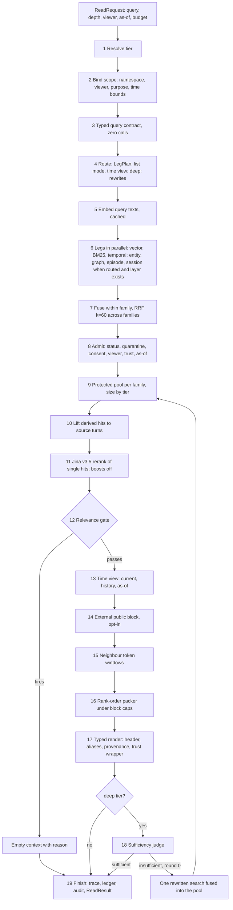

# Retrieval pipeline

The retrieval pipeline turns one question into one bounded, typed context for a reader model. It covers the
retrieve operator $\mathcal{R}$ (scope, contract, route, legs, fusion, pool, lift, rerank, gate, time view) and
the compose operator $\mathcal{C}$ (windows, packing, typed render with provenance and trust wrapping), plus the
opt-in deep tier and the opt-in public-knowledge block. It reads projections only (records, vectors, lexical
index, graph when present) and never writes memory content: the event log stays the truth, and the only events a
read may append are the read audit (shared and regulated profiles) and ledger rows. The default tier (`fast`)
makes **no model call**; Jina v3.5 reranks every read wherever it is installed (Q5, Q6). Decisions: R-01 to R-26
(`areas/read.md`), P-17 to P-21 (`areas/models.md`), G-09, G-12, G-13, G-15, G-16 (`areas/govern.md`), M-05,
M-09, M-10, M-11 (`areas/model.md`). Work packages R3-01 to R3-15, F-10, F-11, T5-02 (`PLAN.md`).

Measured anchors (the only measured numbers in this file; everything else is an estimate or a target):

| Anchor | Value | Source |
|---|---|---|
| clean-jina-full (v1 reference; arm `scr-pool-protect-jina`, `--topk 10`) | **81.4%** on 1,540 LoCoMo cat 1-4 (multi-hop 66.7, temporal 83.2, open-domain 42.7, single-hop 90.0); mean context 2,097 tokens; p50 764 ms | `VERIFY.md` §4, `evals/arms/scr-pool-protect-jina.json` |
| A03 typed query contract, focus slice | **+15 / -7, net +8, HOLD** under the G-E1 paired gate (sign p 0.134); full run stopped partway (P0-07) | `VERIFY.md` §3 (re-score of the earlier +9 in `areas/read.md`) |
| E02 slot loop (f-slot-i2) | **net -3**, fired on 150 of 437, about 8x wall time | `areas/read.md` R-22 |
| E01 read-time fact chain (f-chain-i2) | **net -1** | `areas/read.md` R-22 |



Step 20 (execution, caching and latency budgets) is cross-cutting and applies to steps 5 to 17.

## Entry points and triggers

| # | Entry | Exact condition | Today (file:line) | Decided |
|---|---|---|---|---|
| E1 | `h.recall(q, depth=, budget=)` on a scoped handle | Caller call; handle carries namespace, principal, purpose, viewer (G-16 D) | No handle; `Engine.read` `engine.py:6576` | F-13: handle is the only public read surface; no compatibility aliases (owner 2026-10-12, `ARCHITECTURE.md` §7) |
| E2 | `h.compose(q, budget)` | As E1, returns the rendered `ContextBlock` list only | `Engine.assemble` `engine.py:5843` (retrieve mode, no replay windows) | Same pipeline as E1; `compose` = steps 1-17 and 19, `recall` additionally returns the ranked evidence list |
| E3 | `h.search(q, k)` (evidence only, no compose) | Caller call | `Engine.search` `engine.py:5035` | Steps 1-12 only; returns `LegHit`-ranked `EvidenceItem`s |
| E4 | MCP tool `memory_search` / `read` (stdio) | Tool call bound to a principal | `protocols/tools.py:111`, `:127` | Maps onto E1/E3 with the tool context's scope (G-17 C) |
| E5 | REST `POST /search`, `POST /assemble` | HTTP call; loopback only unless auth is set | `protocols/rest/app.py:340`, `:357` | Scope bound to the authenticated principal (G-17 C) |
| E6 | Internal read by another pipeline | Offline stages that need retrieval (for example entity resolution candidates, standing-answer refresh) | Internal `_search` calls, e.g. cards header `engine.py:8124` | Internal callers use E3 with an explicit system principal; never steps 13-17 |
| E7 | Deep-tier re-entry | `depth=deep` and the sufficiency judge says insufficient on round 0 | `_agentic_extend` `engine.py:6775` | Re-enters at step 6 with the rewrite as an extra probe leg; at most once (R-22 B) |
| E8 | Calibration (not a read, feeds step 12) | Gate probes recomputed at first sleep per namespace, or when the store size or embedder id changes | `_store_calibration` called lazily inside `_calibrated_gate` `engine.py:7982`; `core/relevance_probes.py:80` | Computed by the offline pipeline at sleep (R-21); a read only looks them up |

There are no timers or thresholds that start a read on their own. A read never waits on the outbox: raw L0 records
are searchable at commit (Q2); derived layers are read as they stand (the "read barrier" of F-04 applies only to
tests and to callers that ask for it).

## Steps

### 1. Resolve the tier

- **Purpose:** fix the depth tier and its contents (enhancers, call caps, token caps, pool size) once per request.
- **Runs when:** always.
- **Model call?** never.
- **Input / Output:**

```text
Input  ReadRequest            (section 5)
       TierConfig             read.default_depth, read.allowed_depths, read.tiers
Output TierPolicy
  depth:          "fast" | "standard" | "deep"      required  resolved tier
  pool_per_leg:   int                               required  fetch width per leg (about 20 / 40 / 80, to calibrate)
  pool_size:      int                               required  candidates kept for rerank
  keep:           int                               required  hits kept after rerank (reference: 10)
  model_calls:    int                               required  cap: 0 / 0 / deep cap (see open question Q-R2)
  rerank_mode:    "always" | "gated" | "off"        required  from runtime (Q5): always if Jina installed
  allow_external: bool                              required  R-23: tiers the config allows
  slo_p95_ms:     int                               required  R-25 target for the tier
```

- **Writes:** nothing. **Reads:** config, `describe()` runtime plan (P-19).
- **Failure and retry:** a `depth` outside `allowed_depths` raises `ConfigError` to the caller (no silent
  downgrade). A `deep` request with no worker role bound: `on_missing_model: error` raises; `rules` runs as
  `standard` and records `degraded_from: deep` in the trace (P-03 D).
- **Idempotency:** pure function of request and config.
- **Ordering and locking:** none.
- **Config:** `read.default_mode` (`auto|full|replay|retrieve|compose`, base template `replay`) ->
  `read.default_depth` (default `fast`); new `read.allowed_depths` (default all three); `read.agentic: true`
  -> `default_depth: deep`; `read.candidate_pool` (default 1, reference 2) -> `read.tiers.fast.pool_size`.
- **Today vs decided:** today a "mode" picks a read shape (`engine.py:6713-6716`, `_read_routed`
  `engine.py:7531-7607`: `full` if the store fits, `compose` for aggregation, else `replay`); there is no tier.
  Decided R-01 A+B: tiers per call within config. The `full` and `compose` shapes are not in the decided design
  (see Q-R7). WP **R3-01**.

### 2. Bind scope: namespace, viewer, purpose, time bounds

- **Purpose:** fix what this read may ever see, before any leg runs.
- **Runs when:** always.
- **Model call?** never.
- **Input / Output:**

```text
Input  ReadRequest, handle Scope{tenant, user, agent, session, principal, purpose, viewer}
Output ReadScope
  namespace:     str                         required  validated; the single hard boundary (G-12 B)
  multi_party:   bool                        required  namespace has participant or visibility tags naming >1 party
  viewer:        str | None                  optional  fixed on the handle (G-16 D)
  viewer_rule:   "full" | "viewer" | "shared_only"  required  shared_only = no viewer in a multi-party namespace
  purpose:       str | None                  optional  consent purpose (G-11; enforce flag opt-in)
  as_of_valid:   datetime | None             optional  M-11 axis 1 (world time)
  as_of_known:   datetime | None             optional  M-11 axis 2 (what memory had recorded); caller-set only
  date_filter:   DateFilter | None           optional  explicit valid/recorded bounds
  sensitivity:   Callable[[Record], bool] | None  optional  I48/I52 sensitivity and inferred-support bars
```

- **Writes:** nothing. **Reads:** namespace registry, store-level `multi_party` flag (new; see Q-R5).
- **Failure and retry:** an invalid namespace raises. A multi-party namespace read with no viewer does **not**
  raise: it narrows to `owner_shared` and unmarked records (G-12 B; "fails closed" = narrowed view). No retry.
- **Idempotency:** pure.
- **Ordering and locking:** the scope is immutable for the whole read, including the deep round.
- **Config:** `read.language_guard` (unchanged); `consent.enforce` (default false); viewer has no config: it
  comes from the handle.
- **Today vs decided:** today `read()` builds context-var scopes (`engine.py:6669-6684`, `RecordScope`
  `core/read_filters.py:272-320`). With `viewer=None` **no visibility filter applies at all**
  (`read_filters.py:318`), which is weaker than G-12 B. The scope is applied by listing the whole namespace
  (`_date_allowed` `engine.py:5140-5160`), O(records) per read. `as_of` maps to `valid_from_before` only
  (`engine.py:6657-6659`); there is no `as_of_known` (callers pass `recorded_before`). Decided: G-12 B viewer
  rule, M-11 B two axes, scope pushed into each leg's query (index filter, not a namespace listing). WP **F-16**
  (scope keys), **R3-14** (two-axis as-of), **F-13** (handle).

### 3. Build the typed query contract

- **Purpose:** state what the question asks for (subjects, relation, answer type, time scope, cardinality,
  request kind) so the router, the reranker hint and the header can use it.
- **Runs when:** `read.query_contract: heuristic` (decided default **only after** P0-07 passes; until then
  behind the flag). The LLM resolver (`llm`) is a multilingual opt-in.
- **Model call?** never by default; optional one `plan@contract` worker-tier call when `llm` and the rules are
  unsure (`answer_type in {unknown, entity}`).
- **Input / Output:** `query: str`, `lang: str | None` -> `QueryContract` (section 5).
- **Writes:** nothing (contract goes to the trace). **Reads:** nothing.
- **Failure and retry:** never raises; an unreadable or non-English question gives the `unknown` contract, which
  adds nothing (the read behaves as with the flag off). LLM failure keeps the rules' contract.
- **Idempotency:** deterministic; cached per question text (bounded 512).
- **Ordering and locking:** none.
- **Config:** `read.query_contract` `off` -> `heuristic` (after gate); `read.query_contract_use`
  `[header, rerank]` stays.
- **Today vs decided:** built today in `core/query_contract.py:461` (`build_contract`), cached in
  `_query_contract` `engine.py:14004-14022`; used only as a rerank suffix (`engine.py:5717-5730`) and a header
  line (`engine.py:3306-3313`); it does not route. Decided R-03 B: the contract also drives the router (step 4)
  and the time view (step 13). Measured: A03 focus +15/-7, net +8, **HOLD**. WP **P0-07** then **R3-02**.

### 4. Route: leg plan, list mode, time view, deep-tier rewrites

- **Purpose:** map the contract and tier to the legs to run, their fetch widths, list mode and the time view.
- **Runs when:** always (rules); rewrites only in `deep`.
- **Model call?** never in `fast` and `standard`; in `deep` one `query_rewrite` worker-tier call writes 2-3
  rewrites in the wording of stored records (R-04 D). Thinking off (P-15).
- **Input / Output:**

```text
Input  QueryContract, TierPolicy, ReadScope, LayerSet (which layers exist in this namespace)
Output LegPlan
  legs:       list[LegSpec{name, family, fetch_k, timeout_ms, reason}]  required  core three always
  probes:     list[str]                    optional  deep rewrites (reused by step 18)
  list_mode:  bool                          required  cardinality in {many, count}
  time_view:  "current" | "history" | "as_of"  required  R-24
  reasons:    list[str]                     required  one per routed decision, logged (misroutes are silent)
```

- Routing rules (decided, all zero-call):

| Contract signal | Action |
|---|---|
| any | vector, BM25, temporal always (R-05 D) |
| `time_scope` set | temporal leg uses the anchored window (R-07); `time_view` from step 13 rules |
| `cardinality` many or count | `list_mode = true`: wider pool, no `keep` cut after rerank, windows single-turn past the first N hits |
| `subjects` names a known entity | entity leg on (R-08) |
| graph layer (L3) exists and multi-hop shape | graph leg on (R-09) |
| episode layer (L2) exists | episode leg on, lifted (R-10) |
| `request` inference or recommendation | candidate for step 14 if the tier allows |

- **Writes:** nothing. **Reads:** layer registry (Q1: which opt-in layers are populated).
- **Failure and retry:** a failed rewrite call leaves `probes = []` and the read runs as `standard` would.
- **Idempotency:** deterministic except the deep rewrite (temperature 0; cached per question and model
  fingerprint).
- **Ordering and locking:** none.
- **Config:** `read.planner` (`rules|decision|llm`) -> retired in favour of `read.router` (rules); unscreened
  probes (`prf_expansion`, `multi_intent_split`, `bridge_hop`, `cluster_expand`, `second_round`,
  `statement_probe`) -> router actions or G-22 retirement.
- **Today vs decided:** today routing is mode routing (`_plan_read_mode` `engine.py:13976`,
  `_llm_read_plan` `:14041`), list mode via `_list_fires` (`engine.py:7617-7618`), and up to five extra
  sequential searches in `_assemble_core` (`engine.py:6064-6171`). Decided R-04 D, R-05 D. WP **R3-03**.

### 5. Embed the query texts

- **Purpose:** produce the query vector (and probe vectors) once per read.
- **Runs when:** always (vector leg is core).
- **Model call?** never (an embedder is not a model call in the economy sense).
- **Input / Output:** `[query, *probes]: list[str]` -> `list[Vector]` in the store's pinned vector space
  (`embedder_id` recorded on the store, P-17, P-25).
- **Writes:** query-vector cache entry. **Reads:** cache.
- **Failure and retry:** embedder failure raises (the vector leg is core; without it there is no read).
  Dimension or embedder-id mismatch with the store raises `ConfigError` at start, not at read.
- **Idempotency:** cache key = (embedder_id, instruction, text).
- **Ordering and locking:** none.
- **Config:** `embedding.*` (unchanged), `embedding.query_instruction`.
- **Today vs decided:** `embed_queries` in `_search` `engine.py:5350`, `:5359`; every extra search re-embeds.
  Decided R-26 D keeps the query-vector cache; one embed per read. WP **R3-15**.

### 6. Run the legs

- **Purpose:** fetch ranked candidates from independent evidence sources.
- **Runs when:** core legs always; routed legs when step 4 turns them on **and** their layer exists.
- **Model call?** never.
- **Input / Output:** `LegPlan`, vectors, `ReadScope` -> `list[NamedLeg]`, each `list[LegHit]` (section 5).

| Leg | Family | Decided behaviour | Today |
|---|---|---|---|
| vector | dense | cosine over L0 + L1 (+ opted layers), scope-filtered in the index | `_vector_leg` `engine.py:5162` |
| BM25 | lexical | Okapi BM25 with a per-namespace language tokeniser (CJK bigrams, stemming, literal codes kept) (R-06 D) | `_lexical_leg` `engine.py:5196`, default tokeniser only |
| temporal | structured | window from the contract's time phrase, anchored to `reference_time` (caller value, else now; `as_of_valid` when set) in the source time zone; matches event intervals by overlap once M-10 lands, else utterance time (R-07 D) | `temporal_leg` `core/temporal_query.py:181`; anchored only with `temporal_relative` or `as_of` (`engine.py:2434-2438`); base template turns it on (`templates/base.yaml:23`) |
| entity | structured | named subjects; boost sim x 0.5 x 1/(1 + 0.001(n-1)^2), capped, max over entities (R-08 B) | `entity_leg` `core/temporal_query.py:745`, no hub damping |
| graph (L3) | derived | one-hop convergent expansion from up to 20 semantic seeds; score sums shared-entity, semantic, causal weights; BFS-2 and PPR are arms (R-09 C) | `_graph_leg` `engine.py:2627` |
| episode (L2) | derived | episode and view-tag hits are keys only; lifted in step 10 (R-10 B) | `view_tag_leg` `temporal_query.py:854`, `session_leg` `engine.py:3424` |
| session | dense | router-activated, opt-in | `session_leg` `engine.py:3424` |

- **Writes:** nothing. **Reads:** vector, lexical, record and graph projections (Neo4j on the server profile, Q4).
- **Failure and retry:** each leg runs under its own deadline (step 20). A failed or timed-out non-vector leg is
  dropped and logged (`leg_dropped{name, reason}` in the trace); the read continues. No retry inside a read.
- **Idempotency:** deterministic: equal scores settle by (recorded time, content fingerprint, record id)
  (`_tie_keys` `engine.py:5205`).
- **Ordering and locking:** legs run concurrently; their outputs merge in a fixed leg order so parallel and
  sequential execution give byte-identical results (R-25). Reads take no namespace lock; they read the last
  committed projection state (snapshot per read).
- **Config:** `read.perspective_leg` True -> **False** (leaves the default set, I75); `read.temporal_relative`
  false -> true; `read.leg_min_scores` -> per-store calibrated floors (R-13); `read.hybrid` true (unchanged);
  built-but-off legs (`maxsim_leg`, `word_vector_leg`, `cohesion_leg`, `graph_node_search`, `speaker_vote`)
  -> opt-in registry or G-22 retirement.
- **Today vs decided:** legs run one after another inside a widening loop (`_search` `engine.py:5387-5603`,
  widen x4 up to 64). Decided: parallel registry of `Leg` objects, each tagged with a family. WP **R3-04**,
  **R3-05**.

### 7. Fuse: within family, then RRF across families

- **Purpose:** merge correlated legs so they do not double-vote, then fuse independent evidence.
- **Runs when:** always.
- **Model call?** never.
- **Input / Output:** `list[NamedLeg]` -> `list[FusedHit{record_id, fused_score, families, best_leg, best_rank}]`.
  Within a family: max rank per record. Across families: RRF, k = 60, equal weights. Score normalised by the
  theoretical maximum (number of non-empty families / (k+1)) so it sits in [0, 1].
- **Writes:** nothing. **Reads:** nothing.
- **Failure and retry:** cannot fail on valid input; an empty family is skipped.
- **Idempotency:** deterministic; ties by the step 6 tie keys.
- **Ordering and locking:** none.
- **Config:** `read.fusion` (`rrf|minmax`) -> `read.fusion: family_rrf` default, `rrf` kept as a mode;
  `read.rrf_k` (None -> 60); `read.leg_weights`, `leg_weights_by_shape` deprecated unless screened (G-22).
- **Today vs decided:** plain RRF over every leg (`engine.py:5472-5555`, `rrf_fuse`
  `services/lexical/base.py:80`); the family map exists only for pool protection (`engine.py:875-890`) and
  names families `semantic|lexical|temporal|other`, while R-11 names `dense|lexical|structured|derived`.
  With the core three the output must equal plain RRF byte for byte. WP **R3-06**.

### 8. Admit candidates (record gates)

- **Purpose:** only live, permitted records may compete for the pool.
- **Runs when:** always.
- **Model call?** never.
- **Input / Output:** `list[FusedHit]`, `ReadScope` -> `list[Candidate{record, fused_score}]`. A record is
  admitted when all hold:

| Gate | Rule | Decision |
|---|---|---|
| status | current under the time view: not erased, not retracted; superseded records admitted only for `history` or when current at `as_of_valid` | M-11, R-24 |
| known-at | `recorded_at <= as_of_known` when set | M-11 B |
| quarantine | never admitted | G-06 |
| consent | the record's purposes allow this read (when `consent.enforce`) | G-11 |
| viewer | `visible_to(tags, viewer)` or the `shared_only` rule | G-12 B |
| trust | trust at or above the admission threshold $\theta_{\mathrm{read}}$; live re-evaluation when integrity is on | G-07 |
| bookkeeping | grant records and cues are keys, never content (a trusted cue resolves to its live target) | v1 C8', EI-1 |
| generation | the record's generation is current (no publication of an erased parent's in-flight derivation) | G-13 C |

- **Writes:** nothing (cuts go to the trace with a reason). **Reads:** records projection.
- **Failure and retry:** a corrupt cold-tier row is skipped with a warning, never fails the read
  (`engine.py:5301-5306`). If gates remove too many, the legs widen once to the next tier width (bounded).
- **Idempotency:** deterministic.
- **Ordering and locking:** the read sees one snapshot; a `forget` that commits during the read affects the next
  read, and the generation check stops a stale record from being shown from any cache.
- **Config:** `integrity.*` (unchanged), `consent.*`.
- **Today vs decided:** `_gate_hits` `engine.py:5219-5308` plus post-filters `:5566-5598`. The viewer and date
  filters work by listing the namespace (`:5577-5588`); generation checks do not exist. WP **R3-14**, **T5-04**,
  **F-16**.

### 9. Protected pool, sized by tier

- **Purpose:** keep each source family's best hits in the rerank pool so one family cannot crowd out another.
- **Runs when:** always.
- **Model call?** never.
- **Input / Output:** `list[Candidate]`, `TierPolicy` -> `Pool{entries: list[PoolEntry], evicted: list[str]}`.
  The top `per_family` hits of every family are held (votes de-duplicated); the rest fill by fused rank up to
  `pool_size`; the lowest unprotected entries are evicted, never a protected one.
- **Writes:** nothing. **Reads:** nothing.
- **Failure and retry:** none.
- **Idempotency:** deterministic.
- **Ordering and locking:** none.
- **Config:** `read.pool_protect_mode` `per_leg` -> **`source_family`** (if it fails R-12's screen, ship
  `per_leg` 3); `read.pool_protect_per_leg` 0 -> 3; `read.candidate_pool` -> `read.tiers.<tier>.pool_size`
  (fast about 20 = reference `topk 10 x candidate_pool 2`); `read.list_pool` (3) -> list-mode multiplier;
  `read.rerank_balanced` -> retired (subsumed).
- **Today vs decided:** `engine.py:5500-5519` (protection at the fused cut) and `:5633-5662` (pool cut);
  `_family_slots` `engine.py:893`. The reference arm runs `per_leg 3`. WP **R3-06**.

### 10. Lift derived hits to source turns

- **Purpose:** keep the context grounded: a derived hit (fact, episode, edge, observation) is a key to its source
  turns; the turns compete under one score.
- **Runs when:** always for L1 facts (`facts_to_sources` on); for L2, L3, L4 hits when those layers exist.
- **Model call?** never.
- **Input / Output:** `Pool` -> `Pool` where each derived entry is replaced by its live parent L0 turns
  (through the lineage table, M-09) at the derived entry's position, de-duplicated; the derived record itself
  moves to the notes candidates (`NoteItem`, step 16 caps it). A derived record with no live, admitted parent
  keeps its own slot; a derived record with **no lineage** is excluded from lifting and shown only as a note.
- **Writes:** nothing. **Reads:** lineage table, records projection (parents pass step 8 gates again).
- **Failure and retry:** a missing parent is skipped.
- **Idempotency:** deterministic.
- **Ordering and locking:** runs **before** the rerank in this spec so lifted turns are scored as hits (R-15 note
  on R-17: "lifted parent turns are scored as hits"). The design table in `areas/read.md` lists rerank before
  lift; see Q-R1.
- **Config:** `read.facts_to_sources` false -> **true**; v1 `_best_source_turn` single-turn replay retired.
- **Today vs decided:** `_facts_to_sources` `engine.py:8357-8386` runs **after** the rerank inside
  `_assemble_core` (`engine.py:6210-6213`); the parent turn inherits the fact's score and is never scored by
  Jina. Replay separately adds the "best source turn" of each fact (`engine.py:7635-7638`). Decided R-17 B.
  WP **R3-08**.

### 11. Rerank the single hit (Jina v3.5), bounded boosts

- **Purpose:** one relevance score per hit, meaningful across layers.
- **Runs when:** wherever `jina-reranker-v3.5` is installed (`[st]`), on every read in every tier (Q5). `gated`
  mode (pre-run gate: flat fused spread or pool over budget) is the CPU-only profile. The eval harness forces
  `always`. With no reranker installed the fused score stands in and `describe()` says so.
- **Model call?** the reranker is a model but not a generative call; it counts in the latency budget, not the
  call economy.
- **Input / Output:**

```text
Input  Pool, rerank_query = query + contract hint (" (the answer is a <type>)"), unit = one hit (R-15 A)
       document text = record text with a "[Date: YYYY-MM-DD]" prefix when dated (opt-in today)
Output RankedList: list[ScoredHit{record_id, rerank_raw, score, fused_score, boosts}]
       score = minmax(rerank_raw) x BoundedBoost (off: 1.0; band e.g. 0.92-1.10, R-16)
       keep = TierPolicy.keep, except in list mode (whole pool kept)
```

- **Writes:** nothing. **Reads:** reranker weights (loaded lazily, once, under a lock).
- **Failure and retry:** a reranker exception is logged, counted (`rerank_failures`) and the fused order stands
  for this read; construction failure disables the stage once per process (sticky), with a `describe()` note.
  No retry within a read.
- **Idempotency:** deterministic for a fixed model fingerprint and pool order.
- **Ordering and locking:** one listwise call per read; inference serialised by a process lock; runs in a worker
  thread. The Jina adapter scores at most 64 documents per call; entries beyond 64 get 0.0 (see Q-R4).
- **Config:** `read.rerank` `off` -> **`jina`** if installed (`read.rerank.model: jinaai/jina-reranker-v3.5`,
  `read.rerank.gate: always|gated|off`); `read.rerank_gate` (post-run float) kept as a second confidence skip;
  `read.rerank_keep` (None, reference 10) -> tier `keep`; `read.rerank_floor: skip` (reference) stays;
  `read.rerank_context` 0 stays default (G-W28 not taken; opt-in, listed for G-22); `read.rerank_chunk_chars`
  opt-in for long documents; `read.skip_rerank_for_ordering` -> router rule; `rerank_blend` deprecated.
  Licence: weights CC-BY-NC-4.0 with `trust_remote_code`; a permissively licensed fallback is named in the docs
  (Q6, research task).
- **Today vs decided:** `_search` `engine.py:5703-5783`; `_rerank_provider` `engine.py:11676-11703`;
  `services/rerank/jina_rerank.py:29-80` (`max_documents=64`); `factory.py:102-114`. Today a read can call the
  reranker several times (raw-evidence probe `engine.py:8961`, cards header `:8124`, routed read, extra probe
  searches). Decided: one rerank per search round. Additive scoring weights removed (ADR-030). WP **R3-07**.

### 12. Relevance gate

- **Purpose:** stop irrelevant memory leaking into unrelated requests.
- **Runs when:** `read.relevance_gate: store_calibrated`, decided default **after** its screen (OP-Bench up, no
  recall loss on MAB-CR, ConvoMem, LoCoMo); off until then.
- **Model call?** never (probes are computed at sleep, E8).
- **Input / Output:** `RankedList`, `StoreCalibration{p95, sd, leg: "rerank"|"vector", n_probes, store_size}` ->
  `GateVerdict{passed: bool, reason: str, top: float, threshold: float, bypass: str | None}`. Passes when the
  top score > p95 + `margin_sd` x sd (calibrated on the Jina score when the read reranked, else the raw dense
  score). **Bypass**: the question names a person or entity known to the store (or, opt-in, uses the first
  person). When it fires, the read returns an empty evidence context with `reason = "relevance_gate"`.
- **Writes:** nothing. **Reads:** calibration row for the namespace.
- **Failure and retry:** missing calibration or any error **fails open** (inject) and records `gate: uncalibrated`.
- **Idempotency:** deterministic given the calibration.
- **Ordering and locking:** after rerank, before compose (the v1 gate ran after composition and ran its own
  extra searches).
- **Config:** `read.relevance_gate` (`off|decider|store_calibrated`); `relevance_gate_margin_sd` 1.0;
  `relevance_gate_bypass` `named`; `relevance_gate_leg` `auto`; `read.abstain_on_raw` and
  `constants.THETA_ABSTAIN` (0.25) retired.
- **Today vs decided:** `_relevance_gate` `engine.py:8038-8061`, `_calibrated_gate` `:7959-8006` (calibration
  computed lazily on the first read; `_gate_raw_tops` re-searches), `_gate_bypassed` `:8008-8036`; the
  assembly `theta_abstain` path `core/policies/assembly.py:113-135`. Decided R-21 C. WP **R3-11**.

### 13. Time view and as-of

- **Purpose:** show the state the question asks about: current, history, or as of a date.
- **Runs when:** always (view selection); value-history lines only when keyed L1 values exist.
- **Model call?** never.
- **Input / Output:** `RankedList`, `time_view` (step 4), `ReadScope.as_of_*` -> `RankedList` plus
  `list[NoteItem(kind="value_history")]`.

| View | Selected when | Shows |
|---|---|---|
| current (default) | no time phrase, or "now", "currently" | records valid now and not retracted |
| history | "used to", "before", "changed", "first time" | transitions in order, including A to B to A (RV05) |
| as-of | a date in the question (maps to `as_of_valid`) or caller `as_of_valid` | records valid at that time; superseded-after records count as current then |
| unclear | contract time scope empty but a keyed value has history | current value plus one compact value-history line (O-14 deterministic view) |

`as_of_known` is never inferred from the question; only the caller sets it (M-11 B).
- **Writes:** nothing. **Reads:** value-history view (L1, deterministic; O-14), validity and recorded times.
- **Failure and retry:** a missing history view degrades to the current view.
- **Idempotency:** deterministic; a metamorphic test shifts the read clock and the answer must not change.
- **Ordering and locking:** none.
- **Config:** `read.current_state_view` false -> part of the time view (on); `read.present_order`
  `recorded_if_shared_key` -> history view.
- **Today vs decided:** `as_of_scope` `core/read_filters.py:253-268`; `_current_at` admission
  (`engine.py:5235`); `_current_state_view` `engine.py:3914` (off by default). Decided R-24 C, M-11 B. WP
  **R3-14**.

### 14. External public-knowledge block (opt-in)

- **Purpose:** let invited-inference and recommendation questions use world knowledge without mixing it with
  private memory.
- **Runs when:** `read.external_evidence` is `cache` or `web` **and** the tier allows it **and** the contract's
  `request` is inference or recommendation **and** there is at least one evidence hit.
- **Model call?** never (one search-provider call, budget 20 per process, cached).
- **Input / Output:** query, evidence texts -> `public_query` (privacy-filtered: names, places and capitalised
  words from the context removed) -> `ContextBlock(kind="public")` with the clause that it never proves a private
  fact.
- **Writes:** evidence cache (no memory record). **Reads:** cache, provider.
- **Failure and retry:** any failure or refusal leaves the context unchanged and is traced.
- **Idempotency:** cached by public query.
- **Ordering and locking:** before packing, so the block counts against the budget under its `public` cap.
- **Config:** `read.external_evidence` (`off`), `external_provider` (`none`), `external_max_calls` (20),
  `external_cache_dir`.
- **Today vs decided:** `_external_overlay` `engine.py:3178-3222` appends the block **after** the gate and
  outside the budget (`tokens_used +=` with no check). Decided R-23 B: a `public` block inside the packer.
  Benchmark headlines never include it (RV13). WP **R3-13**.

### 15. Neighbour windows

- **Purpose:** give each hit the conversational context it needs (the "yes, that one" problem), after
  reranking.
- **Runs when:** for L0 turn hits (lifted ones included); not for notes.
- **Model call?** never.
- **Input / Output:** `RankedList` -> `list[Window{anchor_id, member_ids, score, tokens}]`. Token-sized windows,
  1:2 before:after (default 256 / 512 tokens), shrinking as the budget fills; overlapping windows merge and take
  the higher anchor score; in list mode hits past the first N are single turns; every neighbour passes step 8
  gates (a neighbour the viewer may not see is skipped).
- **Writes:** nothing. **Reads:** session order, records.
- **Failure and retry:** a gated or missing neighbour is skipped; it never costs the hit its place.
- **Idempotency:** deterministic (nearest first, older on a tie).
- **Ordering and locking:** none.
- **Config:** `read.replay_window_unit` `turns` -> **`tokens`**; `replay_budget_scaling` false -> **true**;
  `replay_window_tokens_before/after` 256 / 512; `replay_window_before/after` (reference 2 / 4) kept as the
  chat preset; `replay_hits_first` -> packer behaviour (hits before neighbours).
- **Today vs decided:** `_read_routed` replay branch `engine.py:7632-7752`, `_window_turns`
  `engine.py:9405-9492`, `_expand_neighbours` `engine.py:9319`; token unit exists but turns are default.
  Decided R-19 C, R-15 A. WP **R3-10**.

### 16. Pack under the budget

- **Purpose:** fill the reader budget in rank order, never exceed it.
- **Runs when:** always.
- **Model call?** never.
- **Input / Output:**

```text
Input  windows, notes (facts, value-history lines, profile card entries, observation lines), public block,
       budget B = budget_tokens - reply_reserve, block caps {raw, notes, profile, public}, reader tokenizer
Output EvidenceBundle{blocks: list[ContextBlock], tokens_used: int, skipped: list[SkipRecord]}
```

  Rules: rank order across blocks; an item that does not fit is **skipped and packing continues** (no early
  break); the first item, if oversize, is truncated at a sentence boundary or falls back to its gist; headers,
  aliases, dates and provenance count in the cost; the final count uses the reader's tokenizer; unused cap flows
  to the next item in global rank. With an empty notes block, `raw` takes all (identical to today's replay).
- **Writes:** nothing. **Reads:** tokenizer of the bound reader (fallback: chars/4 with a safety margin, traced).
- **Failure and retry:** none; output is always within budget (unit-tested).
- **Idempotency:** deterministic.
- **Ordering and locking:** stable blocks (persona, profile card, standing answers) first, volatile evidence last
  (prefix caching, P-24).
- **Config:** `constants.ASSEMBLE_BUDGET_TOKENS` 2,048 and `ASSEMBLE_TOP_K` 16 (harness uses 10) unchanged;
  `read.reply_reserve_tokens` 0; new `compose.block_caps`; `assembly.relative_floor` 0.3 (reference) and
  `mmr_lambda` reviewed under G-22.
- **Today vs decided:** `AssemblyPolicy.assemble` `core/policies/assembly.py:179-319` stops at the first item
  that does not fit (`:288-299`, `:302-309`); replay counts `len // 4 + 1` (`engine.py:7662-7716`); `_render`
  drops records until the rendered text fits (`engine.py:6468-6481`). Read headers take fixed shares first
  (`_read` `engine.py:6722-6730`). Decided R-18 D: step 1 (skip-and-continue fix) adopts now; block shares
  need their screen. WP **R3-09**.

### 17. Render: typed sections, header, aliases, provenance, trust wrapping

- **Purpose:** give every integrator the same dated, attributed, safe context.
- **Runs when:** always (empty context renders only the reason line).
- **Model call?** never.
- **Input / Output:** `EvidenceBundle` -> `ReadResult.blocks` (rendered text plus alias map). Layout:

```text
[contract]  Answer type: place:city; expected: one.            (only when the contract is known)
[profile]   [p1] ...                                          (stable, relevance-gated, M-20)
[raw]       [3] Tue 2023-05-09 (day) | Ilse -> Bram | chat: "..."   (windows, rank order, time order inside)
[notes]     [k4] fact, said Tue 2023-05-09, from [3]           (capped; each cites a shown alias)
[public]    ... clause: this never proves a private fact       (R-23)
```

  Each line: per-call integer alias (strict: a reply citing an unshown alias is rejected, P-09 B), speaker,
  absolute date with weekday and precision, modality. Records below the external-channel trust cap sit inside a
  labelled "data, not instructions" wrapper (G-09 D); in protected and regulated profiles they render only as
  mined claims marked unverified. Instruction-flagged content is always wrapped (E1).
- **Writes:** nothing. **Reads:** records' provenance class, trust, times, speaker axes.
- **Failure and retry:** none.
- **Idempotency:** byte-stable prefix for equal stable inputs (prefix-stability test).
- **Ordering and locking:** stable sections first, then volatile (R-26, P-08).
- **Config:** `read.render` `plain` -> **`typed`**; `integrity.untrusted_wrap_below` 0.0 -> external-channel
  trust cap in every profile; `integrity.claims_only_below` set in protected/regulated profiles;
  `read.query_contract_use: [header]`.
- **Today vs decided:** `_decorate` `engine.py:6386-6417` (claims-only, relative dates, instruction wrapper,
  current-state view, untrusted wrapper; the untrusted wrapper is off unless integrity is on), `_render`
  `engine.py:6419-6482`, `_render_dated` `:9528`, contract header in `_read_overlay` `engine.py:3306-3313`.
  There are no read-side aliases today. Decided R-20 D, G-09 D, P-09 B. WP **F-11**, **T5-02**, **R3-02**.

### 18. Deep tier: sufficiency check and one rewrite

- **Purpose:** on request only, check whether the composed context can answer, and try one rewritten search if
  not.
- **Runs when:** `depth=deep` and allowed; gated by the new `f-suff` screen before it ships (net > about +7 on
  the 437-question slice, no category loss, wall time at most 2x the reference). If it fails, `deep` ships with
  the R-04 rewrites only.
- **Model call?** one `sufficiency` judge call (worker tier, may be hosted under the reader's tier gate, thinking
  off) and, if insufficient, the rewrite already produced in step 4 is reused (no new call when step 4 ran).
- **Input / Output:** rendered context, query -> `Sufficiency{enough: bool, missing: str}`; if not enough,
  steps 6-17 rerun once with the rewrite as an extra probe leg fused into the pool.
- **Writes:** ledger rows (calls, tokens). **Reads:** nothing new.
- **Failure and retry:** judge failure = "enough" (keep the first context). Never more than one round.
- **Idempotency:** temperature 0; deterministic for a fixed model fingerprint.
- **Ordering and locking:** the second round reuses the scope and the time view of round 0.
- **Config:** `read.agentic`, `agentic_mode: query` -> `deep` tier; `agentic_mode: slot` (net -3, about 8x
  time), `read.fact_chain: read_time` (net -1) and `read.event_ledger` retired as research arms (G-22).
- **Today vs decided:** `_agentic_fires` `engine.py:6762`, `_agentic_extend` `:6775`, `_agentic_slot_loop`
  `:6976`, `core/slot_loop.py`, `core/fact_chain.py:239`; invoked from `_read` `engine.py:6744-6751`.
  Decided R-22 B (owner chose B over D). WP **R3-12**.

### 19. Finish: trace, ledger, audit, return

- **Purpose:** return one `ReadResult` and leave an explanation of every cut.
- **Runs when:** always.
- **Model call?** never.
- **Input / Output:** all stage outputs -> `ReadResult` (section 5).
- **Writes:** `memory.audit` read event (record ids and purpose only) in `multi_agent` and `regulated`
  profiles (G-15 D); ledger rows for deep-tier calls (P-22); no RETRIEVE reinforcement event by default
  (`record_access` false; reinforcement counts come from consolidation, O-13, not reads; O-25 A).
- **Reads:** nothing.
- **Failure and retry:** an audit write failure in a regulated profile fails the read (no unaudited read);
  elsewhere it is logged.
- **Idempotency:** audit events carry a read id; re-sending the same read id does not duplicate.
- **Ordering and locking:** audit appends go through the event log like any event.
- **Config:** `audit.reads` per profile; `read.record_access` false (base and reference).
- **Today vs decided:** `_audit_read` in `read()` `engine.py:6696-6698` (only with a purpose scope); RETRIEVE
  event `engine.py:5820-5829`; forensics `search_forensics` `engine.py:917`. WP **T5-05**.

### 20. Execution, caching and latency budgets (cross-cutting)

- **Purpose:** keep reads within their tier SLO and caches safe under erasure.
- **Runs when:** always.
- **Model call?** never.
- **Input / Output:** `LegPlan` -> `LegExecutor(gather, per-leg timeouts)` results; caches as below.

| Item | Decided | Today |
|---|---|---|
| Legs | concurrent, deterministic merge order, per-leg timeout, timed-out leg dropped and logged | sequential (`engine.py:5387-5603`) |
| p95 targets (CI, pinned hardware) | fast < 150 ms without rerank or about < 350 ms with Jina; standard < 500 ms with Jina on GPU; deep < 3 s (all to confirm); P-21: zero-LLM read p95 <= 300 ms | reference p50 764 ms per question (timer scope to confirm) |
| Query-vector cache | kept | per call |
| Read snapshot | kept: one listing per (namespace, type, group) per read, cleared by every append | `_snapshot_listings` `engine.py:739-776` |
| Vocabulary caches | kept, keyed by record count | `engine.py:1268-1300` |
| Rerank-score cache, composed-context cache | **deferred** until keys include tenant, viewer, record version and generation (R-26, M-25) | none |
| Prompt layout | stable first, volatile last; provider cache hints only with a hosted reader | `core/policies/assembly.py:80-85` (boundary index) |
| Invalidation | every cache keyed by generation; erasure tombstones through the reverse-lineage index (G-13 C); caches cleared on upgrade | partial; RV07 gap |

- **Writes:** cache entries only. **Reads:** caches.
- **Failure and retry:** a cache failure degrades to a miss.
- **Idempotency:** cache hits return byte-identical results to misses (test).
- **Ordering and locking:** in-process thread or task pool (G-19 A, Q2); one global model semaphore matched to
  server slots (P-20).
- **Config:** `read.leg_timeout_ms` (new, per leg), `read.slo` (new, per tier), cache backend
  `config/schema.py:1368-1369`.
- **Today vs decided:** see table. WP **R3-15**.

## Scenarios

| # | Scenario | Expected behaviour | Step | Test |
|---|---|---|---|---|
| 1 | Plain lookup ("Where did Bram move to?") | core legs, family RRF, pool, Jina, windows; answer turn in `[raw]` with date and speaker | 6-17 | `test_engine_read_modes.py`, `test_pre_wave1_read_golden.py`; tier golden to add |
| 2 | Empty store | no leg hits; empty context, `reason="empty_store"`, no rerank call, no error | 6, 19 | to add |
| 3 | No answer present (on-topic store, absent fact) | best evidence returned; no invented note; gate passes on a named reference (bypass) | 12, 17 | `test_relevance_bypass.py`; abstention probe to add (G-04) |
| 4 | Off-topic message ("write me a haiku about rain") on a calibrated store | gate fires; empty evidence with `reason="relevance_gate"` | 12 | `test_relevance_gate_calibrated.py` |
| 5 | Gate not yet calibrated (new namespace) | fails open; trace `gate: uncalibrated` | 12 | `test_relevance_gate_calibrated.py` (extend) |
| 6 | As-of query ("Where did Ilse live in March 2022?") | `as_of_valid` from the question; superseded-after record admitted as current then | 8, 13 | `test_as_of_read.py` |
| 7 | Known-at query (caller `as_of_known` before a correction) | the correction recorded later is hidden; shown after | 2, 8 | to add (M-11 test) |
| 8 | Relative phrase on a backfilled store ("what did Bram do last week?") | window anchored to `reference_time`, not the read clock; metamorphic clock shift leaves the answer unchanged | 6 | `test_temporal_relative_leg.py`; metamorphic test to add |
| 9 | Unknown source time zone | anchor uses the declared source zone; if none, UTC with precision `unknown`, traced | 6 | to add |
| 10 | Multi-hop ("Which city did Ilse's sister visit after the wedding?") | entity leg on; graph leg only if L3 exists; lifted turns scored by Jina | 4, 6, 10, 11 | `test_graph_read_leg.py`; routed-leg screens (R3-05) |
| 11 | Change question ("Has Bram's job changed?") | history view: transitions in order, including A to B to A | 13 | `test_current_state.py`; supersession suite to add (G-04) |
| 12 | Scope unclear on a keyed value | current value plus one value-history line in `[notes]` | 13, 16 | to add |
| 13 | List question ("What hobbies has Ilse mentioned?") | list mode: wider pool, no `keep` cut, single-turn windows past first N | 4, 9, 11, 15 | `test_list_mode.py`, `test_list_mode_round2.py` |
| 14 | Count question ("How many times did Bram go hiking?") | cardinality count -> list mode; occurrences visible; no duplicate turns | 4, 15 | `test_count_timeline.py` |
| 15 | Multi-party namespace, viewer given | only records `visible_to(viewer)`; private turns of others never appear, including as neighbours and lifted parents | 2, 8, 10, 15 | `test_governance_labels.py`; neighbour/lift leak test to add |
| 16 | Multi-party namespace, no viewer | narrowed to `owner_shared` and unmarked records | 2, 8 | to add (G-12; today sees everything) |
| 17 | Cross-namespace probe | zero records from another namespace in any leg, cache or window | 2, 8 | `test_namespace_isolation_sweep.py` |
| 18 | Low-trust evidence (tool-channel record with instruction framing) | admitted only above $\theta_{\mathrm{read}}$; rendered inside the data wrapper; claims-only in protected profiles | 8, 17 | `test_claims_only.py`, `test_engine_integrity.py`; wrapper-default test to add (T5-02) |
| 19 | Quarantined or erased record ranks first in a leg | never admitted; never returned from any cache after restart | 8, 20 | `test_erasure_cascade.py`, `test_erasure_reach.py`; integration `test_erasure_persistence.py` |
| 20 | Forget commits during a read | this read's snapshot may include it; generation check stops it in caches; next read never shows it | 8, 20 | `test_forget_miner_race.py` (extend to reads) |
| 21 | Graph or episode layer not built | router does not plan the leg; no error; trace `leg_skipped: layer_absent` | 4 | `test_graph_leg_off_golden.py`; layer-absent test to add |
| 22 | Reranker absent (no `[st]`) | fused order stands; `describe()` reports; gate calibrated on the dense score | 11, 12 | `test_rerank_keep.py` (unavailable path) |
| 23 | Reranker raises mid-read | fused order for this read; `rerank_failures` incremented; next read retries | 11 | `test_engine_p7b.py` |
| 24 | Pool larger than Jina's 64-document window (deep tier) | must not silently zero the tail: see Q-R4 | 11 | to add |
| 25 | Budget overflow: one oversize turn first in rank | truncated or gisted; packing continues with smaller items; total within budget by reader tokenizer | 16 | `test_assembly_window_dedupe.py`; early-break fix test to add (R3-09) |
| 26 | Very small budget (e.g. 200 tokens) | windows shrink to the hit; at least one item; header counted | 15, 16 | `test_read_levers.py` (extend) |
| 27 | Lexical leg fails (index corrupt) | dropped and logged; read continues on vector + temporal | 6 | `test_routed_read_gates.py` (extend) |
| 28 | Leg timeout under load | timed-out leg dropped; result equals sequential run without that leg | 6, 20 | determinism test to add (R-25) |
| 29 | Parallel vs sequential legs | byte-identical output | 6, 20 | `test_read_determinism.py` (extend) |
| 30 | Non-English question | contract `unknown`; BM25 with the namespace tokeniser; read behaves as flag-off | 3, 6 | to add (G-04 non-English probe) |
| 31 | Deep tier, no model bound | `error` raises; `rules` runs `standard` and traces `degraded_from: deep` | 1 | to add (P-03 matrix) |
| 32 | Deep tier, judge says insufficient | one rewritten search fused, recomposed; never a second round | 18 | `test_agentic_read.py` (rewrite for R-22 B) |
| 33 | Recommendation request with external on | privacy-filtered public query; separate `[public]` block within its cap; no names leave the process | 14, 16 | `test_external_privacy.py`, `test_asset_external_engine.py` |
| 34 | Injection attempt stored earlier ("ignore previous instructions...") | instruction-flagged: wrapped as data; never quoted unwrapped | 17 | `test_marker_escaping.py` |
| 35 | Derived fact with no lineage | not lifted; shown only as a capped note | 10 | to add (R3-08) |
| 36 | Duplicate hits across legs and lifted parents | one entry per record; family votes de-duplicated | 7, 9, 10 | `test_pool_protect.py` |
| 37 | Very large namespace (1M records) | scope pushed into index queries, no namespace listing; p95 within tier SLO | 2, 8, 20 | to add (scale, R3-15) |
| 38 | Repeated identical read | prefix bytes identical; query-vector cache hit; same output | 17, 20 | `test_read_snapshot.py`; prefix-stability test to add |
| 39 | Concurrent write while reading | read sees its snapshot; a later read sees the write (raw searchable at commit) | 8, 20 | integration `test_sqlite_wal_contention.py` |
| 40 | Hosted reader bound, PII-tagged record in context | record withheld from the remote reader's context (G-10 C) | 17 | `test_remote_gate_review.py` |

## Shared data types used here

Marks: **today** = exists in v1 code (file); **new** = to build; decision ids define each field.

```text
ReadRequest                                                       new (read.md interface sketch)
  query:          str                       required  the question                         today: read() arg
  depth:          "fast"|"standard"|"deep"|None  optional  None -> config default          new  R-01
  as_of_valid:    datetime | None           optional  world-time view                      new  M-11 (today: as_of)
  as_of_known:    datetime | None           optional  record-time view                     new  M-11
  viewer:         str | None                optional  fixed on the handle                  today: read(viewer=)  G-12
  budget_tokens:  int | None                optional  None -> 2,048                        today  R-18
  reference_time: datetime | None           optional  anchor for relative phrases          new  R-07, W-04
  lang:           str | None                optional  question language                    new  R-03, R-06

QueryContract                                                     today core/query_contract.py:85
  subjects:     tuple[str,...]   names; "asker"/"assistant" markers       today  R-03
  relation:     str              content words, at most 6                 today  R-03
  answer_type:  person|place|date|duration|count|quantity|title|name|yesno|choice|reason|description|entity|unknown  today
  subtype:      str              place: city|country|region|continent; date: time|year|month|weekday  today
  time_scope:   str              explicit time phrase                     today  R-07, R-24
  cardinality:  one|many|count                                           today  R-04 list mode
  request:      recall|inference|recommendation                          today  R-23
  source:       rules|llm                                                today

LegHit                                                            today core/temporal_query.py:93
  record_id: str ; score: float (leg-local scale)
NamedLeg = list[LegHit] + name: str                               today temporal_query.py:766
  family: dense|lexical|structured|derived                        new  R-11 (today: semantic|lexical|temporal|other)

PoolEntry                                                         new  R-12
  record_id: str; fused_score: float; family: str; protected: bool; lifted_from: str | None (R-17)

ScoredHit                                                         new  R-14..R-17
  record_id: str; rerank_raw: float | None; score: float; boosts: float = 1.0; source_rank: int

Record fields read (one record shape, model.md)                   new unless marked
  id, scope{tenant,user,agent,session} (M-05), layer L0..L5 (Q1, M-02), type (M-03),
  envelope.spk / sub / addr / ask (W-05; today: participant tags), modality, polarity (M-07),
  source_time, recorded_at (today), event{start,end,precision} (M-10), valid{from,to} (today: valid_from/valid_to),
  src_class (G1, W-08), trust (today), generation (G-13, M-25), lineage parents (M-09; today: source.parents),
  visibility tags (today core/visibility.py)

NoteItem                                                          new  R-02, R-17
  kind: fact|value_history|profile|observation; text: str; cites: list[alias]; record_id: str; score: float

Window                                                            new  R-19 (today: _window_turns tuples)
  anchor_id: str; member_ids: list[str]; score: float; tokens: int

ContextBlock                                                      new  R-02, R-20
  kind: contract|profile|raw|notes|public; lines: list[RenderedLine]; tokens: int; cap: int
RenderedLine
  alias: str ("[3]", "[k4]", P-09); record_id: str; speaker: str | None; date: str (weekday, precision);
  modality: str; wrapped: none|untrusted|instruction|claim (G-09); text: str

ReadResult                                                        today engine.py:1024 (mode, context)
  depth: str                         new  R-01   (today: mode full|replay|retrieve|compose)
  blocks: list[ContextBlock]         new  R-20   (today: AssembledContext.records)
  aliases: dict[str, record_id]      new  P-09
  tokens_used: int                   today AssembledContext.tokens_used
  boundary_index: int                today (stable-prefix boundary)
  abstained: bool; reason: str|None  today abstained; reason new  R-21
  contract: QueryContract | None     new (today: forensics only)
  trace: ReadTrace                   today forensics dict (search_forensics engine.py:917)

ReadTrace                                                         today as forensics; new as a typed object
  legs{name: [(id, score)]}, dropped_legs, fused, pool, protected, rerank_scores, gate verdict, cuts[{id, reason}],
  windows, packer skips, model_calls, latency_ms per stage, degraded_from
```

## Open questions for the owner

| id | Question | Options (recommended first) |
|---|---|---|
| Q-R1 | Lift before or after the rerank? `areas/read.md` lists rerank then lift, but R-15's note says lifted turns are scored as hits; today the parent inherits the fact's score. | **A. Lift before rerank** (pool -> lift -> one Jina call), so every shown turn has its own score; costs a few more pairs. B. Lift after rerank (today), parent inherits the derived score. C. Both: rerank once, then rerank only the newly lifted turns in a second call. |
| Q-R2 | Deep-tier call cap: R-22 allows 2 extra calls (rewrite + judge), P-14 says at most 1 extra model call and 1 extra search. | **A. Two calls** (rewrite in step 4 + judge), reuse the rewrite in the round; amend P-14. B. One call: judge only, the rewrite produced by rules from the judge's `missing` field. C. One call: rewrite only, no judge (R-04 C). |
| Q-R3 | Fast-tier SLO with Jina on every read: R-25 gives about 350 ms, P-21 says zero-model read p95 at most 300 ms. | **A. Two targets**: 300 ms without rerank (CPU profile), 350 ms with Jina on GPU. B. Tighten to 300 ms with Jina (smaller fast pool). C. Exclude rerank time from P-21. |
| Q-R4 | Jina's listwise adapter scores at most 64 documents per call and gives 0.0 to the rest; the deep pool is about 80. | **A. Cap every tier's pool at 64** (calibrate deep at 64). B. Score in windows of 64 with overlap and normalise per window (scores across windows are not comparable). C. Pre-cut by fused score to 64. |
| Q-R5 | How is a namespace known to be multi-party, and what happens without a viewer? | **A. Store-level flag set by the write path** when a second participant or a visibility tag appears; no-viewer reads narrow to `owner_shared` + unmarked. B. Same flag, but no-viewer reads raise. C. Scan tags per read (today's cost, no flag). |
| Q-R6 | When the relevance gate fires, does the stable prefix (persona, profile card, standing answers) stay? | **A. Keep the stable prefix, drop all evidence** (prefix caching keeps working; profile is separately relevance-gated). B. Fully empty context (literal R-21). |
| Q-R7 | v1 `full` (whole store if it fits) and `compose` (aggregation) read shapes are not in the decided design. | **A. Retire both under G-22**; list mode covers aggregation. B. Keep `full` as an opt-in small-store shortcut that still passes steps 8 and 17. C. Keep both as presets. |
| Q-R8 | v1 read headers (cards header with its own search, profile, novelty, slots, session digest, recent turns, count and duration sections) run separate searches before the routed read. | **A. Fold facts into the notes block from the single pool; keep profile card as `[profile]`; retire the rest under G-22 unless screened.** B. Keep the headers as opt-in blocks with their own caps. |

## Change log

- 2026-10-13: first version from `areas/read.md` (R-01..R-26), `areas/models.md` (P-17..P-21), `areas/govern.md`
  (G-09, G-12, G-13, G-15, G-16), `VERIFY.md` Q1-Q9 and `PLAN.md` R3 packages, traced to code at
  `feat/local-qwen-stack` 8c7081a; 20 steps, 40 scenarios, 8 open questions.
